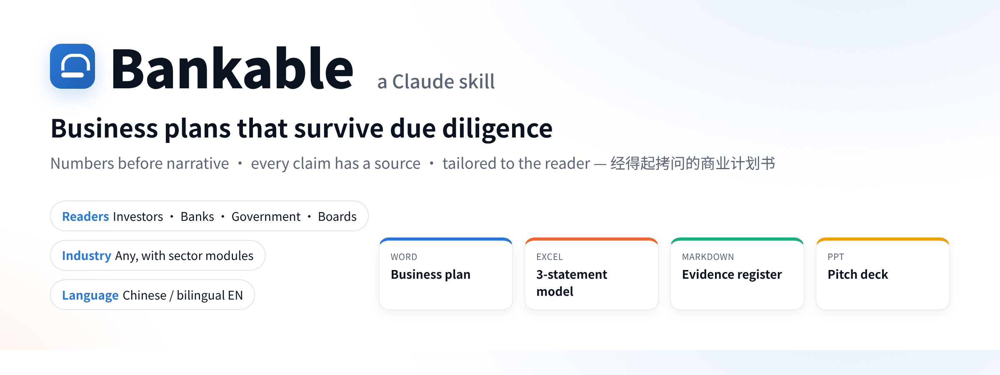
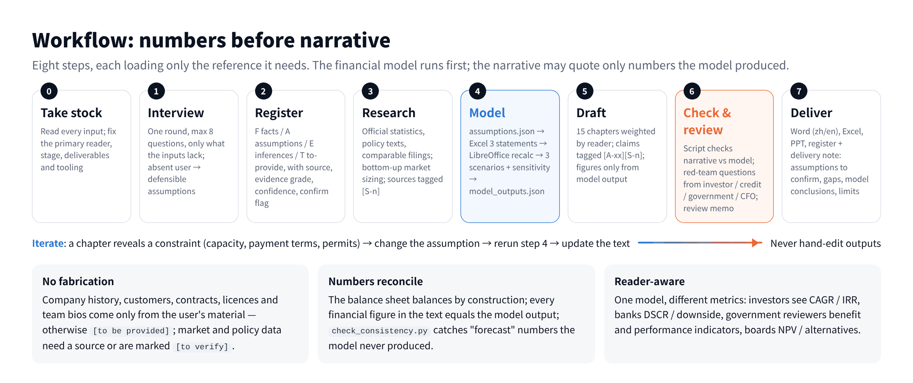
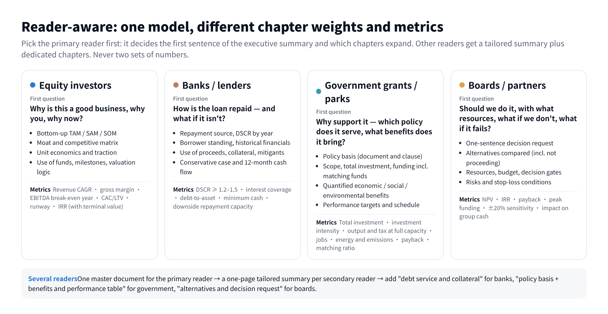
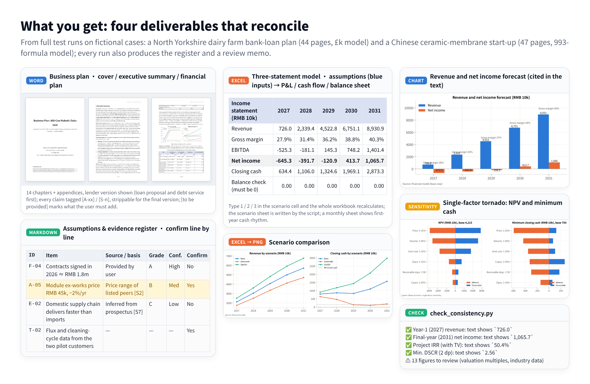

<p align="center">
  <a href="README.md"></a>
  <a href="README.zh-CN.md"></a>
</p>

<p align="center">
  
</p>

<p align="center">
  <a href="#get-started-in-three-steps"></a>
  <a href="LICENSE"></a>
  <a href="CHANGELOG.md"></a>
  
</p>

**Bankable** is a Claude skill that turns a business idea — or a folder of half-finished material — into a business plan that **survives due diligence by investors, banks, government reviewers and boards**. Numbers come before narrative, every claim has a source, and the document is tailored to who will read it.

It delivers four things that reconcile with each other: a Word business plan (English, Chinese or both), a live Excel three-statement model with scenarios and sensitivity, an assumptions-and-evidence register you confirm line by line, and a pitch deck. Industry-agnostic, with sector modules for agriculture, manufacturing, SaaS, consumer, clean energy, healthcare, tourism and trade.

> **Bankable**（经得起拷问的商业计划书）是一个 Claude skill：数字先于故事、每个主张都有出处、按读者定制。中文说明见 [README.zh-CN.md](README.zh-CN.md)。

## Watch: Bankable in 80 seconds

https://github.com/user-attachments/assets/20f15602-1690-42ea-9930-e6c6e7314958

<p align="center"><sub>Principles · install · how to ask · workflow · readers · deliverables · rerun — 1:21 · voice-over · English + 中文 captions · <a href="docs/video/bankable-guide.mp4">download</a></sub></p>

## Get started in three steps

**1. Install**

| Where you use Claude | How |
|---|---|
| Claude.ai / desktop app | Download `bankable.skill` from [Releases](../../releases) → Settings → Capabilities → enable *Code execution and file creation* → Skills → Upload → toggle on |
| Claude Code | `git clone https://github.com/yurbro/bankable.git ~/.claude/skills/bankable` (or into `.claude/skills/bankable` inside a project), or `npx skills add yurbro/bankable` |
| Codex / Cursor / other SKILL.md-aware agents | Clone into the agent's skills directory, or point the agent at `SKILL.md` |

The scripts need Python 3.10+ with `openpyxl`, `python-docx`, `python-pptx` and `matplotlib`; recalculating the Excel model needs LibreOffice (`soffice` on PATH). Claude.ai's code-execution sandbox already has all of this. Locally: `pip install openpyxl python-docx python-pptx matplotlib` and `brew install --cask libreoffice` or `apt install libreoffice-calc fonts-noto-cjk`.

**2. Describe what you need and attach what you have**

```
Write an investor-grade business plan with a financial model. We are … (one paragraph).
Where data is missing, make reasonable assumptions and list what I need to confirm.
```
```
We're applying to our bank for a £2.2m 15-year loan; last two years' accounts attached.
The bank wants cash-flow forecasts and sensitivity to milk price.
```
```
Business plan for a provincial circular-economy grant application, and the board decides next week.
Chinese and English Word versions, Excel model, 12-slide deck.
```

Claude asks at most eight questions up front (and proceeds on defensible, registered assumptions if you are away), then researches, builds the model, drafts, checks and red-teams the plan. A full plan is 25–50 pages and takes about an hour; say "quick" or "short version" for a 10–15 page plan.

**3. Confirm the register, rerun**

The delivery note lists the assumptions that matter most and every `[to be provided]` gap. Correct the register — or edit the blue input cells in the Excel assumptions sheet — and Claude reruns the model; every figure in the text updates with it.

## Workflow

<p align="center"></p>

## Reader-aware

<p align="center"></p>

## What you get

<p align="center"></p>

Full sample runs are in [`samples/`](samples/): a Chinese investor plan for a fictional ceramic-membrane start-up (47 pages), and English GBP/EUR cases — a North Yorkshire dairy farm applying for a bank loan with Defra grants, and a Rotterdam textile-to-rPET start-up raising a Series A alongside an EU grant.

## How it differs from "ask an AI for a business plan"

| Typical approach | Bankable |
|---|---|
| One pass; numbers by feel | **Model first, narrative second**; the text may quote only model output, and `check_consistency.py` enforces it |
| Facts, assumptions and guesses blended | A register separates F facts / A assumptions / E inferences / T to-provide, each with source, evidence grade (A–D), confidence and a confirm flag |
| Missing data gets a plausible invention | Company history, customers, contracts, licences and team bios are never invented — they are marked `[to be provided]` |
| One text for every reader | Chapter weights and metrics switch with the primary reader; several readers get one master document plus tailored summaries and dedicated chapters |
| Only the optimistic case | Base / downside / upside derived from the risk matrix, plus single-factor sensitivity (tornado chart) and whole-alternative comparisons |
| Self-assessed quality | Red-team review from investor, credit-officer, government-reviewer and CFO perspectives, written up as a review memo |

Five eval cases (investor plan from a brief; bank loan for an existing cooperative; government grant + board decision, bilingual with deck; UK dairy farm loan with grants in GBP; Dutch start-up Series A with EU grant in EUR) pass their acceptance criteria. On the investor case the control run without the skill scored 5/7 — it lacked exactly the evidence register and the narrative-vs-model check.

## Repository layout

```
SKILL.md                 workflow, rules and quality bar — what Claude reads first (Chinese)
references/              loaded per stage: interview questions · evidence & register · audience profiles · chapter guide ·
                         financial-model guide · review checklist · deck guide · bilingual guide · industry modules
scripts/
  build_financial_model.py   assumptions.json → Excel three-statement model with live formulas (loans with repayment/drawdown
                             schedules, grants, opening balance sheet, construction in progress, loss carry-forward)
  recalc_and_extract.py      LibreOffice recalculation · 3 scenarios · model_outputs.json · scenario sheet written back
  run_sensitivity.py         single-factor sensitivity and whole-alternative comparison: table + tornado chart + JSON (zh/en)
  make_tables.py             every financial table for the text (KPIs, statements, debt service, scenarios, funding, sensitivity) zh/en
  make_charts.py             chart PNGs (zh/en)
  build_docx.py              plan.md → formatted Word (cover, TOC, numbered headings, tables, figures, headers/footers)
  build_pptx.py              deck.md → PPT (fallback when no slide skill is available)
  check_consistency.py       narrative figures vs model output (CNY 万元 and GBP/EUR/USD formats; zh/en report)
  model_i18n.py              English labels for the Excel model (--lang en)
assets/                  example assumptions file · 15-chapter skeleton · register and review-memo templates (zh and en)
evals/                   5 eval cases (prompt + graders)
examples/                example model and layout sample (fictional)
samples/                 complete outputs of full test runs
docs/                    README images and their HTML sources (regenerate with python docs/render.py); docs/video/ guide video + its sources
tests/smoke_test.sh      script smoke test (run in CI)
```

## Run the model pipeline by hand

```bash
mkdir -p work && cp assets/assumptions-example.json work/assumptions.json
python scripts/build_financial_model.py work/assumptions.json -o work/model.xlsx --lang en
python scripts/recalc_and_extract.py work/model.xlsx -o work/model_outputs.json --assumptions work/assumptions.json --lang en
python scripts/run_sensitivity.py work/assumptions.json -o work/sensitivity_outputs.json --md work/sensitivity.md --chart work/charts/sensitivity.png --lang en
python scripts/make_charts.py work/model_outputs.json -o work/charts --lang en
python scripts/make_tables.py work/model_outputs.json -o work/tables.md --sensitivity work/sensitivity_outputs.json --lang en
python scripts/build_docx.py work/plan.md -o work/plan.docx --title "Business Plan" --org "Company" --date "November 2026" --lang en
python scripts/check_consistency.py work/plan.md work/model_outputs.json --extra work/sensitivity_outputs.json --lang en
```

For a Chinese engagement drop `--lang en`; the model unit comes from `meta.unit` in the assumptions file (`万元`, `£k`, `€k`, `$k` …).

## Modify and improve

1. Edit `SKILL.md`, `references/` or `scripts/` and commit. Reader logic lives in `references/audience-profiles.md`, chapters in `chapter-guide.md`, sectors in `industry-modules.md`.
2. Script regression: `bash tests/smoke_test.sh` (CI runs it on every push).
3. Behavioural regression: the cases in `evals/` (`prompt.md` + `graders/`); in Claude Code, `claude plugin eval . --allow-tools Write,Edit,Bash --scaffold`.
4. Release: `git tag v0.4.0 && git push --tags` — the release workflow packages `bankable.skill` and attaches it to the GitHub Release for upload to Claude.ai. Locally: `bash tests/package.sh`.

## Notes

- Companies and figures in `examples/`, `samples/` and the images are fictional or test-generated; they demonstrate format and method only.
- Outputs are professional first drafts for review — not audited statements, tax or legal advice, and no promise of financing.
- The method borrows ideas from several open-source business-plan skills (assumption registers with consistency checks, evidence discipline, red-team review); the implementation is original. MIT licence.
