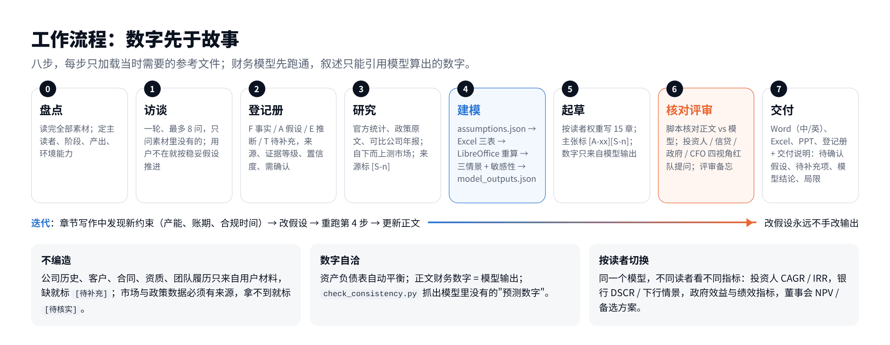
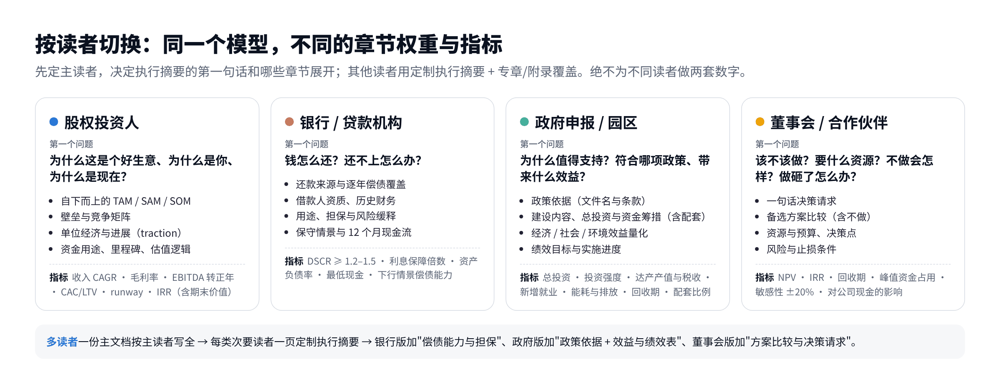
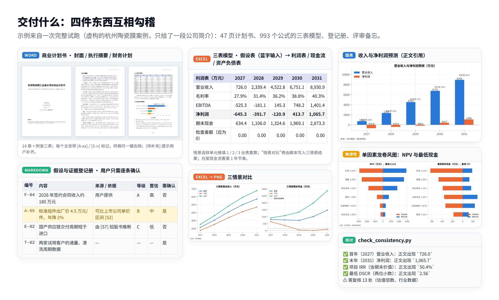

<p align="center">
  
</p>

<p align="center">
  <a href="README.md"></a>
  <a href="README.zh-CN.md"></a>
</p>

<p align="center">
  <a href="#三步上手"></a>
  <a href="LICENSE"></a>
  <a href="CHANGELOG.md"></a>
  
</p>

**Bankable** 是一个 Claude skill：把一个业务构想或一堆零散材料，变成**经得起投资人、银行、政府评审和董事会拷问**的商业计划书——数字先于故事，每个主张都有出处，按读者定制。

交付四件互相勾稽的东西：中文 Word 计划书（可选英文版）、可重算的 Excel 三表财务模型（三情景 + 敏感性）、供逐条确认的假设与证据登记册、路演 PPT。行业无关，自带农牧、制造、SaaS、消费、新能源、医疗、文旅、贸易等行业模块。

> **Bankable** is a Claude skill for business plans that survive due diligence: investor-, lender-, government- and board-grade. Interview → fact / assumption / evidence register → research → Excel three-statement model with scenarios and sensitivity → audience-specific drafting → narrative-vs-model consistency check → red-team review → Word / bilingual / Excel / PPT. Chinese-first, any industry.

## 三步上手

**1. 安装**

| 在哪里用 | 怎么装 |
|---|---|
| Claude.ai / 桌面版 | 从 [Releases](../../releases) 下载 `bankable.skill` → 设置 → 功能 → 开启"代码执行与文件创建" → Skills → 上传 → 打开开关 |
| Claude Code | `git clone https://github.com/yurbro/bankable.git ~/.claude/skills/bankable`（项目内：`.claude/skills/bankable`），或 `npx skills add yurbro/bankable` |
| Codex / Cursor 等 | 克隆到对应的 skills 目录，或让 agent 读 `SKILL.md` 并按其指引执行 |

脚本依赖 Python 3.10+ 与 `openpyxl` `python-docx` `python-pptx` `matplotlib`，重算 Excel 需要 LibreOffice（`soffice`）；Claude.ai 的代码执行环境已具备。本机：`pip install openpyxl python-docx python-pptx matplotlib`，LibreOffice 用 `brew install --cask libreoffice` 或 `apt install libreoffice-calc fonts-noto-cjk`。

**2. 说需求，附上手头的材料**

```
给我写一份能直接给投资机构看的商业计划书，附财务模型。我们是……（一段介绍）
缺的数据先按合理假设做，然后把需要我确认的地方列出来。
```
```
向农商行申请 600 万 5 年期贷款，附件是近两年财务摘要，重点看还款能力。
```
```
申报省级专项资金，同时董事会下周要立项。中英文各一份 Word，附 Excel，再做 12 页汇报 PPT。
```

Claude 会先问最多 8 个关键问题（你不在也会按稳妥假设推进），然后研究、建模、起草、核对、评审。完整版通常 25–45 页，约 1 小时；说"快速 / 简版"切到 10–15 页的精简模式。

**3. 逐条确认登记册，重跑**

交付说明会列出影响最大的假设和 `[待补充]` 项。你改好登记册或直接改 Excel 假设表的蓝字单元格，Claude 重跑模型，正文数字一起更新。

## 工作流程

<p align="center"></p>

## 按读者切换

<p align="center"></p>

## 交付什么

<p align="center"></p>

完整样件在 [`samples/`](samples/)：虚构的杭州陶瓷膜案例（中文，投资人版，47 页），以及英欧案例（英国奶牛场银行贷款 + Defra 补助、荷兰纺织再生 PET 初创 A 轮 + 欧盟补助，英文、£/€）。

## 和"让 AI 写个 BP"的区别

| 普通做法 | Bankable |
|---|---|
| 一次生成，数字凭感觉 | **先建模型再写叙述**；正文只能引用模型算出的数字，`check_consistency.py` 自动核对 |
| 事实、假设、推断混在一起 | 登记册分开 F 事实 / A 假设 / E 推断 / T 待补充，每条有来源、证据等级（A–D）、置信度、"需确认" |
| 缺信息就编一个像样的 | 公司历史、客户、合同、资质、团队履历一律不编，标 `[待补充]` |
| 一套内容给所有人看 | 按主读者切换章节权重与指标；多读者时一份主文档 + 定制执行摘要 + 专章 |
| 只有乐观情景 | 基准 / 下行 / 上行三情景由风险矩阵推导，另有单因素敏感性龙卷风图 |
| 自己觉得写得不错 | 以投资人、信贷审查、政府评审、CFO 四种身份红队评审，写评审备忘 |

三个测试用例（投资人版 / 银行贷款 + 存量业务 / 政府申报 + 董事会 + 中英双语 + PPT）全部通过各自的验收标准（7/7、5/5、6/6）；投资人版的对照组（不带 skill）为 5/7——缺的正是证据登记册和正文与模型的一致性核对。三次试跑暴露的问题已修入 v0.3.0。

## 仓库结构

```
SKILL.md                 流程、规则、质量底线（Claude 触发后首先读取）
references/              按阶段加载：访谈问题库 · 证据与登记册 · 读者画像 · 章节指南 · 财务模型指南 ·
                         评审清单 · PPT 指南 · 双语规范 · 行业模块
scripts/
  build_financial_model.py   assumptions.json → 带公式的 Excel 三表模型（多笔贷款与还款/提款计划、补助、期初余额、建设期在建工程、亏损结转）
  recalc_and_extract.py      LibreOffice 重算 · 三情景 · model_outputs.json · 写回情景对比
  run_sensitivity.py         单因素敏感性 + 备选方案比较：表格 + 龙卷风图 + JSON（中/英）
  make_tables.py             正文全部财务表格（关键指标、三表、偿债、三情景、总投资与筹措、敏感性；中/英）
  make_charts.py             财务图表 PNG（中/英）
  build_docx.py              plan.md → 排版好的 Word（封面、目录、编号标题、表格、图、页眉页脚）
  build_pptx.py              deck.md → PPT（没有 pptx skill 时的备选）
  check_consistency.py       正文数字 vs 模型输出
assets/                  假设文件示例 · 15 章写作骨架 · 登记册与评审备忘模板
evals/                   5 个测试用例：投资人版 / 银行 + 存量业务 / 政府 + 董事会双语 + PPT / 英国奶牛场贷款（£）/ 荷兰初创 A 轮 + 欧盟补助（€）
examples/                虚构案例的 Excel 模型与 Word 排版样例
samples/                 一次完整试跑的全部产出
docs/                    README 配图（中/英）及其 HTML 源（python docs/render.py 重新生成）
tests/smoke_test.sh      脚本冒烟测试（CI 运行）
```

## 手动跑一遍模型流水线

```bash
mkdir -p work && cp assets/assumptions-example.json work/assumptions.json
python scripts/build_financial_model.py work/assumptions.json -o work/模型.xlsx
python scripts/recalc_and_extract.py work/模型.xlsx -o work/model_outputs.json --assumptions work/assumptions.json
python scripts/run_sensitivity.py work/assumptions.json -o work/sensitivity_outputs.json --md work/sensitivity.md --chart work/charts/sensitivity.png
python scripts/make_charts.py work/model_outputs.json -o work/charts
python scripts/make_tables.py work/model_outputs.json -o work/tables.md --sensitivity work/sensitivity_outputs.json
python scripts/build_docx.py work/plan.md -o work/计划书.docx --title "××商业计划书" --org "××公司" --date "2026年11月"
python scripts/check_consistency.py work/plan.md work/model_outputs.json --extra work/sensitivity_outputs.json
```

## 修改与改进

1. 改 `SKILL.md` / `references/` / `scripts/`，提交。想调整读者的评审逻辑改 `references/audience-profiles.md`，调整章节改 `chapter-guide.md`，加行业改 `industry-modules.md`。
2. 脚本回归：`bash tests/smoke_test.sh`（push 时 CI 自动跑）。
3. 行为回归：`evals/` 里 3 个用例（`prompt.md` + `graders/`），在 Claude Code 里 `claude plugin eval . --allow-tools Write,Edit,Bash --scaffold`，或用 skill-creator 的流程人工跑。
4. 发布：`git tag v0.3.0 && git push --tags`，Action 自动打包 `bankable.skill` 挂到 Release，供 claude.ai 上传。本地打包：`bash tests/package.sh`。

## 说明

- `examples/`、`samples/`、配图中的公司与数据均为虚构或测试生成，仅用于演示格式与流程。
- 产出是供审阅的专业首稿，不是审计报告、税务或法律意见，也不构成融资承诺。
- 方法借鉴了若干开源商业计划 skill 的思路（假设登记与一致性核对、证据纪律、红队评审）；实现为本仓库原创，MIT 许可。
