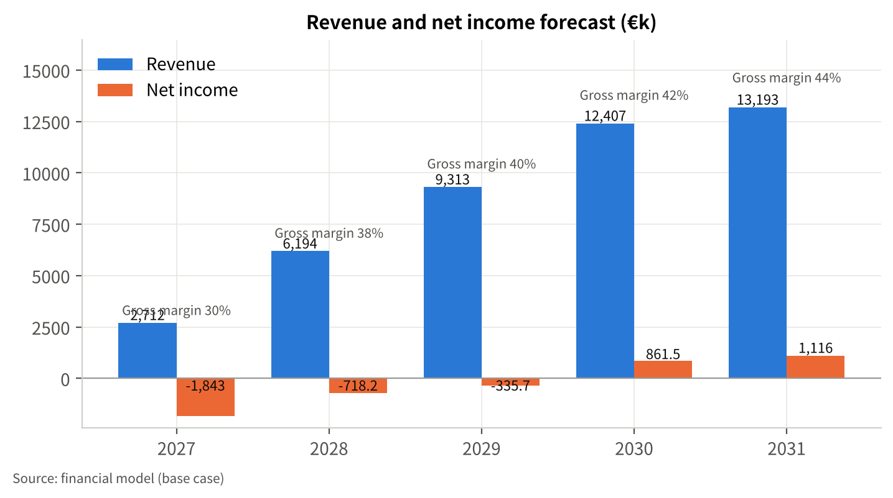
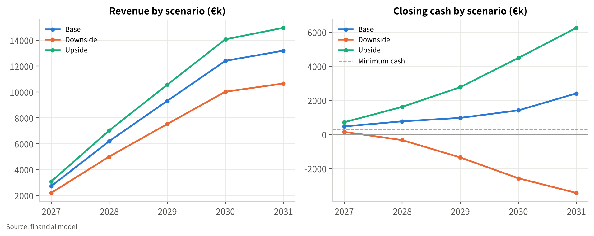
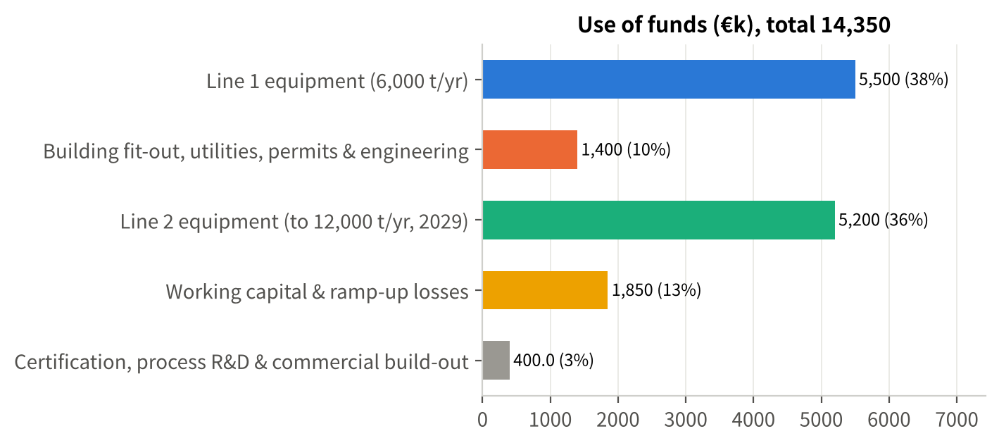

# Rotterdam Textile-to-rPET
## Turning Europe's unwearable polyester into certified recycled PET
Series A — €4.0 million | Rotterdam, November 2026 | Draft for founder review
> Opening (30 s): We turn the fraction of collected clothing that nobody can resell — polyester-rich, non-rewearable textiles — into certified rPET pellets and flakes for fibre producers and non-food packaging. We run a 1,500 t/yr pilot today and are raising €4.0 million to build the first 6,000 t/yr line of a 12,000 t/yr plant in the Port of Rotterdam area. Everything in this deck comes from the business plan and its financial model; numbers are base case unless stated.

# Europe collects textiles it cannot use: 8 Mt/yr burned or landfilled, 1% recycled into clothes
- EU textile waste 6.95 Mt/yr; only 1.95 Mt collected separately (12%; NL 37%) [S-04]
- >8 Mt/yr incinerated or landfilled; 48% of sorted textiles exported [S-05]
- Only 1% of used clothes become new clothes [S-03]
- Since 2024 sorted second-hand no longer covers sorters' costs — the non-rewearable fraction is a liability [S-16]
> The problem is structural: collection is now mandatory everywhere in the EU, but the share that cannot be resold has no domestic outlet. Sorters pay to get rid of it. Expected question: "Isn't the problem cotton rather than polyester?" — Polyester is the largest synthetic fraction in post-consumer textiles and the only one with an existing polymer market (PET); blends are handled by chemical recyclers, not by us.

# Our solution: mechanical textile-to-rPET at roughly €1,000 of capex per annual tonne
- Input: sorted, ≥90% polyester, non-rewearable textiles from NL/BE/DE sorters
- Process: shred → hard-point removal → wash → extrusion + melt filtration → SSP → pellets (flakes exit after washing)
- Output: GRS/RCS-certifiable rPET pellets (fibre & non-food packaging) and flakes
- Not food-contact: textile-derived rPET is outside the technologies authorised under Regulation (EU) 2022/1616 [S-12]
- Operating pilot since 2024 — recipes for dyed, finished, blended feedstock are the know-how
> We are deliberately mechanical: lower capex and energy per tonne than depolymerisation, viable at 6–12 kt instead of 50 kt+. The trade-off is that we do not make food-grade material — we say so up front, because an investor will find it in the regulation anyway. Expected question: "What is proprietary?" — Pre-processing and recipe know-how built on the pilot; certification and customer qualification are the lock-in. Patents/IP status to be confirmed by the founders.

# Why now: EU law has fixed both ends — EPR funds supply (2025–28), PPWR mandates demand (2030)
| Measure | What it does | When |
|---|---|---|
| WFD Art. 11 — separate collection of textiles [S-03] | More collected tonnage, more non-rewearable fraction | since 1 Jan 2025 |
| Directive (EU) 2025/1892 — textile EPR [S-01] | Producer fees fund collection & sorting EU-wide | schemes by Apr 2028 |
| Dutch UPV textiel [S-06] | 33% fibre-to-fibre recycling target | 2030 (25% in 2025) |
| PPWR Regulation (EU) 2025/40 [S-02] | 35% recycled content in other plastic packaging; 30% contact-sensitive PET | 1 Jan 2030 |
| ESPR 2024/1781 [S-17] | Ban on destroying unsold apparel (large companies) | 19 Jul 2026 |
> Each row is cited to the legal text or an official summary in the plan's source list. The point for investors: supply of our feedstock is being subsidised into existence by producer fees, and demand for post-consumer recycled content in non-food packaging is a legal minimum from 2030, not a brand preference. Expected question: "Does PPWR count textile-derived content?" — The calculation rules are due by end-2026; we treat this as a monitored regulatory risk (R-06).

# Feedstock is not the constraint: ≈263 kt/yr of polyester-rich fraction today, ≈473 kt by 2030; we need 14.5 kt
- Separately collected EU textiles 1.95 Mt (2020) → ≈3.5 Mt by 2030 as EPR scales [S-04, A-39]
- × 45% non-rewearable × 30% polyester-rich = 263 kt today, 473 kt in 2030 [A-38]
- Plant at 11,000 t output needs ≈14,500 t input: 6% of today's EU fraction, 3% in 2030
- But >50% of what Dutch sorters alone can yield (≈27 kt) → contracts across NL, BE, DE [E-05]
- Demand side: output <1% of European PET demand; qualification, not volume, is the gate
> This is a bottom-up sizing with every factor tagged to the register; the two soft factors are the non-rewearable and polyester-rich shares, which the founders should validate with sorter data. The honest message: feedstock exists, but we must contract it across three countries, and Reju's planned 50 kt plant at Chemelot will compete for the same fractions. Expected question: "What do you pay for feedstock?" — We assume €250/t delivered; pilot purchase data must confirm it.

# Unit economics: €621/t contribution on pellets, €411/t on flakes before labour; 44% gross margin at scale
| Per tonne (2027) | Pellets | Flakes |
|---|---|---|
| Selling price [A-03, A-04] | €1,250 | €950 |
| Feedstock (€250/t ÷ 76% yield) [A-05, A-06] | €329 | €329 |
| Conversion (energy, chemicals, residue, freight) [A-07, A-08] | €300 | €210 |
| Materials contribution | €621 (50%) | €411 (43%) |
| Production labour (8 FTE on 2,400 t) [A-17] | €193 | €193 |
| Gross margin per tonne | €428 | €218 |
> Prices sit between published NW-European flake (€950–990/t) and food-grade pellet (virgin + €340) quotes from March 2026. Gross margin is 30% in 2027 and 44% in 2031 as two lines share one crew and unit cost falls 2% a year. The weak point is obvious: every cost line is an estimate until pilot data replaces it. Expected question: "Who pays €1,250 for non-food pellets?" — Fibre producers nominated by brands with recycled-content commitments and converters facing the PPWR 35% minimum; the first binding contract with a virgin-indexed floor is milestone M2, before Line 1 is ordered.

# Traction: an operating 1,500 t/yr pilot, ≈€620k revenue in 2026, two brand LOIs — and what is not yet proven
- Pilot line running; ≈€620k revenue expected in 2026 [F-02, F-04]
- Two offtake LOIs with European brands; terms to be disclosed in the data room [F-03]
- Not yet proven: cost per tonne at scale, stable spec across feedstock batches, binding volumes
- Series A milestones are exactly these three (M2 offtake contract, M3 feedstock contracts, M7 Line 1 on spec)
- Team of 9 (founders and staff) — biographies to be added by the founders [T-05]
> We would rather show investors what the pilot has and has not demonstrated than oversell two LOIs. The Renewcell precedent — capacity ahead of binding demand — is the pattern we are structured to avoid: no second line without contracted offtake. Expected question: "Why is the team slide a placeholder?" — This draft contains only information the founders have supplied; team backgrounds will be added before the deck leaves the company.

# Competition: chemical recyclers go big and slow; bottle recyclers can't use our feedstock
| | This project | Chemical T2T (Reju, Syre, Circ) | Bottle rPET | Fibre recyclers |
|---|---|---|---|---|
| Scale | 6→12 kt/yr | 50–250 kt planned [S-14] | 20–40 kt | 5–30 kt |
| Capex / annual t | ≈€1,000 | several × higher | €1,000–1,500 | low |
| Output | non-food pellet/flake | virgin-equivalent | food-grade | fibre / downcycled |
| Feedstock | polyester-rich textiles | wide incl. blends | bottles | mixed textiles |
| Status NW Europe | pilot; Line 1 2027 | hubs; plants subject to FID | over-capacity, closures 2025 [S-08] | operating |
> Reju's 50 kt Chemelot plant and Syre's gigascale ambitions are real and well funded; they are our future competitors for feedstock and premium customers, and our likely acquirers. Our window is 2027–2030: lower capex per tonne, operating earlier, in the densest sorting cluster in Europe. Bottle recyclers compete on flake price but cannot process textiles. Expected question: "What stops Reju from buying all the Dutch polyester fraction?" — Multi-year contracts with three or more sorters, signed before Line 1 is ordered (M3).

# Plan: Line 1 live Q4 2027, certified by year-end, Line 2 only after gate G2 in 2029
| Milestone | When | Done when |
|---|---|---|
| M1 Series A closed (€4.0m) | Feb 2027 | funds received |
| M2 first binding offtake with virgin-indexed floor | Mar 2027 | contract signed |
| M3 ≥3 sorter contracts covering ≥70% of 2028 input | Apr 2027 | agreements signed |
| M5/M6 Line 1 ordered (after grant filing); €3.6m loan drawn | Mar 2027 | PO; drawdown |
| M7/M8 Line 1 on spec; GRS/RCS + ISCC PLUS | Q4 2027 | certificates |
| G2 Line 2 decision | Q1 2029 | >80% utilisation, ≥60% of Line 2 contracted, Series B + L2 in place |
| M10 Line 2 commissioned → 12,000 t/yr | H2 2029 | on-spec output |
> The order of M2/M3 before M5 is the discipline: no equipment order without a contracted customer and contracted feedstock. G2 is the investor protection on Line 2. Expected question: "What if the permit slips?" — Each quarter of delay removes about 1,000 t from 2027 and deepens the Q4 2027 cash trough, which is why we want a standby working-capital facility alongside the round.

# Financials: revenue €2.7m → €13.2m (CAGR 48.5%), EBITDA positive 2028, net profit 2030, IRR 24.1%
- Revenue 2027–2031: €2.7m / €6.2m / €9.3m / €12.4m / €13.2m; output 2,400 → 11,000 t
- Gross margin 30.3% → 43.9%; EBITDA −€0.8m (2027) → €2.8m (2031, 21.6%)
- Net income −€1.8m (2027) → €0.9m (2030) → €1.1m (2031)
- Project IRR 24.1% with terminal value (7× EBITDA); NPV €3.1m at 14%; equity IRR 37.2%
- Minimum cash €467k (2027); operating DSCR 1.24 (2029) → 1.87 (2031)

> All numbers are from the three-statement model in the data room. Two caveats we volunteer: there is no IRR without the terminal value inside five years — this is a capex-heavy plant whose payback lies beyond 2031 — and 2029 is the tight year for debt service when Line 1 principal starts and Line 2 depreciation begins. Expected question: "Why does revenue more than double in 2028?" — Line 1 contributes one quarter in 2027 and a full year in 2028; growth is capacity-bounded, not share-driven.

# Scenarios: the base case is funded; the downside needs €3.7m more — price and unit cost decide it
- Downside (vol −15%, price −5%, cost +4%, opex +3%): revenue €10.7m in 2031, no profitable year, funding gap €3.7m
- Upside (vol +8%, price +5%, cost −3%): profit from 2029, NPV €10.4m, IRR 43.6%
- Single factors: price −10% or volume −20% → NPV negative, gap €1.9–2.0m; unit cost +10% → IRR 13.6%
- No grant: IRR unchanged, liquidity gap €786k in 2028 → standby facility
- Responses: virgin-indexed price floors, 15–20% flexible cost base, G2 gate, standby liquidity, early bridge

> We show the downside because an IC will run it anyway. It is not survivable from operations alone, and deferring Line 2 does not fix it — Line 2 is accretive even at downside prices — so the remedies are contractual (floors), structural (flexible costs) and financial (standby liquidity, early bridge). Expected question: "What is your stop-loss?" — Line 1 is not ordered without M2 and 50% of 2028 feedstock contracted; Line 2 is not ordered if G2 fails.

# The ask: €4.0m Series A funds Line 1, certification and contracted offtake by end-2027
- Sources across the plan: Series A €4.0m; equipment loan L1 €3.6m (2027); grant €1.25m (uncertain — DEI+/EIC type, no eligibility asserted); Series B €2.5m + loan L2 €3.0m at G2 (2029)
- Series A use: Line 1 deposit €2.2m; site fit-out & permits €1.4m; certification, R&D & commercial €0.4m
- Total investment €12.9m vs €14.35m sources; peak funding need €13.0m (2029)
- Ask alongside the round: €0.5–0.75m standby working-capital facility; pro-rata rights for the 2029 round
- Grant strategy: one lead scheme (RVO DEI+ 2027 round or EIC Accelerator); file before ordering equipment [S-10, S-11]

> We are explicit that €4.0 million does not build 12,000 t/yr on its own — the plan is a phased build with equipment debt, a grant we treat as uncertain, and a Series B that is only released at gate G2. The grant changes liquidity, not returns: without it the IRR is unchanged and a €786k gap appears in 2028, which the standby facility covers. Contact details and data-room access: to be added by the founders.
