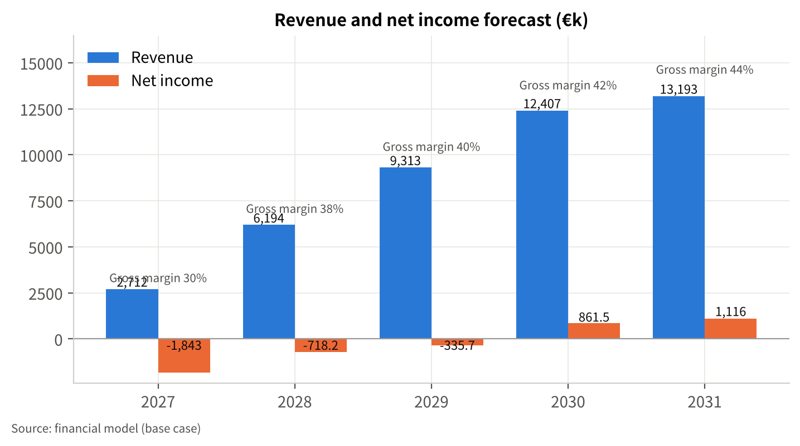
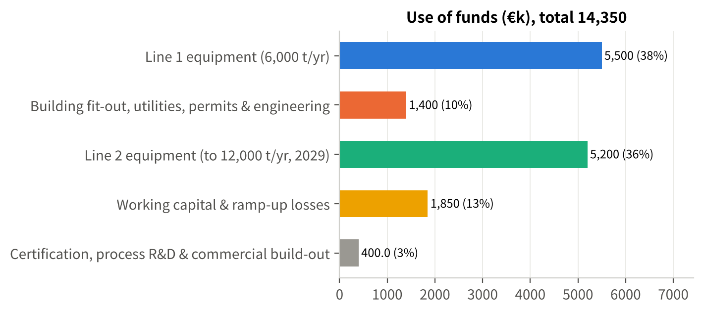
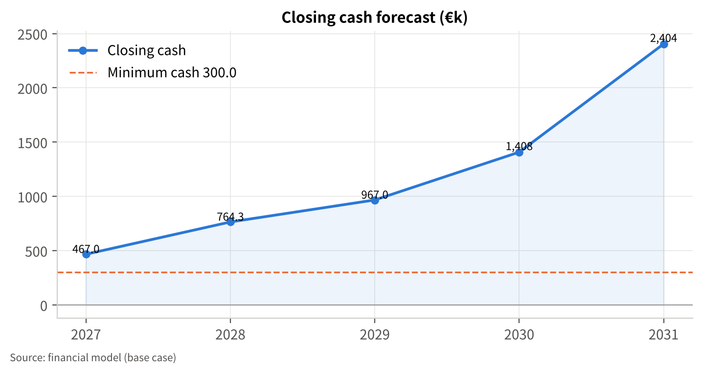
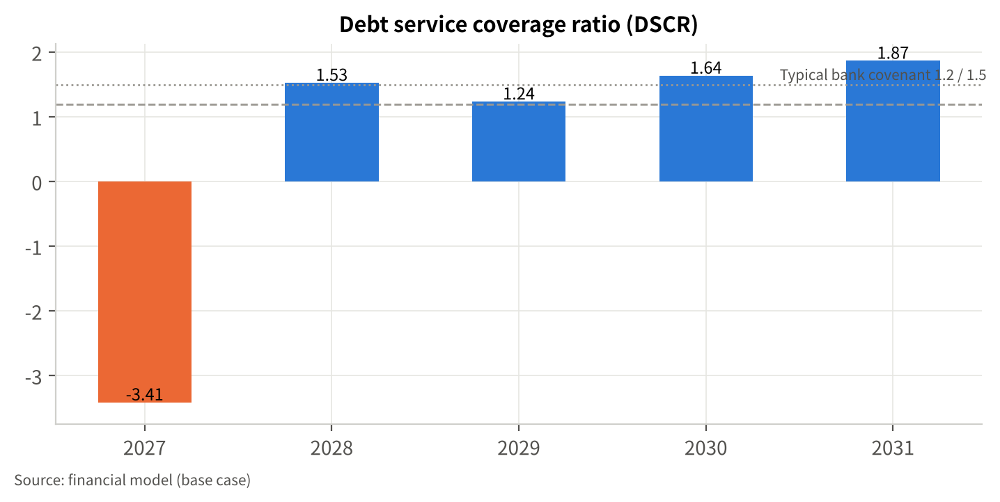
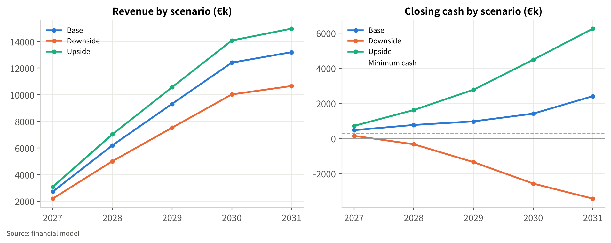
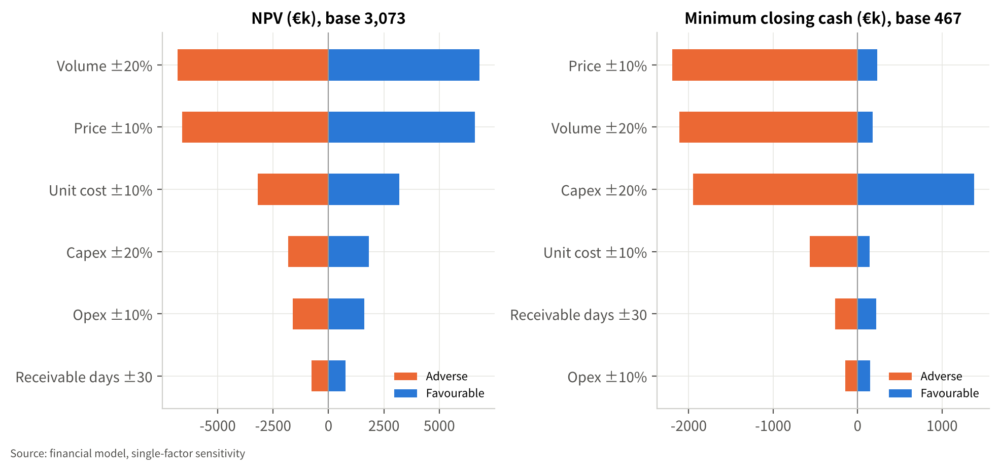
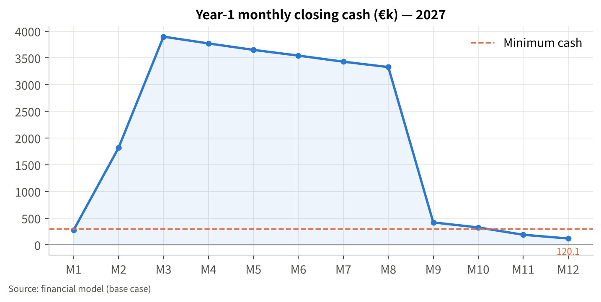

# 1 Executive Summary

## 1.1 For investors: why this is a good business, and what the €4.0 million buys

`[Company name — to be confirmed]` is a Rotterdam-based Dutch BV, founded in 2024 with a team of nine, that turns post-consumer polyester textile waste into certified recycled PET (rPET) flakes and pellets for fibre producers and non-food packaging converters [F-01, F-07]. A 1,500 t/yr pilot line has been running since `[to be confirmed]` and is expected to generate approximately €620k of revenue in 2026 [F-02, F-04]. Two European brands have signed offtake letters of intent [F-03]. The company is raising a **€4.0 million Series A** to build the first 6,000 t/yr production line of a 12,000 t/yr plant in the Port of Rotterdam area, and is preparing an application for an EU or Dutch circular-economy grant of €1.0–1.5 million [F-05, F-06].

**Why now.** Europe has legislated both ends of this business. On the supply side, separate collection of textiles has been mandatory in every Member State since 1 January 2025 [F-09, S-03], and Directive (EU) 2025/1892 obliges Member States to set up producer-funded (EPR) schemes for textiles by April 2028 [F-08, S-01]; the Netherlands already runs one, with a fibre-to-fibre recycling target rising from 25% in 2025 to 33% in 2030 [F-16, S-06]. On the demand side, the Packaging and Packaging Waste Regulation (EU) 2025/40 sets minimum post-consumer recycled content in plastic packaging from 2030 — 35% for non-contact-sensitive plastic packaging and 30% for contact-sensitive PET — rising to 65% and 50% by 2040 [F-10, S-02]. Today only about 1% of used clothes are recycled into new clothes [F-14, S-03], and the EU still incinerates or landfills more than 8 million tonnes of used textiles a year [F-15, S-05]. The polyester-rich, non-rewearable fraction that sorters cannot sell is exactly this plant's feedstock.

**The business.** Sorted, polyester-rich textile waste is bought from sorters in the Netherlands, Belgium and Germany, mechanically processed (shredding, hard-point removal, washing, melt filtration, extrusion and solid-state polycondensation) and sold as rPET pellets at an assumed €1,250/t [A-03] and flakes at €950/t [A-04] — below food-grade bottle rPET, above virgin PET [F-17]. The model prices feedstock at €250/t delivered [A-05] with a 76% yield [A-06]; materials cost per tonne of output is €630 for pellets and €540 for flakes [A-07, A-08]. None of these unit costs has yet been confirmed with pilot data; they are the first items for the founders to verify (register T-02).

**What the model says (base case, financial model, €k; all figures from `model_outputs.json`).** Revenue grows from €2.7 million in 2027 to €13.2 million in 2031 (CAGR 48.5%), gross margin from 30.3% to 43.9%, EBITDA from −€0.8 million in 2027 to €2.8 million in 2031 (21.6% margin). The company is EBITDA-positive in 2028, cash-flow positive in 2029 and net-income positive in 2030 (€0.9 million), reaching €1.1 million in 2031. Project IRR including a terminal value at 7× 2031 EBITDA [A-32] is 24.1%; NPV at a 14% discount rate [A-31] is €3.1 million; the equity IRR is 37.2%.

**What the money funds — and what it does not.** The 12,000 t/yr plant costs €12.9 million on a feasibility basis (capex €12.7 million plus initial working capital) [E-04]. A €4.0 million Series A cannot fund it alone, so the plan is phased and leveraged: Line 1 (6,000 t/yr, €5.5 million) and site works (€1.4 million) in 2027, funded by the Series A, a €3.6 million equipment-backed loan [A-27] and — if awarded — a €1.25 million grant [A-26]; Line 2 (€5.2 million) in 2029, funded by a €3.0 million second equipment loan [A-28] and a €2.5 million Series B [A-30] released only when gate G2 is met (Line 1 utilisation above 80% and contracted offtake for at least 60% of Line 2). Total external funding across the plan is €14.35 million against a peak funding need of €13.0 million; the base case keeps cash at or above €467k in every year and above the €300k minimum with no funding gap.

**What breaks it.** The business is thin on margin for a manufacturing start-up and highly sensitive to price and unit cost: a 10% lower selling price or 20% lower volume each wipe out the NPV and open a €1.9–2.0 million funding gap in 2029–2031; a 10% higher unit cost cuts the IRR to 13.6%. In the downside case (volume −15%, price −5%, unit cost +4%, opex +3% together) [A-36] the company never reaches profit within the horizon and needs €3.7 million of additional funding. Without the grant the base case opens a €786k gap in 2028 that a working-capital facility or a slightly larger Series A must cover. Section 13 sets out the mitigations: price floors indexed to virgin PET in offtake contracts, multi-sorter feedstock contracts, the G2 gate before Line 2, and a 15–20% flexible cost base.

Table 1 Key financial indicators (base case, €k)

| Metric | 2027 | 2028 | 2029 | 2030 | 2031 |
|---|---|---|---|---|---|
| Revenue | 2,712.0 | 6,193.5 | 9,313.2 | 12,407.0 | 13,192.7 |
| Gross margin | 30.3% | 37.7% | 40.4% | 42.5% | 43.9% |
| EBITDA | -796.8 | 358.3 | 1,429.8 | 2,620.2 | 2,845.2 |
| Net income | -1,843.3 | -718.2 | -335.7 | 861.5 | 1,115.8 |
| Closing cash | 467.0 | 764.3 | 967.0 | 1,407.6 | 2,404.2 |
| Output (t) | 2,400 | 5,400 | 8,000 | 10,500 | 11,000 |

Source: financial model (base case). Scenario and sensitivity results are in Chapter 11; the funding plan and grant strategy are in Chapter 12.

## 1.2 For grant evaluators: why this project merits public support

The project demonstrates, at industrial scale in the Netherlands, the conversion of non-rewearable polyester textile waste into rPET that returns to fibre and packaging — the fibre-to-fibre route that Dutch EPR targets (33% by 2030 [F-16]) and the revised Waste Framework Directive [F-08] require but that almost no European capacity currently delivers [F-13, F-14]. At full output the plant processes about 14,500 t/yr of textile waste that would otherwise be incinerated or exported [A-40] and displaces virgin PET with an estimated saving of roughly 1.5 t CO₂e per tonne of rPET [A-40]; both figures are to be confirmed by a screening life-cycle assessment before any application. The total investment is €12.9 million [E-04], of which the grant application would cover the demonstration-related extra investment of Line 1; the applicant is a small enterprise under the EU SME definition [F-01]. Section 12.4 reviews which schemes fit (RVO DEI+ Circular Economy, EIC Accelerator, LIFE, Innovation Fund small-scale) and — importantly — which conditions would disqualify the project, such as placing binding equipment orders before an application is filed [F-20]. **Grant eligibility is not asserted anywhere in this plan**; the grant is modelled as uncertain and the plan is shown both with and without it.

<!-- pagebreak -->

# 2 Company Overview

## 2.1 Company facts

| Item | Status | Register |
|---|---|---|
| Legal form and seat | Dutch BV, Rotterdam | F-01 |
| Founded | 2024 | F-01 |
| Team | 9 people (founders and staff); names and roles `[to be confirmed]` | F-01, T-05 |
| Registered / paid-in capital, cap table | `[to be confirmed]`; the model assumes €2.6 million of paid-in capital at end-2026 | A-33, T-01 |
| Current operations | 1,500 t/yr pilot line | F-02 |
| 2026 revenue | ≈€620k (year not closed) | F-04 |
| Customers | Two offtake LOIs with European brands (terms `[to be confirmed]`) | F-03, T-02 |
| Certifications and IP | `[to be confirmed]` (GRS/RCS, ISCC PLUS, ISO; patents or know-how) | T-06 |

Nothing in this table has been invented; where the founders have not yet supplied information the cell says so.

## 2.2 Mission and positioning

The company exists to make the polyester in discarded clothing and household textiles a dependable industrial raw material. Its position in the value chain is that of a **feedstock-flexible mechanical recycler**: it buys the fraction sorters cannot sell for reuse, and sells a specified, certified polymer to customers who need recycled content for regulatory or brand reasons. It does not collect textiles, does not sort them for reuse, and does not spin fibre.

## 2.3 History and current position

Key facts provided: incorporation in 2024; a 1,500 t/yr pilot line; two offtake LOIs; approximately €620k of 2026 revenue [F-01 to F-04]. The pilot has proved that the company can take post-consumer polyester textiles to a saleable flake and pellet and find buyers; what it has not yet proved is cost per tonne at scale, consistent product specification across feedstock batches, and contracted volumes — the three things the Series A is meant to establish (Chapter 10).

Dates of pilot start-up, pilot output by month, product specifications achieved and customer qualification status are `[to be confirmed]` (T-02, T-10).

## 2.4 The project

Build a 12,000 t/yr textile-to-rPET plant in the Port of Rotterdam area in two phases [F-06]:

- **Phase 1 (2027):** lease and fit out an industrial hall sized for the full 12,000 t/yr [A-10]; install Line 1 (6,000 t/yr nameplate) — pre-processing, washing, extrusion with melt filtration, solid-state polycondensation and pelletising [A-19]; commission in Q4 2027 [A-35]. The pilot line continues to run for development and smaller batches.
- **Phase 2 (2029):** install Line 2 (second extrusion/SSP train plus expanded washing and sorting) to reach 12,000 t/yr [A-21], subject to gate G2 (Section 10.2).

Site selection, lease terms and permitting status are `[to be confirmed]` (T-04). The Port of Rotterdam location is chosen for proximity to Dutch and Belgian sorters, to Rhine/road logistics into Germany, and to Chemelot-area polymer customers.

<!-- pagebreak -->

# 3 Product, Service and Technology

## 3.1 The problem

Sorters in north-west Europe are left with a growing fraction of collected textiles that nobody buys. Since spring 2024 the price of sorted second-hand garments has not covered sorting costs [F-24, S-16]; exports of used textiles from the EU fell from 465 kt in 2022 to 430 kt in 2023 [F-24]; and the EU still incinerates or landfills more than 8 million tonnes of used textiles a year [F-15]. Only 1% of used clothes are recycled into new clothes [F-14]. For the sorter the non-rewearable, synthetic-rich fraction is a cost; for brands facing recycled-content and EPR obligations it is an untapped source of certified recycled polymer.

On the other side, converters and fibre producers need post-consumer recycled PET to meet the PPWR 2030 minima [F-10] and brand commitments, but bottle-derived rPET is scarce, prioritised for food-contact use, and priced above virgin PET [F-17]. Textile-derived rPET is an additional, non-competing feedstock pool for the non-food part of that demand.

## 3.2 Products

| Product | Specification (indicative; pilot data T-10) | Customers | Model revenue line |
|---|---|---|---|
| **rPET pellets** — fibre & non-food packaging grade, melt-filtered and SSP-upgraded | Intrinsic viscosity, colour and contaminant limits `[to be confirmed]`; GRS/RCS-certified recycled content | Polyester fibre and filament producers nominated by brand partners; compounders; non-food packaging converters (sheet, strapping, cosmetics) | R1 (60% of volume [A-02]) |
| **rPET flakes** — washed, hard-point-free, metal-free | Bulk density, moisture, PVC/metal limits `[to be confirmed]` | Sheet extruders, strapping producers, recyclers with their own SSP | R2 (40% of volume [A-02]) |

**Food-contact packaging is not an addressable market for these products today.** Under Regulation (EU) 2022/1616 only two recycling technologies are currently listed as suitable for food-contact recycled plastic — post-consumer mechanical PET recycling from food-contact collection loops, and closed, controlled product loops — and any other input or process must go through the "novel technology" notification and safety-evaluation route [F-21, S-12]. The plan therefore defines the packaging segment as non-food packaging [E-01]. A later novel-technology notification is a strategic option, not a plan assumption.

## 3.3 Process and core capability

The process is mechanical: (1) incoming inspection and NIR verification of polyester content; (2) shredding and removal of hard points — zips, buttons, labels — by density and metal separation; (3) hot washing to remove soils and finishes; (4) drying; (5) extrusion with melt filtration and degassing; (6) solid-state polycondensation to restore intrinsic viscosity; (7) pelletising, QC and certification documentation. Flakes leave the process after step 4.

The company's know-how lies in steps 1–3 and 5 — handling blended, dyed and finished textiles that bottle recyclers never see — and in the recipes (filtration, additives, SSP time) that bring a variable textile feedstock to a stable pellet specification. The pilot line is the development platform for these recipes [F-02]. Patents, trade secrets and certifications held are `[to be confirmed]` (T-06); nothing is claimed here that has not been supplied.

## 3.4 Comparison with alternatives

Table 2 Routes for post-consumer polyester textiles

| Dimension | This project (mechanical, textile input) | Chemical depolymerisation (e.g. glycolysis to BHET) | Bottle-derived rPET (mechanical) | Incineration / export |
|---|---|---|---|---|
| Input tolerance | Polyester-rich sorted fractions (≥80–90% PET); blends limited | Wide, including blends; cotton removed | Clear PET bottles only | Any |
| Output | Non-food pellets and flakes [E-01] | Virgin-equivalent monomer/polymer, food-contact possible after evaluation | Food-grade rPET | None |
| Scale economics | Viable from ~6–12 kt/yr | Plants announced at 50 kt+ (Reju, Chemelot) [F-22] | 20–40 kt plants typical | — |
| Capex per annual tonne | ≈€1,000 [A-19] | Several times higher (Circ Saint-Avold ≈$500m for 70 kt [F-22]) | ≈€1,000–1,500 | — |
| Carbon | ≈50% below virgin claimed for chemical routes [S-13]; mechanical generally lower energy — LCA pending [A-40] | ≈50% below virgin claimed [S-13] | Lowest | Highest |
| Status in NW Europe | Pilot operating; Line 1 2027 | Demonstration hubs; industrial plants subject to FID [F-22] | Mature, over-capacity and closures in 2025 [F-18] | Default route today [F-15] |

Sources: F-17, F-18, F-21, F-22, S-13; company data for the first column.

## 3.5 Barriers to entry and durability

- **Feedstock relationships.** Contracted access to polyester-rich non-rewearable fractions from Dutch, Belgian and German sorters is the scarcest asset; the plant needs roughly 60% of what Dutch sorting capacity can yield today [E-05], so multi-country contracts are the moat as much as the technology.
- **Recipe know-how.** Processing dyed, finished, blended textiles to a stable pellet is a learning-curve business; the pilot gives a two- to three-year head start over new mechanical entrants.
- **Certification and qualification.** GRS/RCS and ISCC PLUS chain-of-custody, plus customer qualification cycles of 6–12 months, lock in buyers once achieved (status T-06, T-10).
- **Durability.** The chemical recyclers (Reju, Syre, Circ) target scale and virgin-equivalent quality [F-22]; they are the long-term competitors for feedstock and for premium customers. The mechanical route competes on capex and energy per tonne, not on quality parity; the plan assumes no price premium beyond today's non-food rPET range [A-03, E-03].

## 3.6 Product roadmap

2027: Line 1 pellet specification frozen; GRS/RCS and ISCC PLUS certification of the Rotterdam site. 2028: coloured and black pellet grades for strapping and sheet; qualification with two further fibre spinners. 2029: Line 2; evaluation of a novel-technology food-contact notification with a partner (option, unfunded). All roadmap items beyond 2027 are intentions, not commitments.

<!-- pagebreak -->

# 4 Market Analysis

## 4.1 Regulatory drivers

The following EU and Dutch measures shape supply of feedstock and demand for recycled content. Each is cited to its source; where a provision could not be re-verified online in this session it is marked.

Table 3 Regulatory drivers

| Measure | Provision relevant to this plan | Effect | Source |
|---|---|---|---|
| Waste Framework Directive, Art. 11 — separate collection of textiles | Mandatory separate collection in all Member States since 1 January 2025 | More collected tonnage, more non-rewearable fraction for recyclers | F-09 [S-03] |
| Directive (EU) 2025/1892 (WFD revision — textiles and food waste) | In force 16 Oct 2025; Member States must establish EPR schemes for textiles and footwear within 30 months (by April 2028); transposition by 17 June 2027; micro-enterprises until April 2029 | Producer fees fund collection and sorting across the EU; eco-modulation expected to reward recycled content | F-08 [S-01] |
| Dutch Besluit UPV textiel (Stb. 2023, 132) | 50% of textiles placed on the market prepared for reuse or recycled in 2025, rising to 75% in 2030; fibre-to-fibre recycling 25% (2025) → 33% (2030); annual reporting to Rijkswaterstaat | Direct, quantified demand for fibre-to-fibre recycling capacity in the Netherlands | F-16 [S-06] |
| Regulation (EU) 2025/40 (PPWR) | Minimum post-consumer recycled content in plastic packaging from 1 Jan 2030: 30% contact-sensitive PET, 10% contact-sensitive other plastics, 30% single-use beverage bottles, 35% other plastic packaging; 2040: 50% / 25% / 65% / 65%; calculation rules due by 31 Dec 2026 | Structural demand for non-food rPET (the 35% category) — this plant's packaging segment | F-10 [S-02] |
| Directive (EU) 2019/904 (SUPD), Art. 6(5) | 25% recycled plastic in PET beverage bottles from 2025; 30% in all beverage bottles from 2030 | Pulls bottle-derived rPET into food-contact use, leaving non-food demand for other sources | F-11 [S-18 — to verify] |
| Regulation (EU) 2024/1781 (ESPR) | In force 19 July 2024; destruction of unsold apparel and footwear banned for large companies from 19 July 2026 (medium-sized from 2030); textile delegated acts incl. Digital Product Passport pending | Unsold stock becomes recycler feedstock; future product rules likely to reward recycled content | F-12 [S-17] |
| Regulation (EU) 2022/1616 (recycled plastic in food contact) | Only authorised technologies may supply food-contact recycled plastic; novel technologies require notification and evaluation | Constrains this plant to non-food packaging and fibre [E-01] | F-21 [S-12] |

## 4.2 Textile waste volumes and the recycling gap

- The EU-27 generated about **6.95 million tonnes** of textile waste in 2020, roughly 16 kg per person; 82% of it post-consumer [F-13, S-04].
- Only **1.95 million tonnes** were collected separately in 2020 — an average capture rate of 12%, against 37% in the Netherlands and 50% in Belgium and Luxembourg [F-13]. The JRC estimates about 2.4 million tonnes of separate collection and more than 8 million tonnes incinerated or landfilled each year [F-15, S-05].
- EU sorting capacity is about 1.5 million t/yr, of which the Netherlands about 200 kt and Poland about 300 kt; after sorting, about 48% of textiles are exported [F-13, F-15].
- Fibre-recycling capacity expected to 2025 was 1.25–1.3 million t/yr, of which about 1.0 Mt mechanical and 0.25 Mt chemical — and most recycled fibre is downcycled; fibre-to-fibre recycling remains around 1% [F-13, F-14].

With separate collection now mandatory and EPR fees arriving between 2025 and 2028 [F-08, F-09], the plan assumes separately collected volumes grow from 1.95 Mt (2020) to about 3.5 Mt by 2030 [A-39] — a judgement, not a forecast from a published source.

## 4.3 Prices along the chain

| Point in the chain | Price (NW Europe, 6 March 2026 unless stated) | Source |
|---|---|---|
| Virgin PET (bottle grade) | €1,000–1,100/t | F-17 [S-07] |
| rPET flake | €950–990/t | F-17 |
| Food-grade rPET pellet | ≈€340/t above virgin (gap had exceeded €460/t a week earlier) | F-17 |
| Sorted second-hand textiles | Below sorters' processing cost since spring 2024 | F-24 [S-16] |
| Polyester-rich non-rewearable fraction, sorted and baled | Assumed €250/t delivered — no published benchmark; pilot purchase data to confirm | A-05, T-02 |

Two features matter for the model. First, 2025–26 was a weak rPET market: low volatility, some FMCG brands cutting recycled-content use, and almost 1 million tonnes of European plastics-recycling capacity expected to close by end-2025 [F-18, S-08]. The plan does not assume a recovery; it prices pellets at €1,250/t and flakes at €950/t in 2027 with 1.5% annual growth [A-03, A-04]. Second, feedstock pricing is more likely to fall than rise as EPR money reaches sorters [E-02], but the plan does not bank on this either — unit cost falls only 2% a year [A-09].

## 4.4 Customer segments

| Segment | Buying motive | Product | Evidence / status |
|---|---|---|---|
| Polyester fibre and filament producers nominated by brands with recycled-content commitments | Brand EPR eco-modulation and recycled-content claims; GRS-certified textile-to-textile content commands attention but not yet a proven premium | Pellets | Two brand LOIs [F-03]; spinner qualification status T-10 |
| Non-food packaging converters (sheet, thermoforms, strapping, cosmetics) | PPWR 35% minimum for "other plastic packaging" from 2030 [F-10]; bottle rPET scarce and priced for food use [F-17] | Pellets, flakes | Prospect list `[to be confirmed]` |
| Recyclers and compounders with own SSP | Feedstock diversification | Flakes | Spot market |

Food and beverage packaging is excluded [E-01].

## 4.5 Market sizing — bottom-up

**Feedstock available (supply-side SAM).**
Separately collected textiles × non-rewearable share × polyester-rich share = polyester-rich non-rewearable fraction.

- 2020: 1.95 Mt [F-13] × 45% [A-38] × 30% [A-38] ≈ **263 kt/yr** across the EU.
- 2030: 3.5 Mt [A-39] × 45% × 30% ≈ **473 kt/yr**.
- Netherlands today: ≈200 kt sorting capacity [F-13] × 45% × 30% ≈ **27 kt/yr** [E-05].

At 11,000 t of output in 2031 the plant needs about 14,500 t of input [A-01, A-06] — roughly 6% of today's EU polyester-rich fraction, 3% of the 2030 figure, and more than half of what Dutch sorters alone can supply today (about 60% at full nameplate output) [E-05]. Feedstock is therefore sourced across the Netherlands, Belgium and the German border region within about 300 km of Rotterdam. The two factors with the largest effect on this calculation are the non-rewearable share and the polyester-rich share [A-38]; halving the polyester-rich share to 15% halves the SAM and makes the plant dependent on 12% of the EU fraction — still feasible, but with more sorters under contract.

**Obtainable market (SOM) — demand side.** The model's 2031 output of 11,000 t is less than 1% of European PET demand `[market total to verify]`; demand is not the sizing constraint, qualification is. The plan requires six to eight qualified customers by 2029 (Chapter 7); the two LOIs [F-03] are the starting point.

Top-down cross-check: Dutch EPR requires 33% fibre-to-fibre recycling by 2030 [F-16]; the total Dutch textile fibre-recycling requirement implied by that target has not been quantified here (`[to verify]` with Rijkswaterstaat UPV reports). Reju's announced 50 kt rBHET plant at Chemelot [F-22] indicates that at least one industrial player sees Dutch polyester feedstock sufficient for a plant four times this one — supportive of supply, but also the main future competitor for it.

## 4.6 Demand validation

Two European brands have signed offtake LOIs [F-03]. Volumes, duration, price formulae and exclusivity are `[to be confirmed]` (T-02); the LOIs are treated here as evidence of demand, not as contracted revenue, and the model does not assume any fixed-price contract. Converting at least one LOI into a binding offtake agreement with a virgin-PET-indexed floor before Line 1 is ordered is milestone M2 (Chapter 10).

<!-- pagebreak -->

# 5 Competitive Analysis

## 5.1 Landscape

Three groups compete for the same feedstock and customers:

1. **Chemical textile-to-textile recyclers** building large plants: Reju (Technip Energies) — demonstration hub in Frankfurt since October 2024 and a 50 kt/yr rBHET plant planned at Chemelot, Sittard, subject to a final investment decision [F-22, S-13]; Syre (H&M/Vargas) — 10 kt/yr plant in North Carolina from mid-2025 and a 150–250 kt gigascale plant planned from 2027 [F-22]; Circ — 70 kt/yr polycotton plant planned in Saint-Avold, France (≈$500m) [F-22]; Ambercycle [F-22].
2. **Bottle-based mechanical rPET producers** — mature, over-supplied in 2025, facing imports and closures [F-18]; they serve food-contact and compete in non-food flakes and pellets on price.
3. **Mechanical textile recyclers** producing fibres or downcycled products (insulation, nonwovens) — compete for feedstock, not for polymer customers.

## 5.2 Comparison

Table 4 Competitive matrix

| Dimension | This project | Chemical textile recyclers (Reju, Syre, Circ) | Bottle rPET producers | Mechanical fibre recyclers |
|---|---|---|---|---|
| Plant size | 6 → 12 kt/yr | 50–250 kt/yr planned [F-22] | 20–40 kt/yr typical | 5–30 kt/yr |
| Capital intensity | ≈€1,000/annual t [A-19] | Several times higher [F-22] | ≈€1,000–1,500/t | Low |
| Time to industrial output | 2027 (Line 1) | Subject to FID; 2027–2029 | Operating | Operating |
| Product quality | Non-food pellet/flake [E-01] | Virgin-equivalent | Food-grade | Fibre / downcycled |
| Feedstock | Polyester-rich sorted fractions | Wide incl. blends | Bottles (DRS) | Mixed textiles |
| Price position | Between flake and food-grade pellet [E-03] | Target parity with virgin at scale (stated ambition) | Market | Low |
| Main weakness | Scale, margin thinness, feedstock dependence | Capex, FID risk, technology ramp | Over-capacity, imports | Low value |

Sources: F-17, F-18, F-22; model assumptions for the first column.

## 5.3 Substitutes and the demand warning

The direct substitute for every recycled polymer is virgin PET at €1,000–1,100/t [F-17]. The Renewcell bankruptcy in February 2024 — demand for its recycled material grew more slowly than expected and financing could not be secured [F-23, S-15] — is the reference case for what happens when a recycler's capacity runs ahead of binding offtake. This plan responds in three ways: no capacity beyond Line 1 until gate G2 is met (Section 10.2); pricing that assumes no premium over today's non-food rPET range [A-03]; and a sales target of six to eight qualified customers rather than reliance on two brands.

## 5.4 Differentiation

Lower capital and energy intensity than chemical routes; a feedstock pool (polyester-rich textile fractions) that bottle recyclers cannot use; location next to the densest sorting cluster in Europe (Netherlands 37% capture, 200 kt sorting; Belgium 50% capture) [F-13]; and an operating pilot with paying customers [F-02, F-04].

## 5.5 Likely competitor responses

Chemical recyclers will contract Dutch and Belgian sorters for polyester-rich fractions once their plants reach FID — raising feedstock prices (risk R-04). Bottle recyclers with idle capacity may cut non-food flake prices (R-03). The plan's answers are multi-year feedstock contracts with three or more sorters (M3), and flake sales kept to 40% of volume so the pellet business, where the competition is weaker, carries the margin [A-02].

<!-- pagebreak -->

# 6 Business Model and Unit Economics

## 6.1 Value proposition

For sorters: a domestic, contracted outlet for the polyester-rich non-rewearable fraction that currently costs them money [F-24]. For converters and fibre producers: certified post-consumer rPET with a documented textile origin, at a price between flake and food-grade pellet [E-03], from a plant 300 km from their sites.

## 6.2 Revenue model and pricing

Revenue is product sales by the tonne. Two lines are modelled:

| Line | Volume 2027 → 2031 (t) | Price 2027 (€/t) | Price growth | Basis |
|---|---|---|---|---|
| R1 rPET pellets | 1,440 → 6,600 | 1,250 | 1.5%/yr | A-01, A-02, A-03 |
| R2 rPET flakes | 960 → 4,400 | 950 | 1.5%/yr | A-01, A-02, A-04 |

The blended realised price is therefore about €1,130/t in 2027 and €1,199/t in 2031 (model: revenue ÷ tonnes). Offtake contracts are intended to carry a floor indexed to virgin PET (M2); the model does not assume this protection.

## 6.3 Unit economics

Table 5 Unit economics per tonne of output (2027, base case)

| Item | Pellets | Flakes | Basis |
|---|---|---|---|
| Selling price | €1,250 | €950 | A-03, A-04 |
| Feedstock (€250/t input ÷ 76% yield) | €329 | €329 | A-05, A-06 |
| Conversion: energy, water, chemicals, filters, residue disposal, freight | €300 | €210 | A-07, A-08 |
| **Materials contribution** | **€621 (50%)** | **€411 (43%)** | model |
| Production labour (8 FTE × €58k ÷ 2,400 t) | €193 | €193 | A-17 |
| **Gross margin per tonne** | **€428** | **€218** | model (blended 30.3%) |

By 2031 materials cost per tonne falls to about €581 (pellets) and €498 (flakes) [A-09] and labour to about €125/t as two lines run on one site [A-17], taking the blended gross margin to 43.9%. The customer acquisition cost is low in absolute terms — sales and marketing are 2% of revenue [A-14] plus a commercial team of two to five people [A-17] — but qualification cycles are long (6–12 months), which is why the LOIs matter.

## 6.4 Cost structure and operating leverage

Fixed costs (site lease, utilities, maintenance, certification, R&D, G&A, production labour) are about €2.1 million in 2027 and €4.3 million in 2031 (opex €2.9 million plus production labour €1.4 million, from the model). Variable materials cost is 53% of revenue in 2027 and 46% in 2031. Break-even revenue on an EBIT basis is €8.1 million in 2028 and €10.7 million in 2031 (model `breakeven_revenue`); the plant runs at 124% of break-even in 2031 and below break-even in 2027–2029. This is the heart of the investment case and of its risk: the business only earns its cost of capital with both lines running near 90% utilisation.

## 6.5 Partners and channels

Feedstock: three or more sorters in NL/BE/DE under multi-year contracts (M3). Logistics: port-area warehousing, Rhine and road. Certification: GRS/RCS and ISCC PLUS bodies [A-13]. Technology: equipment suppliers for washing and extrusion/SSP (quotes T-07). Customers: direct sales to spinners and converters, with brands as sponsors of qualification.

<!-- pagebreak -->

# 7 Marketing and Sales

## 7.1 Targets

| Year | Qualified customers (cumulative) | Contracted share of output | Output (t) [A-01] |
|---|---|---|---|
| 2027 | 3 (two LOI brands' nominated spinners + one converter) | ≥50% of Line 1 | 2,400 |
| 2028 | 5 | ≥60% | 5,400 |
| 2029 | 6–8 | ≥60% of Line 2 before G2 | 8,000 |
| 2030–31 | 8–10 | ≥70% | 10,500–11,000 |

## 7.2 Channel

Direct B2B sales. Brands do not buy pellets; their nominated spinners and converters do. Each LOI is therefore worked as a three-party qualification: brand specification → spinner/converter trial → commercial contract with the processor and a brand commitment on volume. Flakes are sold to extruders and recyclers through a small number of trading relationships to smooth utilisation.

## 7.3 Budget

Sales and marketing are modelled at 2% of revenue (€54k in 2027 rising to €264k in 2031 — model opex line O5) [A-14], covering trade fairs, sampling and customer trials; commercial headcount grows from two to five [A-17].

## 7.4 Pricing and contracting

List prices per Section 6.2 with a virgin-PET-indexed floor where achievable; GRS/RCS transaction certificates with every shipment; 45-day terms [A-23].

## 7.5 Retention

Qualification is the switching cost. Once a spinner's or converter's product is approved on this plant's pellet, re-qualification on a competitor's material costs them months; the plan invests in technical service rather than price to keep accounts.

<!-- pagebreak -->

# 8 Operations Plan

## 8.1 Site

Leased industrial hall in the Port of Rotterdam area, sized for 12,000 t/yr from the start, modelled at €420k/yr rent rising 2.5% a year [A-10]. Site, lease and permit status `[to be confirmed]` (T-04).

## 8.2 Capacity and ramp-up

| Year | Pilot (1,500 t/yr) | Line 1 (6,000 t/yr) | Line 2 (6,000 t/yr) | Output (t) | Utilisation of installed capacity |
|---|---|---|---|---|---|
| 2027 | ≈1,400 | ≈1,000 (Q4 start) | — | 2,400 | pilot 93%; Line 1 start-up |
| 2028 | ≈1,200 | ≈4,200 (70% avg) | — | 5,400 | 72% |
| 2029 | ≈1,000 | ≈5,000 | ≈2,000 (H2 start) | 8,000 | 59% (Line 2 half-year) |
| 2030 | ≈700 | ≈5,200 | ≈4,600 | 10,500 | 78% |
| 2031 | ≈500 | ≈5,300 | ≈5,200 | 11,000 | 92% of 12,000 t/yr [A-01] |

Row splits are illustrative; the model carries only total volumes by product [A-01]. The pilot line is gradually reserved for trials.

## 8.3 Process and quality

Process per Section 3.3. Yield is assumed at 76% [A-06]; the 24% residue (hard parts, non-PET fibre, fines, moisture) is disposed of at an assumed cost included in conversion cost [A-07]. Quality is controlled at intake (NIR composition), after washing (moisture, contaminants) and on pellets (intrinsic viscosity, colour, filtration value). Certification against GRS/RCS and ISCC PLUS is budgeted at €60–95k/yr [A-13].

## 8.4 Feedstock supply chain

The plant needs about 3,200 t of input in 2027 rising to about 14,500 t in 2031 [A-01, A-06]. Dutch sorting capacity can yield about 27 kt/yr of polyester-rich non-rewearable fraction [E-05], so contracts with three or more sorters across NL, BE and DE are required (M3). Feedstock is assumed at €250/t delivered [A-05]; the sector's economics (sorted prices below processing cost [F-24]) and incoming EPR funding [E-02] make a lower price plausible, while competition from chemical recyclers [F-22] could push it higher — hence the ±10% and +25% unit-cost sensitivities in Section 11.8. Payment terms to sorters are assumed at 30 days [A-25]; inventory at 35 days [A-24].

## 8.5 Equipment and investment

Table 6 Capital expenditure plan (€k)

| Item | Year | Amount | Depreciation life | Basis |
|---|---|---|---|---|
| Line 1 equipment — order deposit & detailed engineering (40%) | 2027 | 2,200 | 10 years | A-19 |
| Line 1 equipment — delivery, installation & commissioning (60%) | 2027 | 3,300 | 10 years | A-19 |
| Building fit-out, utilities connection, permits & engineering | 2027 | 1,400 | 10 years | A-20 |
| Sustaining capex & QC lab upgrades | 2028 | 150 | 5 years | A-22 |
| Line 2 — second extrusion/SSP train, washing & sorting expansion | 2029 | 5,200 | 10 years | A-21 |
| Sustaining capex | 2030 | 200 | 5 years | A-22 |
| Sustaining capex | 2031 | 250 | 5 years | A-22 |
| **Total 2027–2031** | | **12,700** | | model |

No equipment quotes have been obtained yet (T-07); the Line 1 figure is a benchmark of roughly €900–1,000 per annual tonne of mechanical rPET capacity. A ±20% capex sensitivity is reported in Section 11.8.

## 8.6 Permits, environment and safety

An environmental permit (omgevingsvergunning) for a waste-processing installation, a waste-acceptance and registration procedure, water discharge consent and fire-safety approval are required before Line 1 can operate; status `[to be confirmed]` (T-04). Permitting is on the critical path (Chapter 10) and the single most likely cause of a commissioning slip (R-01). Third-party certification of collection and pre-processing is required for any future food-contact route [F-21].

<!-- pagebreak -->

# 9 Organisation and Team

## 9.1 Structure

Two founders `[names and roles to be confirmed]` lead the company; functions are plant operations, process engineering & R&D, commercial & sustainability, and finance & administration.

## 9.2 Core team

The company has nine people [F-01]. Names, roles and backgrounds have not been supplied and are **not** described here (T-05); investors should expect a team page with: plant/process leadership with polymer-processing experience, a commercial lead with brand or fibre-industry relationships, and a finance lead able to run project debt and grant reporting.

## 9.3 Advisers and external resources

`[to be confirmed]`.

## 9.4 Key vacancies

The plan requires hiring a plant manager and shift leaders before Line 1 commissioning (2027), a CFO or senior finance manager before the Series A closes (grant and lender reporting), and a second commercial manager for the German market in 2028.

## 9.5 Headcount and cost plan

Table 7 Headcount plan (FTE, year-end) and cost basis

| Function | 2027 | 2028 | 2029 | 2030 | 2031 | All-in cost per FTE (2027) | Model category |
|---|---|---|---|---|---|---|---|
| Management & finance | 3 | 3 | 4 | 4 | 5 | €95k | G&A |
| Commercial, offtake & sustainability | 2 | 3 | 4 | 4 | 5 | €80k | Selling |
| Process engineering & R&D | 2 | 3 | 3 | 4 | 4 | €85k | R&D |
| Plant operations (shift operators, QC) | 8 | 12 | 16 | 20 | 21 | €58k | Cost of goods sold |
| **Total** | **15** | **21** | **27** | **32** | **35** | +3%/yr [A-18] | A-17 |

The step from nine people today to 15 at end-2027 is the Line 1 operating crew.

<!-- pagebreak -->

# 10 Implementation Plan and Milestones

Table 8 Milestones

| # | Milestone | Target date | Evidence of completion | Preconditions |
|---|---|---|---|---|
| M1 | Series A closed (€4.0 million) | Feb 2027 | Funds received | Term sheet; 2026 accounts (T-01) |
| M2 | First binding offtake agreement with virgin-PET-indexed floor (from LOI) | Mar 2027 | Signed contract | Pilot product qualification (T-10) |
| M3 | Feedstock contracts with ≥3 sorters covering ≥70% of 2028 input | Apr 2027 | Signed supply agreements | — |
| M4 | Environmental permit granted; lease signed | Q2 2027 | Permit decision | Site selected (T-04) |
| M5 | Line 1 ordered (40% deposit) after grant application filed | Feb–Mar 2027 | Purchase order | M1; grant application submitted (DEI+ rule: no start before application [F-20]) |
| M6 | Equipment loan L1 (€3.6 million) drawn | Mar 2027 | Drawdown | Lender due diligence (T-09) |
| M7 | Line 1 mechanically complete; commissioning | Sep–Oct 2027 | First on-spec pellets | M4, M5 |
| M8 | GRS/RCS and ISCC PLUS certification of the Rotterdam site | Q4 2027 | Certificates | M7 |
| M9 | Grant decision | 2027–28 | Award letter (or not) | Application filed Q1 2027 |
| G2 | **Gate 2: Line 2 investment decision** | Q1 2029 | Board decision | Line 1 utilisation >80% for two consecutive quarters; contracted offtake ≥60% of Line 2; Series B term sheet and L2 credit approval |
| M10 | Line 2 commissioned | H2 2029 | On-spec output from Line 2 | G2 |
| M11 | 10,500 t output; EBITDA margin >20% | 2030 | Audited accounts | — |

## 10.1 Critical path

Permit (M4) → Line 1 order (M5) → delivery and commissioning (M7). Equipment lead time is assumed at seven to eight months [A-35]; a permit delay of one quarter moves commissioning into Q1 2028 and removes roughly 1,000 t from 2027 output — the single largest driver of the downside case (R-01).

## 10.2 Gate G2 — the go/no-go before Line 2

Line 2 (€5.2 million [A-21]) is only built if three conditions hold at the same time: (1) Line 1 above 80% utilisation for two consecutive quarters; (2) binding offtake for at least 60% of Line 2 output; (3) financing in place — a €2.5 million Series B [A-30] and a €3.0 million equipment loan [A-28]. If any condition fails, the company runs Phase 1 only; Section 11.8 shows that this is cash-sustaining but low-return (IRR 12.0%, NPV −€421k), which is why G2 matters to investors.

## 10.3 Link to funding

Series A proceeds fund M1–M8 and 2027–28 working capital and losses; the grant, if awarded, replaces part of the working-capital buffer; L1 funds Line 1 equipment; Series B and L2 fund Line 2 after G2 (Chapter 12).

<!-- pagebreak -->

# 11 Financial Plan

All figures in this chapter are produced by the accompanying Excel model (`Rotterdam-Textile-to-rPET-Financial-Model-2026-11.xlsx`) and exported to `model_outputs.json`; tables are generated from that file and not retyped. Amounts are in thousands of euros (€k) excluding VAT; the forecast period is 2027–2031; the base case is shown unless stated.

## 11.1 Basis of preparation and key assumptions

The model is an annual three-statement model (income statement, cash flow, balance sheet) with a monthly cash view of 2027, three scenarios (base, downside, upside) and single-factor sensitivities. The company is treated as an existing business with an opening balance sheet at 1 January 2027 [A-33]. Depreciation is straight-line; corporate income tax is 25.8% [A-29] with opening tax losses of €1.175 million [A-29] carried forward (the Dutch 50%-of-profit limitation is ignored); VAT is excluded; interest is paid annually in arrears; loans repay in equal principal instalments after the grace period.

Table 9 Key assumptions

| ID | Assumption | Value | Basis | Confidence |
|---|---|---|---|---|
| A-01 | Output 2027–2031 | 2,400 / 5,400 / 8,000 / 10,500 / 11,000 t | Pilot + Line 1 (Q4 2027) + Line 2 (mid-2029); 92% utilisation in 2031 | Medium |
| A-02 | Mix | 60% pellets / 40% flakes | Pilot mix not supplied | Medium |
| A-03, A-04 | Prices 2027 | €1,250/t pellets; €950/t flakes; +1.5%/yr | NWE rPET prices Mar 2026 [F-17] | Medium |
| A-05, A-06 | Feedstock, yield | €250/t delivered; 76% yield | No pilot data [T-02] | Low |
| A-07, A-08, A-09 | Conversion cost | €300/t pellets, €210/t flakes; unit cost −2%/yr | Bottom-up estimate | Low |
| A-10 to A-16 | Fixed opex 2027 | Lease €420k; utilities €90k; maintenance €120k; certification €60k; S&M 2% of revenue; R&D €150k; professional services €110k | Estimates | Medium |
| A-17 | Headcount | 15 → 35 FTE; €58–95k all-in | Three-shift operation | Medium |
| A-19 to A-22 | Capex | Line 1 €5.5m + site €1.4m (2027); Line 2 €5.2m (2029); sustaining €0.6m | ≈€1,000 per annual tonne; no quotes [T-07] | Low |
| A-23 to A-25 | Working capital | Receivables 45 days; inventory 35 days; payables 30 days | Trade norms | Medium |
| A-26 | Grant | €1.25m (€0.5m 2027, €0.75m 2028) — uncertain | DEI+/EIC terms [F-19, F-20] | Low |
| A-27, A-28 | Debt | L1 €3.6m 2027, L2 €3.0m 2029; 6.5%; 7 years; grace 2 / 1 years | ≈60–65% LTV on equipment | Low |
| A-30 | Series B | €2.5m in 2029 at G2 — not committed | Needed for Line 2 | Low |
| A-31, A-32 | Valuation parameters | 14% discount rate; terminal value 7× 2031 EBITDA | Early-stage industrial | Medium / Low |
| A-33 | Opening balance 1 Jan 2027 | Cash €450k; receivables €95k; inventory €60k; fixed assets €900k; payables €80k; paid-in capital €2.6m; retained earnings −€1.175m | 2026 accounts not supplied [T-01] | Low |

## 11.2 Revenue forecast

Table 10 Revenue by line (base case, €k)

| Item | 2027 | 2028 | 2029 | 2030 | 2031 |
|---|---|---|---|---|---|
| rPET pellets (fibre & non-food packaging grade) | 1,800.0 | 4,110.8 | 6,181.4 | 8,234.7 | 8,756.2 |
| rPET flakes | 912.0 | 2,082.8 | 3,131.9 | 4,172.3 | 4,436.5 |
| **Revenue** | **2,712.0** | **6,193.5** | **9,313.2** | **12,407.0** | **13,192.7** |

Revenue rises from €2.7 million in 2027 to €13.2 million in 2031, a CAGR of 48.5%. The 128.4% step in 2028 is mechanical: Line 1 contributes one quarter in 2027 and a full year at about 70% utilisation in 2028 [A-01]; the 50.4% step in 2029 is Line 2's half-year. From 2030 growth is utilisation only (6.3% in 2031). Growth is bounded by installed capacity, not by a market-share assumption.

## 11.3 Costs and margins

Cost of goods sold is €1.9 million in 2027 and €7.4 million in 2031, of which materials €1.4 million and €6.0 million and production labour €464k and €1.4 million (model `cogs_materials`, `cogs_labor_total`). Gross margin improves from 30.3% to 43.9% through a 2%/yr fall in unit material cost [A-09] and labour spread over two lines. Operating expenses (excluding depreciation) are €1.6 million in 2027 and €2.9 million in 2031: G&A €875k → €1.2 million (lease is the largest item), R&D €320k → €593k, selling €214k → €714k, other €210k → €421k. EBITDA turns positive in 2028 (€358k, 5.8%) and reaches €2.8 million (21.6%) in 2031.

## 11.4 Investment and funding requirement

Capex totals €12.7 million over the period (Table 6); the peak funding need before any financing is €13.0 million (model `peak_funding_need`), reached in 2029. The feasibility-basis total investment is €12.9 million (capex plus €227k of initial working capital). Working capital absorbs about €0.15 million in 2027 and €1.4 million cumulatively by 2031 as receivables grow to €1.6 million.

## 11.5 Financial statements

Table 11 Income statement (base case, €k)

| Item | 2027 | 2028 | 2029 | 2030 | 2031 |
|---|---|---|---|---|---|
| Revenue | 2,712.0 | 6,193.5 | 9,313.2 | 12,407.0 | 13,192.7 |
| Revenue growth | — | 128.4% | 50.4% | 33.2% | 6.3% |
| Cost of goods sold | 1,889.6 | 3,860.3 | 5,548.3 | 7,137.8 | 7,397.6 |
| **Gross profit** | 822.4 | 2,333.2 | 3,764.9 | 5,269.2 | 5,795.1 |
| Gross margin | 30.3% | 37.7% | 40.4% | 42.5% | 43.9% |
| Selling expenses | 214.2 | 371.1 | 525.8 | 597.8 | 714.1 |
| G&A expenses | 875.0 | 908.5 | 1,043.4 | 1,081.3 | 1,221.9 |
| R&D expenses | 320.0 | 422.6 | 450.5 | 571.5 | 592.7 |
| Other expenses | 210.0 | 272.7 | 315.5 | 398.3 | 421.3 |
| **EBITDA** | -796.8 | 358.3 | 1,429.8 | 2,620.2 | 2,845.2 |
| EBITDA margin | -29.4% | 5.8% | 15.4% | 21.1% | 21.6% |
| Depreciation & amortisation | 812.5 | 842.5 | 1,336.5 | 1,376.5 | 1,426.5 |
| EBIT | -1,609.3 | -484.2 | 93.3 | 1,243.7 | 1,418.7 |
| Interest expense | 234.0 | 234.0 | 429.0 | 382.2 | 302.9 |
| Profit before tax | -1,843.3 | -718.2 | -335.7 | 861.5 | 1,115.8 |
| Income tax | 0.0 | 0.0 | 0.0 | 0.0 | 0.0 |
| **Net income** | -1,843.3 | -718.2 | -335.7 | 861.5 | 1,115.8 |
| Net margin | -68.0% | -11.6% | -3.6% | 6.9% | 8.5% |

No tax is paid within the horizon because accumulated losses (€1.175 million opening plus 2027–2029 losses) exceed 2030–2031 profits [A-29].

Table 12 Cash flow statement (base case, €k)

| Item | 2027 | 2028 | 2029 | 2030 | 2031 |
|---|---|---|---|---|---|
| Operating cash flow | -1,183.0 | -302.7 | 622.6 | 1,860.6 | 2,466.6 |
| Investing cash flow | -6,900.0 | -150.0 | -5,200.0 | -200.0 | -250.0 |
| Financing cash flow | 8,100.0 | 750.0 | 4,780.0 | -1,220.0 | -1,220.0 |
| Net change in cash | 17.0 | 297.3 | 202.6 | 440.6 | 996.6 |
| Opening cash | 450.0 | 467.0 | 764.3 | 967.0 | 1,407.6 |
| **Closing cash** | 467.0 | 764.3 | 967.0 | 1,407.6 | 2,404.2 |
| Unlevered free cash flow | -7,433.8 | -93.7 | -4,172.4 | 1,722.0 | 2,153.5 |

Table 13 Balance sheet (year-end, base case, €k)

| Item | 2027 | 2028 | 2029 | 2030 | 2031 |
|---|---|---|---|---|---|
| Cash | 467.0 | 764.3 | 967.0 | 1,407.6 | 2,404.2 |
| Accounts receivable | 334.4 | 763.6 | 1,148.2 | 1,529.6 | 1,626.5 |
| Inventory | 181.2 | 370.2 | 532.0 | 684.4 | 709.4 |
| Total current assets | 982.6 | 1,898.1 | 2,647.2 | 3,621.7 | 4,740.1 |
| Fixed assets, net | 6,987.5 | 6,295.0 | 10,158.5 | 8,982.0 | 7,805.5 |
| **Total assets** | 7,970.1 | 8,193.1 | 12,805.7 | 12,603.7 | 12,545.6 |
| Accounts payable | 288.4 | 479.6 | 648.0 | 804.4 | 850.5 |
| Borrowings | 3,600.0 | 3,600.0 | 5,880.0 | 4,660.0 | 3,440.0 |
| Total liabilities | 3,888.4 | 4,079.6 | 6,528.0 | 5,464.4 | 4,290.5 |
| Paid-in capital | 6,600.0 | 6,600.0 | 9,100.0 | 9,100.0 | 9,100.0 |
| Capital reserve (grants) | 500.0 | 1,250.0 | 1,250.0 | 1,250.0 | 1,250.0 |
| Retained earnings | -3,018.3 | -3,736.5 | -4,072.3 | -3,210.7 | -2,094.9 |
| Total equity | 4,081.7 | 4,113.5 | 6,277.7 | 7,139.3 | 8,255.1 |
| **Total liabilities and equity** | 7,970.1 | 8,193.1 | 12,805.7 | 12,603.7 | 12,545.6 |
| Debt-to-asset ratio | 48.8% | 49.8% | 51.0% | 43.4% | 34.2% |
| Current ratio | 3.41 | 1.58 | 1.42 | 1.79 | 2.29 |

The balance sheet balances in every year (model check). Grants are booked to a capital reserve rather than as deferred income released over the asset life — a simplification that leaves the income statement without the "other income" a statutory treatment would show, and has no effect on cash or debt service.

## 11.6 Key indicators

| Indicator | 2027 | 2028 | 2029 | 2030 | 2031 |
|---|---|---|---|---|---|
| Revenue growth | — | 128.4% | 50.4% | 33.2% | 6.3% |
| Gross margin | 30.3% | 37.7% | 40.4% | 42.5% | 43.9% |
| EBITDA margin | -29.4% | 5.8% | 15.4% | 21.1% | 21.6% |
| Net margin | -68.0% | -11.6% | -3.6% | 6.9% | 8.5% |
| DSCR (EBITDA ÷ debt service) | -3.41 | 1.53 | 1.24 | 1.64 | 1.87 |
| Interest coverage (EBIT ÷ interest) | -6.88 | -2.07 | 0.22 | 3.25 | 4.68 |
| Debt-to-asset ratio | 48.8% | 49.8% | 51.0% | 43.4% | 34.2% |

Summary metrics (base case): project IRR 24.1% with terminal value at 7× 2031 EBITDA [A-32] (no IRR without terminal value — cumulative unlevered free cash flow is still −€7.8 million at end-2031, so payback lies beyond the five-year horizon); NPV at 14% [A-31] €3.1 million; equity IRR 37.2%; first profitable year 2030; first positive operating cash flow 2029; minimum closing cash €467k (2027) against a €300k requirement [A-34]; no funding gap. The operating-period DSCR (years with principal repayment, 2029–2031) is lowest in 2029 at 1.24 — adequate but close to the 1.2 that lenders commonly require, which is why L1 carries a two-year grace period [A-27].

Table 14 Debt and debt service (base case, €k)

| Item | 2027 | 2028 | 2029 | 2030 | 2031 |
|---|---|---|---|---|---|
| Loan drawdown | 3,600.0 | 0.0 | 3,000.0 | 0.0 | 0.0 |
| Principal repaid | 0.0 | 0.0 | 720.0 | 1,220.0 | 1,220.0 |
| Interest expense | 234.0 | 234.0 | 429.0 | 382.2 | 302.9 |
| Debt service | 234.0 | 234.0 | 1,149.0 | 1,602.2 | 1,522.9 |
| Borrowings | 3,600.0 | 3,600.0 | 5,880.0 | 4,660.0 | 3,440.0 |
| EBITDA | -796.8 | 358.3 | 1,429.8 | 2,620.2 | 2,845.2 |
| Operating cash flow | -1,183.0 | -302.7 | 622.6 | 1,860.6 | 2,466.6 |
| **DSCR** | -3.41 | 1.53 | 1.24 | 1.64 | 1.87 |

## 11.7 Break-even

Break-even revenue (EBIT basis, model `breakeven_revenue`) is €8.8 million in 2027, €8.1 million in 2028, €10.1 million in 2029, €10.4 million in 2030 and €10.7 million in 2031. Actual revenue exceeds break-even only from 2030 (ratio 0.8 in 2030 and 2031); in 2029, with Line 2 depreciation starting, revenue is 92% of break-even (ratio 1.1). In tonnes, 2031 break-even is roughly 8,900 t at the 2031 blended price — the plant must run above 74% of nameplate to cover its full cost including depreciation and interest.

## 11.8 Scenarios and sensitivities

Table 15 Scenario comparison (€k)

| Metric | Base | Downside | Upside |
|---|---|---|---|
| Final-year revenue | 13,192.7 | 10,653.1 | 14,960.6 |
| Cumulative net income | -919.9 | -7,087.6 | 3,147.5 |
| First profitable year | 2030 | — | 2029 |
| Minimum closing cash | 467.0 | -3,437.8 | 710.2 |
| Funding gap | 0.0 | 3,737.8 | 0.0 |
| Min. operating DSCR | 1.24 | 0.12 | 2.12 |
| Project IRR (with terminal value) | 24.1% | -15.2% | 43.6% |
| NPV | 3,072.6 | -6,402.5 | 10,392.5 |

Scenario definitions: downside — volume −15%, price −5%, unit cost +4%, opex +3% in all years [A-36], representing risks R-01 to R-04 occurring together; upside — volume +8%, price +5%, unit cost −3% [A-37].

**Downside.** Revenue in 2031 is €10.7 million (19% below base); the company does not reach a profitable year; cumulative losses are €7.1 million; cash turns negative in 2028 and the minimum balance is −€3.4 million, a funding gap of €3.7 million against the minimum cash requirement. The downside is not survivable from operating cash flow alone — it requires the responses in Section 13.1 (cost flexibility worth 15–20% of fixed costs, price floors, and a standby facility or bridge) and, if gate G2 fails, the Phase 1-only configuration below. Note that deferring Line 2 does **not** close the gap in this scenario: the "Downside with Line 2 deferred" variant still shows a €3.9 million gap, because Line 2 is cash-accretive even at downside prices; the remedy is margin and cost, not capacity.

**Upside.** Revenue of €15.0 million in 2031, a profitable year in 2029, cumulative net income €3.1 million, IRR 43.6%, NPV €10.4 million.

Table 16 Sensitivity analysis (single factor and structural cases, €k; change vs base in brackets)

| Case | Final-year revenue | Cumulative net income | Minimum closing cash | Funding gap | NPV | Project IRR (with terminal value) | Min. operating DSCR |
|---|---|---|---|---|---|---|---|
| Base | 13,192.7 | -919.9 | 467.0 | 0.0 | 3,072.6 | 24.1% | 1.24 |
| Volume −20% | 10,554.2 (−2,638.5) | -5,302.4 (−4,382.5) | -1,640.8 (−2,107.8) | 1,940.8 (+1,940.8) | -3,741.4 (−6,814.0) | -1.2% (−25.3%) | 0.45 |
| Volume +20% | 15,831.3 (+2,638.5) | 2,872.4 (+3,792.3) | 643.6 (+176.5) | 0.0 (+0.0) | 9,886.6 (+6,814.0) | 42.2% (+18.1%) | 2.04 |
| Price −10% | 11,873.5 (−1,319.3) | -5,214.1 (−4,294.2) | -1,729.5 (−2,196.5) | 2,029.5 (+2,029.5) | -3,522.4 (−6,595.1) | 0.0% (−24.0%) | 0.45 |
| Price +10% | 14,512.0 (+1,319.3) | 2,806.9 (+3,726.8) | 699.8 (+232.8) | 0.0 (+0.0) | 9,667.7 (+6,595.1) | 42.0% (+17.9%) | 2.04 |
| Unit cost +10% | 13,192.7 (+0.0) | -3,022.9 (−2,103.0) | -100.7 (−567.7) | 400.7 (+400.7) | -115.4 (−3,188.1) | 13.6% (−10.5%) | 0.85 |
| Unit cost −10% | 13,192.7 (+0.0) | 1,181.0 (+2,100.9) | 611.5 (+144.5) | 0.0 (+0.0) | 6,260.7 (+3,188.1) | 33.3% (+9.3%) | 1.64 |
| Opex +10% | 13,192.7 (+0.0) | -2,072.7 (−1,152.8) | 318.4 (−148.6) | 0.0 (+0.0) | 1,453.8 (−1,618.9) | 18.9% (−5.2%) | 1.04 |
| Opex −10% | 13,192.7 (+0.0) | 232.9 (+1,152.8) | 615.6 (+148.6) | 0.0 (+0.0) | 4,691.5 (+1,618.9) | 29.0% (+4.9%) | 1.45 |
| Capex +20% | 13,192.7 (+0.0) | -1,928.8 (−1,008.9) | -1,483.0 (−1,950.0) | 1,783.0 (+1,783.0) | 1,257.9 (−1,814.7) | 17.7% (−6.3%) | 1.24 |
| Capex −20% | 13,192.7 (+0.0) | 89.0 (+1,008.9) | 1,847.0 (+1,380.0) | 0.0 (+0.0) | 4,887.4 (+1,814.7) | 32.0% (+8.0%) | 1.24 |
| Receivable days +30 | 13,192.7 (+0.0) | -919.9 (+0.0) | 201.5 (−265.5) | 98.5 (+98.5) | 2,299.8 (−772.9) | 21.3% (−2.7%) | 1.24 |
| Receivable days −30 | 13,192.7 (+0.0) | -919.9 (+0.0) | 689.9 (+222.9) | 0.0 (+0.0) | 3,845.5 (+772.9) | 26.9% (+2.9%) | 1.24 |
| No grant (€0 instead of €1.25m) | 13,192.7 (+0.0) | -919.9 (+0.0) | -485.7 (−952.7) | 785.7 (+785.7) | 3,072.6 (+0.0) | 24.1% (+0.0%) | 1.24 |
| Unit cost +25% (feedstock ≈€400/t) | 13,192.7 (+0.0) | -6,177.4 (−5,257.5) | -2,873.9 (−3,340.9) | 3,173.9 (+3,173.9) | -4,897.5 (−7,970.2) | -6.1% (−30.1%) | 0.25 |
| Line 2 capex +30% (€6.76m) | 13,192.7 (+0.0) | -1,364.5 (−444.6) | -593.0 (−1,060.0) | 893.0 (+893.0) | 2,088.0 (−984.7) | 20.7% (−3.4%) | 1.24 |
| Series B not raised, Line 2 still built | 13,192.7 (+0.0) | -919.9 (+0.0) | -1,533.0 (−2,000.0) | 1,833.0 (+1,833.0) | 3,072.6 (+0.0) | 24.1% (+0.0%) | 1.24 |
| Phase 1 only (no Line 2, no Series B) | 8,275.5 (−4,917.3) | -2,373.7 (−1,453.8) | 467.0 (+0.0) | 0.0 (+0.0) | -421.0 (−3,493.6) | 12.0% (−12.0%) | 0.96 |
| Downside with Line 2 deferred | 6,682.4 (−6,510.3) | -6,982.3 (−6,062.4) | -3,639.4 (−4,106.4) | 3,939.4 (+3,939.4) | -6,804.1 (−9,876.7) | — | -0.13 |

What the sensitivities say:

1. **Price and volume dominate.** A 10% lower price or 20% lower volume each turn the NPV negative (−€3.5 million / −€3.7 million), take the IRR to about zero and open a €1.9–2.0 million funding gap. A 10% price increase adds €6.6 million of NPV. Offtake contracts with floors are therefore worth more than any other single action.
2. **Unit cost is the second lever.** +10% (about €60/t) cuts the IRR to 13.6% and opens a €401k gap; +25% — feedstock at roughly €400/t instead of €250/t — makes the project unviable (gap €3.2 million). Pilot cost data (T-02) and sorter contracts (M3) must be in place before Line 1 is ordered.
3. **Capex overruns are a cash problem, not a return problem.** +20% capex leaves IRR at 17.7% but creates a €1.8 million gap because the debt is sized on the base capex; the lender LTV, not the equity, should flex with quotes.
4. **The grant is a liquidity item.** Without it the IRR is unchanged at 24.1%, but a €786k gap appears in 2028 — the size of standby facility (or additional Series A headroom) the company should arrange if the grant is not awarded by mid-2027.
5. **Phase 1 alone is sustainable but not investable on its own.** With no Line 2 and no Series B the company stays above its minimum cash (€467k) throughout, but revenue tops out at €8.3 million, cumulative losses are €2.4 million and the IRR is 12.0% (NPV −€421k). Building Line 2 without a Series B creates a €1.8 million gap. Line 2 therefore needs — and justifies — the 2029 equity round.

## 11.9 2026 actuals and the 2027 monthly view

2026 revenue of about €620k [F-04] is a founder estimate for a year not yet closed; the 2026 accounts should replace assumption A-33 before this plan is circulated (T-01).

The monthly view of 2027 [A-35] shows cash peaking at €3.9 million in March after the Series A and the L1 drawdown, falling to €421k in September when the 60% equipment instalment of €3.3 million is paid and the grant's first tranche is assumed to arrive, and ending the year at €120k in December. The annual figure for end-2027 is €467k; the difference (−€347k) arises because the monthly view applies whole-month payment lags and excludes inventory, while the annual statements use days-based working capital — the annual statements are the official basis, the monthly view shows the rhythm. Two conclusions follow: the Q4 2027 trough is the tightest point of the plan, and a €0.5–0.75 million working-capital facility (undrawn in the base case) should be arranged alongside the Series A.

<!-- pagebreak -->

# 12 Funding Plan and Grant Strategy

## 12.1 The Series A

**Amount:** €4.0 million of equity, closing by February 2027 [F-05, A-35]. **Instrument:** ordinary or preferred shares; the pre-money valuation expectation has not been provided and is not asserted here (T-08). The valuation discussion should start from what the round buys: a 6,000 t/yr line with contracted offtake and certified output by end-2027 — the point at which comparable transactions in European recycling have been priced on installed capacity and EBITDA run-rate rather than on revenue multiples. The model's equity IRR of 37.2% over 2027–2031 (including a terminal value at 7× EBITDA [A-32]) is a reference for the return available to the combined Series A and Series B equity; it is not a valuation.

**Use of funds and sources across the plan (€k, model `use_of_funds` and `funding_sources`)**

| Use | Amount | Funded by |
|---|---|---|
| Line 1 equipment (6,000 t/yr) | 5,500 | Series A + L1 |
| Building fit-out, utilities, permits & engineering | 1,400 | Series A |
| Line 2 equipment (to 12,000 t/yr, 2029) | 5,200 | L2 + Series B + operating cash flow |
| Working capital & ramp-up losses | 1,850 | Series A + grant (if awarded) |
| Certification, process R&D & commercial build-out | 400 | Series A |
| **Total uses** | **14,350** | |
| Series A (2027) | 4,000 | equity |
| Series B (2029, at gate G2) | 2,500 | equity — not committed [A-30] |
| Grant (2027–28) | 1,250 | uncertain [A-26] |
| Equipment loan L1 (2027) | 3,600 | debt, 6.5%, 7 years, 2-year grace [A-27] |
| Equipment loan L2 (2029) | 3,000 | debt, 6.5%, 7 years, 1-year grace [A-28] |
| **Total sources** | **14,350** | |

Total sources exceed the feasibility-basis total investment of €12.9 million by €1.4 million; the difference funds the 2027–2028 operating losses and the working-capital build. Of the €4.0 million Series A, €1.4 million goes to site works, €0.4 million to certification, R&D and commercial build-out, and €2.2 million to the Line 1 order deposit; the €3.6 million equipment loan funds the €3.3 million delivery instalment and €0.3 million of working capital; the grant, if awarded, and the remaining headroom fund the 2027–28 operating losses and working-capital build.

**Runway and milestones.** The Series A plus L1 (and the grant, which the base case includes) funds the company through Line 1 commissioning, certification and the first full operating year, to the G2 decision in Q1 2029, with a lowest annual cash balance of €467k (2027). In the downside case the round does not reach G2 without the responses in Section 13.1.

## 12.2 Debt

Two equipment-backed term loans (or equivalent lease structures) are assumed: L1 €3.6 million drawn in March 2027 at about 65% of Line 1 equipment value, 6.5%, seven years with a two-year grace period [A-27]; L2 €3.0 million drawn in 2029 at about 58% of Line 2 value, same rate and tenor with one year of grace [A-28]. Borrowings peak at €5.9 million in 2029 (51.0% debt-to-asset) and fall to €3.4 million by 2031 (34.2%). Debt service is €1.1 million in 2029, €1.6 million in 2030 and €1.5 million in 2031 against EBITDA of €1.4 million, €2.6 million and €2.8 million — operating DSCR of 1.24, 1.64 and 1.87. Lenders will likely ask for a cash-sweep or an equity cure covenant at 1.2×; the plan can accept this because 2029 is the only year near the threshold. Indicative lender terms have not been obtained (T-09).

## 12.3 Series B at gate G2

Line 2 requires €5.2 million in 2029 [A-21]. The plan assumes €2.5 million of new equity [A-30] alongside L2 and operating cash flow, released only when the G2 conditions in Section 10.2 are met. Investors in the Series A should regard the Series B as a planned, milestone-triggered event: the sensitivities show that building Line 2 without it opens a €1.8 million gap, and not building it leaves a low-return Phase 1 business (IRR 12.0%). The Series A term sheet should therefore provide for pro-rata rights and anti-dilution terms that make a 2029 round executable.

## 12.4 Grant strategy — what fits, what does not, and how it is modelled

The founders' working assumption of a €1.0–1.5 million grant [F-05] is plausible in size but **no scheme's eligibility is asserted here**. The table summarises the schemes most often cited for a project of this kind, from their published 2026 terms, and the conditions that would qualify or disqualify this project. Status of any application is `[to be confirmed]` (T-03).

Table 17 Grant and public-funding options (published terms; eligibility to be confirmed)

| Scheme | What it offers (2026 terms) | Fit indicators for this project | Watch-outs / likely disqualifiers | Source |
|---|---|---|---|---|
| **RVO DEI+ — Circulaire economie** (Netherlands) | Subsidy for pilot and demonstration projects that reduce CO₂ and use fewer or secondary raw materials; circular-economy demonstrations 40% of the *extra* investment cost (GBER Art. 47) +20 pp for small enterprises (+10 pp medium); pilots 25% (+20/+10 pp); maximum €30m per demonstration; 2026 budget €60m, first-come-first-served; project duration up to 4 years | Demonstration of a technique new to the Netherlands that replaces primary with secondary material and cuts CO₂ — a close description of Line 1; small-enterprise uplift to 60% of eligible extra costs; €1.25m would correspond to ≈€2.1m of eligible extra investment | The 2026 round (16 Jun–17 Dec 2026) was oversubscribed within a month; a 2027 round is not yet announced; **the project may not start (no binding equipment order, no construction) before the application is filed** — M5 is sequenced accordingly; only the *extra* cost versus a reference investment is eligible, and a CO₂ "zero scenario" must be defined | F-20 [S-10, S-11] |
| **EIC Accelerator** (Horizon Europe) | Grant up to €2.5m plus optional equity investment of €0.5–10m; 2026 budget €634m; six full-application cut-offs in 2026 (7 Jan, 4 Mar, 6 May, 8 Jul, 2 Sep, 4 Nov) | Single SME applicant; grant can fund the demonstration/scale-up stage; the EIC Fund equity could complement the Series A | Requires a deep-tech or breakthrough-innovation case — a mechanical process may be judged incremental; highly competitive multi-stage selection with interviews; timelines of 6–9 months to award | F-19 [S-09] |
| **LIFE — Circular Economy and Quality of Life** | EU co-financing of close-to-market circular-economy projects, typically around 60% of eligible costs `[to verify current call]` | Textile-waste recycling demonstration is squarely within scope; consortium with sorters/municipalities strengthens the case | Annual calls, long evaluation; co-financing rate and 2027 call dates to verify | to verify |
| **EU Innovation Fund — small-scale projects** | Grants for low-carbon demonstration projects with capex €2.5–20m `[to verify thresholds and rate]` | Plant capex (€12.7m) is within range; CO₂ saving is the scoring basis | GHG-avoidance methodology must be demonstrated (A-40 pending LCA); strong competition | to verify |
| **MIA/Vamil** (Netherlands) | Tax deductions for investments on the Environmental List `[to verify categories]` | Reduces taxable income rather than cash now; relevant once profitable (2030) | Not a cash grant; interacts with loss carry-forwards | to verify |
| VEKI, MOOI (Netherlands) | VEKI: proven CO₂-reducing industrial investments; MOOI: collaborative R&D programmes | Weak fit: VEKI requires proven technology (DEI+ is for new-to-NL); MOOI funds R&D consortia, not plant capex | — | to verify |

**How the grant is modelled.** €1.25 million received in two tranches (€0.5 million in 2027, €0.75 million in 2028) [A-26], booked as a capital reserve. Grants in this model do not change the return (IRR 24.1% with or without), but they change liquidity: without the grant the 2028 cash balance falls to −€486k and a €786k gap appears (Table 16). The practical conclusion is to treat the grant as upside for liquidity, not as a source the plan depends on: arrange a standby working-capital facility of the same order, sequence the equipment order after the application (M5), and keep the application effort proportionate — one lead scheme (DEI+ 2027 round or EIC Accelerator), not four parallel applications.

**Reporting obligations.** Any award will carry start-date rules, progress and financial reporting, state-aid cumulation limits and, for DEI+, a defined CO₂ reference scenario; the finance hire in 2027 (Section 9.4) is sized for this.

## 12.5 Exit

Realistic routes are a trade sale to a polymer producer, waste-management group or chemical recycler seeking feedstock-secured capacity, or a sale to infrastructure/circular-economy funds once the plant runs at steady state. The terminal value used for IRR purposes (7× 2031 EBITDA [A-32]) is a modelling convention, not a valuation opinion; comparable transaction multiples should be verified before any discussion with investors.

<!-- pagebreak -->

# 13 Risk Analysis and Mitigation

Table 18 Risk matrix

| ID | Risk | Category | Probability | Impact | Mitigation | Trigger indicator | Owner |
|---|---|---|---|---|---|---|---|
| R-01 | Permit or equipment delay pushes Line 1 commissioning from Q4 2027 into 2028 | Operations | Medium | High: ≈1,000 t less output in 2027; cash trough deepens (Figure 7) | Permit application before Series A close; penalty clauses with equipment supplier; standby working-capital facility | Permit not granted by June 2027; supplier slips delivery past month 8 | COO |
| R-02 | Offtake converts more slowly than planned; LOIs do not become contracts | Market | Medium | High: volume −20% removes the NPV (Table 16) | Three-party qualification programme; six to eight customers by 2029; flake sales as swing outlet; G2 gate before Line 2 | Contracted share below 50% of Line 1 by Q2 2027 | CCO |
| R-03 | rPET prices fall with virgin PET (below €1,000/t) or imports | Market | Medium | High: price −10% removes the NPV and opens a €2.0 million gap | Virgin-indexed floors in contracts; cost programme; certified-content positioning | NWE virgin PET below €950/t for two quarters; flake below €900/t | CCO/CFO |
| R-04 | Feedstock cost rises as chemical recyclers contract sorters; or quality of sorted fractions falls | Supply | Medium | High: unit cost +10% halves the IRR; +25% ends viability | Multi-year contracts with ≥3 sorters (M3); specification-based pricing; pre-sorting capability at plant | Delivered price above €300/t; polyester content below 85% in >10% of lots | COO |
| R-05 | Capex overrun on Line 1 or Line 2 | Project | Medium | Medium: +20% capex → €1.8 million gap | Fixed-price EPC/equipment contracts; contingency 10% within A-19; lender LTV flexes with quotes | Quotes exceed benchmark by >10% | COO/CFO |
| R-06 | Regulatory: textile-derived rPET stays excluded from food contact; PPWR calculation rules (due Dec 2026) define recycled content unfavourably | Regulation | High (food) / Low (PPWR) | Medium | Plan built on non-food segments [E-01]; monitor PPWR implementing acts; option to pursue novel-technology notification with a partner | Draft PPWR calculation rules exclude textile-derived content | CEO |
| R-07 | Grant not awarded or delayed | Funding | Medium-High | Medium: €786k liquidity gap in 2028 | Standby facility; application sequenced before equipment order; one lead scheme | No award letter by Q4 2027 | CFO |
| R-08 | Series B not raised in 2029 | Funding | Medium | High: Line 2 deferred → Phase 1-only economics (IRR 12.0%) | G2 discipline (no Line 2 order without funding); pro-rata rights in Series A; lender L2 appetite tested early | No term sheet by Q4 2028 | CEO |
| R-09 | Product quality variability (colour, IV, contaminants) causes customer rejections | Technology | Medium | Medium | Pilot-derived recipes; intake NIR; melt filtration and SSP; QC lab in capex | Off-spec rate above 5% of output | CTO |
| R-10 | Key-person loss in a nine-person team | Team | Medium | Medium | Hiring plan (Section 9.4); vesting; documentation of recipes | Departure of a founder or plant lead | Board |
| R-11 | Energy price spike | Operations | Medium | Medium: energy ≈€60–70/t within conversion cost [A-07] | Fixed-price supply contract for 2027–28; efficiency projects | Dutch industrial power above €150/MWh | COO |

## 13.1 Link to the scenarios and the response plan

The downside case [A-36] combines R-01/R-02 (volume −15%), R-03 (price −5%), R-04 (unit cost +4%) and general cost inflation (opex +3%). Its outcome — a €3.7 million gap and no profitable year — is the reason the plan carries the following response ladder, in order of activation:

1. **Flexible cost base (worth ≈15–20% of fixed costs).** Hiring freeze on the 2028–2029 additions, R&D and S&M at minimum, deferral of sustaining capex: roughly €0.4–0.6 million a year at 2028–29 cost levels.
2. **Contract protection.** Virgin-indexed floors in offtake contracts (M2) convert the price risk into a volume risk, which the flake channel can absorb.
3. **Gate G2.** No Line 2 order without utilisation, offtake and funding conditions (Section 10.2). Note that in the full downside, deferring Line 2 does not close the gap (Table 16: €3.9 million), so this is a discipline measure, not a rescue.
4. **Standby liquidity.** A €0.5–0.75 million working-capital facility arranged with the Series A, sized for the no-grant case and the Q4 2027 trough.
5. **Bridge or structured equity.** If prices and volumes track the downside for two consecutive quarters, the board opens a bridge round or an asset-level partnership rather than waiting for cash to fall below €300k.

## 13.2 Stop-loss conditions

Line 1 is not ordered if, by March 2027, no binding offtake with a floor exists (M2) and feedstock contracts cover less than 50% of 2028 input. Line 2 is not ordered if G2 fails. These conditions are stated so that investors can see that the plan stops before, not after, the cash does.

<!-- pagebreak -->

# 14 Social and Environmental Benefits

This chapter supports the grant application and the investor ESG review. All quantified claims are assumptions pending a screening life-cycle assessment [A-40] and are tagged accordingly.

**Waste diverted.** At 11,000 t of output in 2031 [A-01] and a 76% yield [A-06], the plant processes about 14,500 t/yr of post-consumer polyester textile waste [A-40] that would otherwise be incinerated or exported — against an EU total of more than 8 million t/yr incinerated or landfilled [F-15] and a Dutch separate-collection rate of 37% [F-13].

**Greenhouse-gas avoidance.** Replacing virgin PET with rPET is assumed to save about 1.5 t CO₂e per tonne [A-40], roughly 16,500 t CO₂e/yr at 11,000 t [A-40]; chemical recyclers claim about 50% lower emissions than virgin polyester for their routes [S-13], and a mechanical route is generally less energy-intensive. These figures must be replaced by an LCA before being used in any application; DEI+ requires a defined reference ("zero") scenario [F-20].

**Policy contribution.** The plant delivers fibre-to-fibre and packaging-grade recycling capacity in the Netherlands, where EPR targets require 25% fibre-to-fibre recycling in 2025 rising to 33% in 2030 [F-16], and supplies post-consumer recycled content toward the PPWR 2030 minima [F-10]. It gives Dutch and Belgian sorters a domestic outlet for the fraction that has had negative value since 2024 [F-24].

**Employment.** 15 FTE at end-2027 rising to 35 FTE by 2031 [A-17], mostly skilled operator and technician roles in the Rotterdam port area, plus indirect employment in collection, sorting and logistics.

**Circularity metrics for reporting.** Tonnes of textile waste processed; tonnes of certified rPET sold; share of output with GRS/RCS transaction certificates; yield; energy per tonne; residue to energy recovery. These are the indicators a grant agreement would monitor and the ones investors should see quarterly.

<!-- pagebreak -->

# Appendices

## Appendix A Assumptions & evidence register (summary)

The full register (`Rotterdam-Textile-to-rPET-Assumptions-and-Evidence-Register-2026-11.md`) lists 24 facts (F), 40 assumptions (A), 5 inferences (E), 10 items to be supplied (T) and 18 sources (S). The ten assumptions with the greatest effect on the conclusions are, in order: A-03/A-04 (prices), A-05 to A-08 (feedstock, yield, conversion cost), A-01 (volumes), A-19 to A-21 (capex), A-26 (grant), A-30 (Series B), A-27/A-28 (debt terms), A-33 (opening balance), A-17 (headcount), A-32 (terminal multiple).

## Appendix B Sources

- [S-01] VdA, *Directive (EU) 2025/1892 amending the Waste Framework Directive*, 2025. https://www.vda.pt/en/publications/insights/directive-20251892-amending-the-waste-framework-directive-directive-200898ec/28063/ — accessed 2 Nov 2026.
- [S-02] Normec Group, *EU publishes final Regulation on Packaging and Packaging Waste (PPWR)* (Regulation (EU) 2025/40), 2025. https://normecgroup.com/en-nl/news/eu-publishes-final-regulation-on-packaging-and-packaging-waste-ppwr — accessed 2 Nov 2026.
- [S-03] European Parliament, *The impact of textile production and waste on the environment (infographics)*, updated 12 Sep 2025. https://www.europarl.europa.eu/topics/en/article/20201208STO93327/the-impact-of-textile-production-and-waste-on-the-environment-infographics — accessed 2 Nov 2026.
- [S-04] European Environment Agency, *Management of used and waste textiles in Europe's circular economy*, Briefing 03/2024, 21 May 2024. https://www.eea.europa.eu/en/analysis/publications/management-of-used-and-waste-textiles-in-europes-circular-economy — accessed 2 Nov 2026.
- [S-05] EUWID Recycling, *JRC study explores options for managing used and waste textiles in the EU*, 4 Jan 2024 (reporting JRC134586, Dec 2023). https://www.euwid-recycling.com/news/policy/jrc-study-explores-options-for-managing-used-and-waste-textiles-in-the-eu-191223/ — accessed 2 Nov 2026.
- [S-06] Business.gov.nl (Netherlands government), *Collecting and recycling textiles (UPV)*, on Besluit UPV textiel (Stb. 2023, 132). https://business.gov.nl/regulation/collecting-recycling-textiles-upv — accessed 2 Nov 2026.
- [S-07] Argus Media, *NWE vPET outstrips rPET for first time in 2 years*, 10 Mar 2026. https://www.argusmedia.com/en/news-and-insights/latest-market-news/2798903-nwe-vpet-outstrips-rpet-for-first-time-in-2-years — accessed 2 Nov 2026.
- [S-08] Recycling Today, *PET recycling in Europe: ICIS analysis, autumn 2025*. https://www.recyclingtoday.com/news/pet-plastic-recycling-europe-icis-analysis-autumn-2025-challenges-stability — accessed 2 Nov 2026.
- [S-09] Hezelburcht, *EIC launches 2026 Work Programme: an overview of the EIC instruments for 2026* (EIC Work Programme 2026, adopted 6 Nov 2025). https://www.hezelburcht.com/en/news/eic-launches-2026-work-programme-an-overview-of-the-eic-instruments-for-2026/ — accessed 2 Nov 2026.
- [S-10] RVO, *DEI+: Circulaire economie en grootschalige biobased projecten*, page checked 16 Jul 2026. https://www.rvo.nl/subsidies-financiering/dei/circulaire-economie — accessed 2 Nov 2026.
- [S-11] RVO, *Handleiding DEI+ 2026*. https://www.rvo.nl/sites/default/files/2026-06/Handleiding%20DEI%2B.pdf — accessed 2 Nov 2026.
- [S-12] Finnish Food Authority, *Regulation on recycled plastic (EU) 2022/1616*. https://www.ruokavirasto.fi/en/foodstuffs/food-sector/packages-and-other-food-contact-materials/rules-for-food-contact-materials/regulation-on-recycled-plastic-eu-1616_2022/ — accessed 2 Nov 2026.
- [S-13] FashionUnited, *Reju announces first industrial-size textile-to-textile recycling centre in the Netherlands*, 20 May 2025. https://fashionunited.uk/news/business/reju-announces-first-industrial-size-textile-to-textile-recycling-centre-in-the-netherlands/2025052081738 — accessed 2 Nov 2026.
- [S-14] Textile World, *Textile Recycling Roundup 2025*, 13 Jun 2025. https://www.textileworld.com/textile-world/fiber-world/2025/06/textile-recycling-roundup-2025/ — accessed 2 Nov 2026.
- [S-15] Waste Dive, *Textile recycler Renewcell files for bankruptcy*, 26 Feb 2024. https://www.wastedive.com/news/renewcell-textile-recycler-bankruptcy/708796/ — accessed 2 Nov 2026.
- [S-16] letsrecycle.com, *EuRIC: used textiles industry on brink of collapse*, 22 Oct 2024. https://www.letsrecycle.com/news/euric-used-textiles-industry-on-brink-of-collapse/ — accessed 2 Nov 2026.
- [S-17] CMS Law, *New EU rules to prevent the destruction of unsold textiles*, Feb 2026. https://cms.law/en/pol/legal-updates/new-eu-rules-to-prevent-the-destruction-of-unsold-textiles — accessed 2 Nov 2026.
- [S-18] Directive (EU) 2019/904 on the reduction of the impact of certain plastic products on the environment, Art. 6(5). https://eur-lex.europa.eu/eli/dir/2019/904/oj/eng — page body not retrievable in this session; **to verify**.

## Appendix C Financial model

The Excel workbook contains: Readme; Assumptions (blue inputs); Revenue; Opex; Capex & depreciation; Financing; Income statement; Cash flow; Balance sheet; Indicators; Scenario comparison; 2027 monthly cash; Source log. Changing any blue input recalculates all statements; the scenario selector (1 base, 2 downside, 3 upside) switches the whole model. Tables 10–16 above are exported from it.

## Appendix D Team CVs

`[to be supplied by the founders — T-05]`

## Appendix E Certifications, permits and IP

`[to be supplied — T-04, T-06]`

## Appendix F Letters of intent and pilot data

`[to be supplied — T-02, T-10]`; LOI counterparties should be anonymised in any version shared outside the data room.

## Appendix G Glossary

rPET — recycled polyethylene terephthalate; SSP — solid-state polycondensation (raises intrinsic viscosity of recycled PET); IV — intrinsic viscosity; NIR — near-infrared sorting; EPR — extended producer responsibility; UPV — uitgebreide producentenverantwoordelijkheid (Dutch EPR); PPWR — Packaging and Packaging Waste Regulation (EU) 2025/40; WFD — Waste Framework Directive 2008/98/EC; ESPR — Ecodesign for Sustainable Products Regulation (EU) 2024/1781; SUPD — Single-Use Plastics Directive (EU) 2019/904; GRS/RCS — Global Recycled Standard / Recycled Claim Standard; ISCC PLUS — chain-of-custody certification; DEI+ — Demonstratie Energie- en Klimaatinnovatie (RVO); EIC — European Innovation Council; GBER — General Block Exemption Regulation (state aid); DSCR — debt service coverage ratio (EBITDA ÷ principal + interest); LTV — loan-to-value; FID — final investment decision; G2 — gate 2 (Line 2 investment decision).

*This business plan is a professional first draft prepared for review by the founders. Forecasts are based on the assumptions listed in the register and the financial model; they are unaudited, simplified for tax and accounting purposes, and do not constitute an offer, a valuation, investment or lending advice, or a commitment of funding or grant award.*
