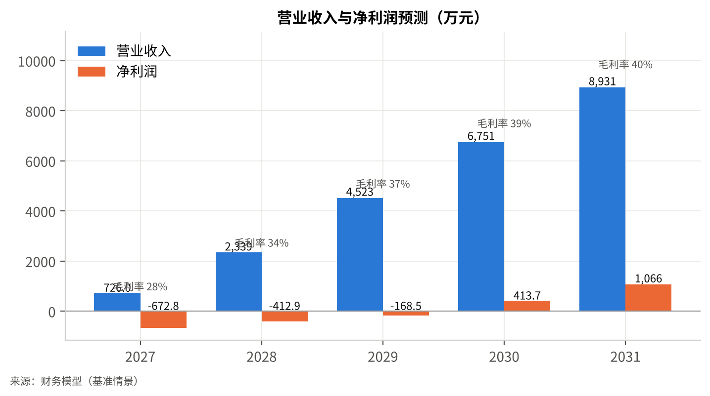
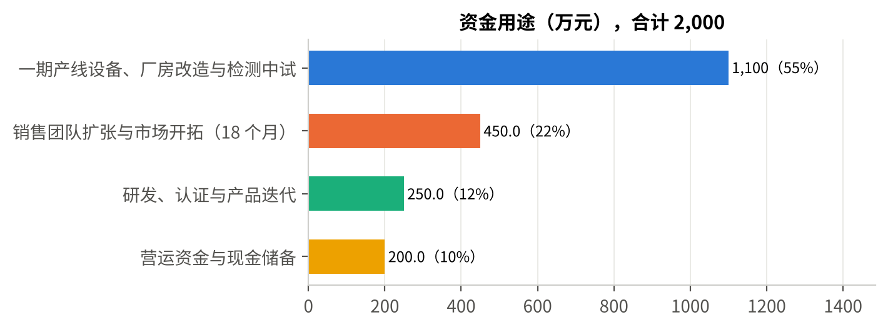
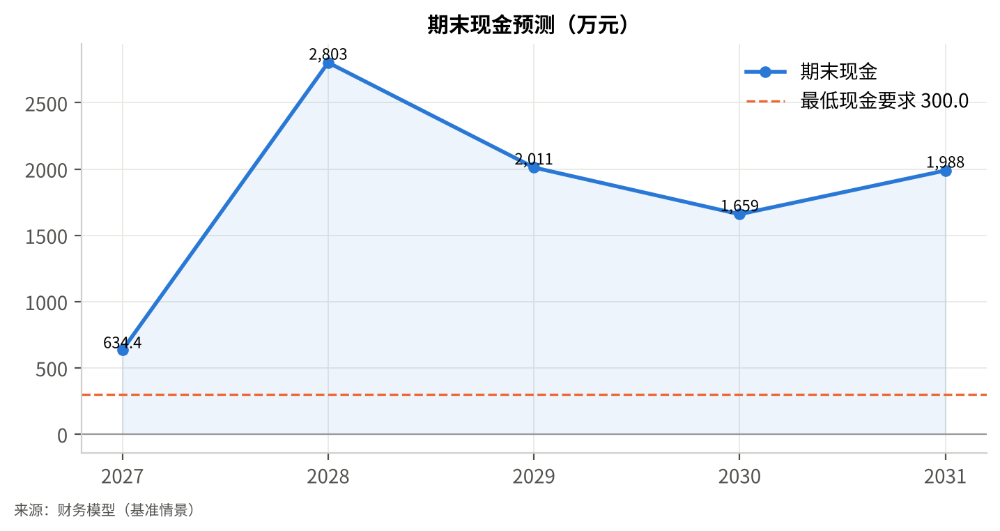
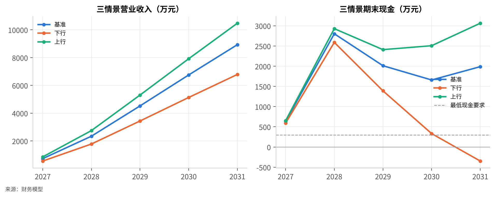
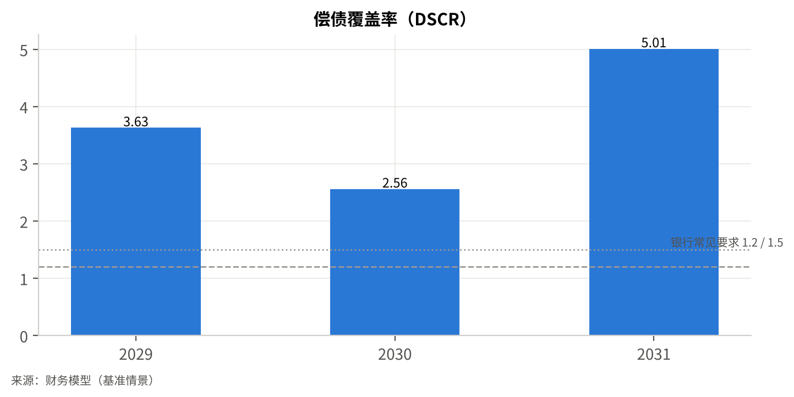
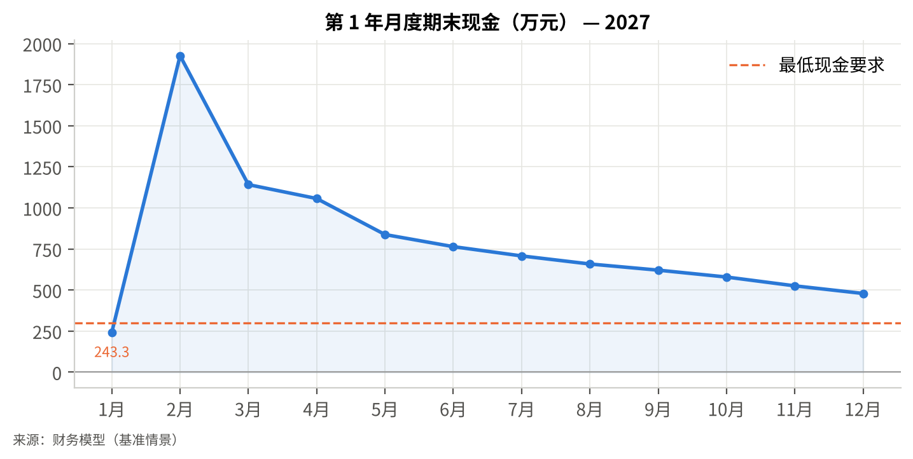

# 1 执行摘要

> 阅读提示：本计划书中标注 `[F-xx]` 的内容为用户提供的事实或有来源的公开数据，`[A-xx]` 为可查证依据的假设，`[E-xx]` 为推断，`[S-xx]` 为来源，`[待补充]` 为必须由公司补齐的信息。全部财务数字来自随附的财务模型（基准情景，万元，不含增值税），任何一处假设改变后都可重算。假设清单见附录 A 与单独交付的《假设与证据登记册》。

**一句话定位。** 公司是一家位于杭州、成立约一年半的陶瓷膜材料企业 [F-01]，为化工园区及园区内企业的高盐、高 COD、含溶剂等难处理工业废水提供陶瓷膜组件、撬装式膜法处理系统和运维服务。相比主流有机膜，陶瓷膜耐酸碱、耐高温、耐氧化、可反冲洗和化学再生，寿命通常以 5–10 年计，适合有机膜无法长期稳定运行的工况；相比进口陶瓷膜，公司以国产供应链和本地化服务争取更短交期和更低综合成本 [E-02]。

**为什么现在。** 政策把化工园区废水处理推到了整改与考核的位置：工信部等五部门 2025 年 7 月要求 2025 年底前完成全部已认定化工园区的复核，并把"污水收集处理设施建设运行不到位"列为必须整改的问题 [F-11][S11]；六部门《工业废水循环利用实施方案》和工业水效提升行动计划要求 2025 年规模以上工业用水重复利用率达到 94% 左右、石化化工重点产品单位取水量下降 5% [F-12][F-13]。全国已认定化工园区 695 家 [F-10][S9]，浙江是园区数量超过 40 家的四个省份之一，并计划到 2027 年培育 6 个以上千亿级化工园区 [F-10][F-17]。我们判断 2026–2028 年会出现一轮园区级和企业级废水处理与回用的设备更新窗口 [E-01]。

**市场与份额。** 自下而上测算（第 4.5 节）：园区级改造与企业级预处理两类需求合计的可服务市场（SAM）约 51 亿元（2027–2031 年五年累计，年均约 10 亿元）[A-28]–[A-31]；本计划 2031 年基准收入 8,930.9 万元，约占年均 SAM 的 9%，相当于久吾高科 2025 年收入的 14%、三达膜的 6% [E-05]，属于行业第二梯队的合理规模。

**进展。** 产品已在两家化工园区客户试用 [F-03]，2026 年签约合同收入约 180 万元 [F-04]。试用结果指标（通量恢复率、清洗周期、吨水运行成本）[待补充：T-02]，是本计划书中最需要公司补齐的证据。

**团队。** CEO 曾任一家环保上市公司技术总监，CTO 为浙江大学材料学博士 [F-02]；两人分别覆盖工业客户与工程交付、膜材料配方与烧结工艺两端。团队现有 6 人 [F-01]，关键空缺是销售负责人、生产负责人和财务负责人（第 9.4 节）。

**财务亮点（基准情景，万元）。** 2027 年营业收入 726.0 万元，2031 年 8,930.9 万元，五年复合增长 87.3%；毛利率从 27.9% 提升至 40.3%（第 5 年接近行业龙头 40–42% 的水平 [F-06][F-09]）；EBITDA 2029 年转正（145.3 万元），净利润 2030 年转正（413.7 万元），2031 年净利润 1,065.7 万元；项目 IRR（含期末价值，EBITDA 10 倍）50.4%。预测期内最低期末现金 634.4 万元（2027 年），无资金缺口；无融资口径的峰值资金需求 4,391.3 万元，由本轮 2,000 万元、计划中的 B 轮 3,000 万元和二期设备贷款 1,000 万元覆盖。

表 1 关键财务指标（基准情景，万元）

| 指标 | 2027 | 2028 | 2029 | 2030 | 2031 |
|---|---:|---:|---:|---:|---:|
| 营业收入 | 726.0 | 2,339.4 | 4,522.8 | 6,751.1 | 8,930.9 |
| 毛利率 | 27.9% | 34.2% | 36.7% | 38.7% | 40.3% |
| EBITDA | -525.0 | -253.1 | 145.3 | 743.5 | 1,401.4 |
| 净利润 | -672.8 | -412.9 | -168.5 | 413.7 | 1,065.7 |
| 期末现金 | 634.4 | 2,802.8 | 2,011.4 | 1,658.7 | 1,988.4 |
| 期末人员（人） | 18 | 27 | 39 | 49 | 58 |

**本轮请求。** A 轮融资 2,000 万元 [F-05]，用途：一期产线设备、厂房改造与检测中试 1,100 万元（55%）、销售团队扩张与市场开拓 450 万元（22.5%）、研发认证与产品迭代 250 万元（12.5%）、营运资金与现金储备 200 万元（10%）[A-22]。资金支撑约 18 个月，对应里程碑：2027 年 7 月一期产线（600 件/年）投产、2027 年收入 726.0 万元、2028 年收入 2,339.4 万元且一期利用率超过 70%，以此进入 B 轮。出让比例与估值 [待补充：T-01]，第 12.3 节给出可比口径的讨论区间。

**最大的三个风险与应对。** （1）园区客户决策周期长、试点转化慢：下行情景（销量 −20%、价格 −5%、单位成本 +5%）下 2031 年收入 6,787.5 万元，预测期内不盈利，2031 年出现 647.4 万元资金缺口——应对是把二期扩建与 B 轮挂钩、设置人员与费用的分级冻结线（第 13 章）。（2）B 轮延迟：若 2028 年 B 轮未到位，2028 年末现金转负，需启用约 1,000 万元备用授信并冻结二期 [E-08]。（3）行业账期长：龙头企业应收账款约为年收入 1.3 倍 [F-08]，模型按 120 天已属乐观，应收每延长 60 天峰值资金需求增加约 1,110 万元（第 11.8 节）。

<!-- pagebreak -->

# 2 公司概况

## 2.1 公司基本情况

| 项目 | 内容 |
|---|---|
| 公司名称 | [待补充：T-05] |
| 注册地 | 浙江省杭州市 [F-01]（具体地址 [待补充]） |
| 成立时间 | 约 2025 年上半年（成立约 1 年半 [F-01]；具体日期 [待补充]） |
| 注册资本 / 实缴 | [待补充：T-05] |
| 股权结构 | [待补充：T-01]（创始团队、早期投资人、期权池比例） |
| 团队规模 | 6 人 [F-01] |
| 主营业务 | 工业废水处理用陶瓷膜组件的研发、生产与销售 [F-01] |
| 资质与认定 | 高新技术企业 / 科技型中小企业 / 专利与软著 [待补充：T-05] |

## 2.2 使命与定位

公司定位为"面向化工园区难处理废水场景的陶瓷膜材料与小型系统供应商"：以自研膜材料配方和烧结工艺为核心，把产品形态收敛在两类标准化产品（标准组件、撬装系统）和一项服务（运维与清洗），不做大型 EPC 工程总包。这一边界的原因在第 5.4 节展开：行业龙头在系统集成业务上毛利率仅 15–28% 并持续收缩该业务 [F-07]，而膜材料环节是利润所在；初创公司应把资金投在材料与产线，用总包商和园区运营方作为系统落地的渠道。

## 2.3 发展历程与现状

- 2025 年上半年：公司成立，核心团队为 CEO（前环保上市公司技术总监）与 CTO（浙江大学材料学博士）[F-01][F-02]。
- 2025–2026 年：完成陶瓷膜组件样品开发，在两家化工园区客户开展试用 [F-03]；试用规模、周期与结果 [待补充：T-02]。
- 2026 年：签约合同收入约 180 万元 [F-04]。合同份数、客户数、产品与服务构成、含税口径、已确认收入与回款 [待补充：T-04]。
- 当前：团队 6 人 [F-01]；组件由中试线小批量生产或外协加工 [A-27，需确认]，尚无规模化产线，这是本轮融资要解决的首要瓶颈。

截至 2026 年末的期初资产负债表按假设建立（现金 310 万元、应收账款 70 万元、存货 50 万元、固定资产净值 100 万元、应付账款 30 万元、实收资本 800 万元、未分配利润 −300 万元）[A-03]，须用公司实际报表替换 [T-08]。

## 2.4 本项目概述

本轮融资实施的项目是"一期小规模产线 + 销售体系"：在杭州或周边园区租赁约 2,000 m² 厂房 [A-10]，建设年产 600 件标准组件（约 6,000 m² 膜面积）的陶瓷膜产线，设备、改造与检测投入合计 1,100 万元 [A-14]，计划 2027 年 7 月投产；同时把销售与应用工程师从 1 人扩至 2027 年 5 人、2028 年 8 人 [A-23]。二期扩产（新增 1,400 件/年，投入 1,200 万元）设定在 2029 年，由 B 轮和设备贷款支持，并有明确的触发条件（第 10.2 节）[A-16]。

<!-- pagebreak -->

# 3 产品、服务与技术

## 3.1 客户痛点与场景

化工园区的废水有三个使有机膜（PVDF/PES 超滤、反渗透）难以长期稳定运行的特征：高盐与高 COD 导致膜污染快、清洗频繁；含溶剂、强酸强碱或氧化性物质导致有机膜溶胀或降解；部分工艺废水温度高于 40 ℃。园区集中污水处理厂和企业预处理单元因此面临三个具体问题：

1. 膜更换周期短，有机超滤膜在难处理废水中往往 1–2 年即需更换，更换成本与停机损失叠加 [待补充：以试用客户现场数据替换，T-02]。
2. 回用率上不去。政策要求规模以上工业用水重复利用率达到 94% 左右 [F-12]，园区被要求整改污水处理设施 [F-11]，而现有工艺对高盐高 COD 水的预处理能力不足，后段反渗透负荷过高。
3. 运维人力与药剂成本高，清洗频率决定吨水成本。

陶瓷膜在这些场景的优势是机制性的：氧化铝/氧化锆等无机材料耐 pH 0–14、耐温 100 ℃ 以上、可高压反冲洗与强氧化剂清洗，通量恢复性好，寿命通常以 5–10 年计。这是过去二十年陶瓷膜在国内从进口替代起步、由龙头企业做到约 6 亿元收入规模的原因 [F-06][S3]。

## 3.2 产品与服务

公司产品与服务与财务模型的三条收入线一一对应：

表 2 产品与服务清单

| 收入线 | 产品 / 服务 | 规格与交付形态 | 单位 | 2027 年定价（不含税） | 依据 |
|---|---|---|---|---|---|
| R1 | 标准陶瓷膜组件 | 以多通道氧化铝/氧化锆陶瓷膜元件（如 19 通道 × 1,178 mm 规格或等效）装配的标准组件，每件约 10 m² 膜面积；孔径覆盖微滤到超滤 [A-27，需确认] | 件 | 4.5 万元/件（约 4,500 元/m²），年降 2% | [A-05] |
| R2 | 撬装式膜法处理系统 | 含约 15 件组件、循环泵、阀组、CIP 清洗单元、PLC 控制，处理规模约 500–1,000 m³/d，工厂预装、现场接管 | 套 | 120 万元/套 | [A-08] |
| R3 | 运维服务与清洗备件 | 年度运维合同：定期化学清洗、膜性能检测、备件与药剂 | 项目·年 | 12 万元/项目/年 | [A-09] |

膜材质、孔径范围、设计通量、耐酸碱范围、与同类产品的性能对比数据 [待补充：T-07]。

## 3.3 技术路线与核心能力

- 材料与工艺：陶瓷膜的核心在支撑体配方与烧结工艺（决定强度与成本）、分离层涂覆与二次烧结（决定孔径分布与通量）。CTO 的材料学背景 [F-02] 对应的正是这两个环节。公司现阶段的具体技术路线、已完成的中试批次、良率水平 [待补充：T-07]。
- 应用工程：CEO 在环保上市公司的技术总监经历 [F-02] 对应工业废水工艺设计、系统集成与客户现场问题解决的能力，这是把膜材料卖进化工园区的必要条件。
- 知识产权：已申请 / 已授权专利与软著清单 [待补充：T-05]。本计划书不假设任何专利已授权。
- 研发阶段：组件已进入客户试用阶段 [F-03]，产线建设前属于"中试—小批量"阶段。

## 3.4 与现有方案的对比

表 3 方案对比（定性，待公司以实测数据替换）

| 维度 | 本公司陶瓷膜组件 | 进口陶瓷膜（TAMI、atech、Pall 等） | 国内龙头陶瓷膜（久吾高科、三达膜等） | 有机超滤膜（PVDF/PES） | 来源 |
|---|---|---|---|---|---|
| 耐酸碱 / 耐温 / 耐氧化 | 强（无机材料共性） | 强 | 强 | 弱，溶剂与强氧化剂环境受限 | 行业共识，需 [T-07] 数据 |
| 使用寿命 | 预期 5 年以上 [待补充] | 5–10 年 | 5–10 年 | 通常 1–3 年 | 行业经验 |
| 单位膜面积价格 | 约 4,500 元/m² [A-05] | 高于国产（具体 [待核实]） | 与本公司接近 [A-05] | 显著低于陶瓷膜 | [A-05] |
| 交期与本地服务 | 杭州本地，短交期，CEO 团队现场支持 | 进口交期长 | 全国布局，但重点转向盐湖提锂等领域 [E-02] | 供应充足 | [F-07] |
| 产品聚焦 | 化工园区难处理废水 | 多行业 | 多行业（生物医药、食品、新能源、环保） | 市政与一般工业 | [S4] |
| 规模与资质 | 初创，无规模产线 | 成熟 | 上市公司，单项冠军 [S3] | 成熟 | — |

本公司在规模、资质与历史业绩上处于明显劣势，这是事实；可以争取的差异点是场景聚焦、服务响应与成本，而不是材料性能上的代差。投资人应要求公司提供试用现场的通量、清洗周期与吨水成本数据来验证第一列 [T-02]。

## 3.5 壁垒与持续性

公司当前真实的壁垒是"工艺 know-how + 客户现场验证数据"，而不是专利或规模：

- 工艺壁垒：陶瓷膜的良率和一致性取决于配方与烧结曲线的积累，新进入者通常需要 2–3 年才能把良率做到经济水平；这一壁垒随公司产线运行时间延长而加厚，但头部企业早已越过，因此对龙头不构成壁垒。
- 场景数据壁垒：在化工园区高盐高 COD 废水上的运行数据（膜污染行为、清洗方案）会沉淀为选型与运维能力，复制周期以年计。
- 客户转换成本：膜法系统一旦投运，更换膜品牌需要重新验证，运维合同进一步提高粘性；这是第 6 章 LTV 的来源。

持续性判断：3 年内主要竞争压力来自国内龙头的价格与渠道，而非技术替代（第 5.5 节）。

## 3.6 产品路线图

| 时间 | 产品 / 技术目标 | 投入来源 |
|---|---|---|
| 2027 | 一期产线投产，标准组件量产良率达到经济水平 [待补充目标值]；完成第三方性能检测与产品认证 | 研发费用 O4/O5，A 轮 |
| 2028 | 撬装系统标准化（2–3 个规格），运维服务包上线；高通量改性膜中试 | 研发费用、B 轮 |
| 2029–2031 | 二期产线；针对高盐废水的耐污染膜与特种规格；探索碳化硅等更高端材料 [待确认技术路线] | B 轮、设备贷款 |

<!-- pagebreak -->

# 4 市场分析

## 4.1 宏观与政策环境

三份文件直接构成本项目的需求驱动：

1. 《工业废水循环利用实施方案》（工信部、国家发展改革委等六部门，2021 年 12 月）：到 2025 年规模以上工业用水重复利用率力争达到 94% 左右，万元工业增加值用水量较 2020 年下降 16%，石化化工行业重复利用率进一步提升，并选择有代表性的园区开展技术综合集成与示范 [F-12][S13]。
2. 工业水效提升行动计划（工信部等六部门，2022 年 6 月）：石化化工重点产品单位取水量下降 5% [F-13][S14]。
3. 《关于推进化工园区规范建设和高质量发展有关工作的通知》（工信厅联原函〔2025〕317 号，2025 年 7 月）：2025 年底前完成已认定化工园区复核；要求整改"化工园区污水收集处理设施建设运行不到位"等问题；园区扩区须达到较低安全风险等级（D 级）和竞争力二级以上；修订完成前暂停认定新园区 [F-11][S11][S12]。

这三份文件的叠加效果是：园区数量封顶、存量园区被复核与整改、水效指标被考核。园区管委会和园区污水厂运营方有了明确的时间表和问责压力，这比单纯的"环保趋严"更能形成采购 [E-01]。人民日报 2024 年 10 月报道的榆林能化园区废水近零排放（回用率 97% 以上）、大连园区再生水售价 2.1 元/吨等案例 [S18]，说明园区级回用在经济上已经成立。

## 4.2 行业规模与增长

- 中国膜产业总产值 2019 年 2,773 亿元（同比 +13.7%）、2020 年 2,884 亿元（中国膜工业协会数据），前瞻产业研究院预计 2025 年达到 5,000 亿元；膜产品市场中反渗透与纳滤约占 50%，无机陶瓷膜与气体分离膜等合计约占 20% [F-16][S16]。该预测发布于 2022 年，仅作量级参考。
- 全球陶瓷膜市场 [F-15]：Fortune Business Insights 口径 2025 年 121.6 亿美元、2034 年 344.2 亿美元（CAGR 12.3%），亚太占 34%、中国约 18%，水与废水处理约占 46% [S7]；GMI 口径 2023 年约 72 亿美元、2032 年 153.8 亿美元（CAGR 8.8%）[S8]。两家口径相差约一倍，本计划书不采用其中任何一个作为市场规模结论，只取"年增长 9–12%、水处理是最大应用"这两个方向性判断。
- 国内可比上市公司：久吾高科 2025 年收入 6.33 亿元（+18.8%）、归母净利润 7,367 万元（+39.0%）[F-06][S1]；三达膜 2025 年收入 15.24 亿元、归母净利润 3.78 亿元 [F-09]。龙头的增长和利润率回升说明细分行业处于上行周期。

## 4.3 产业链与价值分布

| 环节 | 参与者 | 利润水平 | 本公司位置 |
|---|---|---|---|
| 上游：氧化铝/氧化锆粉体、烧结设备、泵阀仪表 | 粉体与设备供应商 | 竞争充分 | 采购方，账期约 60 天 [A-19] |
| 中游：膜元件与组件制造 | 久吾高科、三达膜、江苏凯米等国内厂商；TAMI、atech、Pall 等进口 | 膜材料是行业利润来源，龙头综合毛利率 40–42% [F-06][F-09] | **核心定位** |
| 中游：膜法系统集成 | 膜厂商、环保工程公司 | 龙头系统集成毛利率 15–28% [F-07] | 仅做小型撬装标准品 |
| 下游：园区污水厂运营、企业废水预处理 | 园区运营方、环保总包、化工企业 | 运营毛利 10–20% [S16] | 客户与渠道 |

## 4.4 目标客户细分

| 客户类型 | 规模（全国） | 采购决策者 | 采购动因 | 典型客单价 | 销售周期 |
|---|---|---|---|---|---|
| A. 化工园区集中污水处理厂 / 园区运营方 | 已认定化工园区 695 家 [F-10]，浙江、山东、湖北、安徽为重点省份 [S10] | 园区管委会 + 运营方（常为环保上市公司或水务公司） | 园区复核与整改、回用率考核 [F-11][F-12] | 园区级项目组件 + 系统 300–800 万元，分 2–3 年 [E-04] | 9–18 个月，多经总包或设计院 |
| B. 园区内化工企业（预处理与回用） | 规上化工企业 26,287 家 [F-14][S15]，园区化率政策目标 70% 以上 [S9] | 企业 EHS / 设备部门 | 排放超标整改、水费与排污费、回用节水 | 约 120 万元（1 套撬装系统）[A-31] | 6–9 个月 |
| C. 环保工程总包与设计院（渠道客户） | — | 项目经理 / 采购 | 项目交付与质保 | 按项目 | 随项目 |

首批目标区域是长三角：浙江有超过 40 家已认定化工园区 [S10]，并计划到 2027 年培育 6 个以上千亿级园区 [F-17][S17]，与公司杭州所在地和现有两家试用客户 [F-03] 一致。

## 4.5 市场规模测算（TAM / SAM / SOM）

**自下而上公式。** 可服务市场 SAM = 园区级需求 + 企业级需求（2027–2031 年五年累计）：

- 园区级：695 家已认定园区 [F-10] × 五年内实施膜法改造或提标的比例 50% [A-28] × 园区级陶瓷膜组件与系统可触达采购额 600 万元 [A-29] ≈ 20.9 亿元。
- 企业级：26,287 家规上化工企业 [F-14] × 园区内比例 60% [A-30] × 存在适合陶瓷膜处理的难处理废水比例 20% [A-30] × 企业级平均采购额 120 万元 / 5 年 [A-31] ≈ 37.9 亿元。
- SAM 合计约 58.7 亿元/5 年，考虑两类需求有重叠（园区集中处理替代部分企业预处理），保守取 51 亿元，年均约 10 亿元。

**SOM 与模型的对应。** 本计划 2027–2031 年基准累计收入 23,270 万元（726.0 + 2,339.4 + 4,522.8 + 6,751.1 + 8,930.9），约占五年 SAM 的 4.6%；2031 年收入 8,930.9 万元约占年均 SAM 的 9%。实现机制：一期 600 件/年与二期 2,000 件/年的产能 [A-07][A-16]，2027–2031 年销售与应用工程师 5→16 人 [A-23]，人均产出从 145 万元提升到 558 万元。

**自上而下交叉验证。** 若按全球陶瓷膜市场的中国份额（121.6 亿美元 × 18% ≈ 22 亿美元，按 1 美元 ≈ 7.1 元折合约 155 亿元 [S7]）和水处理占比 46% 计，中国陶瓷膜水处理相关市场约 70 亿元/年，本计划 2031 年收入占其约 1.3%；若按 GMI 较低口径 [S8]（约 42 亿元）约为 2%。两个口径下 SOM 均在个位数百分比，与"行业第二梯队"的定位一致 [E-05]。

**敏感性。** SAM 对 A-28（园区改造比例）和 A-30（难处理废水比例）最敏感：两者各下调 20% 时 SAM 降至约 41 亿元，本计划 2031 年收入占年均 SAM 的比例升至约 11%，仍在可实现范围；但如果园区级改造主要采购进口或龙头品牌，公司的可触达份额将取决于第 7 章的渠道策略，而非市场总量。

## 4.6 需求验证

- 已有证据：两家化工园区客户试用 [F-03]；2026 年签约合同约 180 万元 [F-04]。
- 需补齐：试用客户的名称或脱敏描述、处理规模、运行时长、通量恢复率、清洗周期、吨水运行成本的前后对比，以及是否转为付费采购 [T-02]；在谈项目清单（数量、金额、阶段）[T-09]。
- 本计划书假设两家试用客户 2027 年转为正式采购并各带来 1–2 家园区内新客户 [A-02]；这是 2027 年 726.0 万元收入的主要来源，置信度低，是投资人尽调的第一优先项。

<!-- pagebreak -->

# 5 竞争分析

## 5.1 竞争格局

国内陶瓷膜已完成进口替代的第一阶段：久吾高科自述陶瓷膜国内市场份额"接近 50%"，并被工信部认定为制造业单项冠军产品 [S3，企业自述，C 级]；三达膜、江苏凯米、南京钛净、东强陶瓷等构成第二梯队 [S19]；进口品牌（TAMI、atech、Pall、Metawater 等）在高端与特殊应用仍有份额 [S7][S19]。格局特征：

- 集中度高、但龙头在分散资源：久吾高科 2024 年系统集成业务收入从 2022 年的 6.33 亿元降至 3.16 亿元、主动放弃低毛利项目，同时把 2.14 亿元可转债资金投向特种无机膜组件产线，并大力发展盐湖提锂、新能源业务 [F-07][S4][S5]。
- 龙头的膜材料产能在扩张，价格竞争会加剧；但龙头的销售重心正在向盐湖提锂、生物医药、市政自来水升级转移 [S3][E-02]，化工园区小型项目对其吸引力下降。
- 应收账款周期长是行业共性：久吾高科 2025 年 9 月末应收账款 4.97 亿元，约为年化收入的 1.3 倍 [F-08]。这意味着行业竞争不仅在产品，也在垫资能力。

## 5.2 主要竞争对手

表 4 竞争对比矩阵

| 维度 | 本公司 | 久吾高科（300631） | 三达膜（688101） | 进口陶瓷膜（TAMI / atech / Pall） | 有机膜厂商（替代方案） | 来源 |
|---|---|---|---|---|---|---|
| 2025 年收入 | 2026 年合同约 180 万元 [F-04] | 6.33 亿元 [F-06] | 15.24 亿元（含水务运营）[F-09] | 全球企业，中国收入 [待核实] | — | [S1][S2][S6] |
| 综合毛利率 | 模型 2027 年 27.9% → 2031 年 40.3% | 约 42.3%（2025）[F-06] | 约 40.2%（2025）[F-09] | [待核实] | 通常低于陶瓷膜 | [S2][S6] |
| 陶瓷膜产能 | 一期 600 件/年（2027），二期 2,000 件/年（2029）[A-07] | 行业最大，可转债扩产 2.14 亿元 [S4] | 有自产陶瓷膜与有机膜 | 大 | — | [S4] |
| 业务重心 | 化工园区废水（单一场景） | 盐湖提锂、新能源、生物医药、市政水 [S3][S5] | 膜技术应用 + 水务投资运营 | 多行业高端 | 市政与一般工业 | [S3][S4] |
| 系统集成能力 | 小型撬装标准品 | 强，但在收缩低毛利项目 [F-07] | 强 | 多经代理 | 强 | [S4] |
| 价格 | 与国内龙头持平或略低 [A-05] | 基准 | 基准 | 高于国产 | 显著低于陶瓷膜 | [A-05] |
| 本地服务（长三角） | 杭州，现场响应快 | 南京总部，全国布局 | 厦门总部 | 代理商 | 普遍 | — |
| 应收账款 | 目标 120 天 [A-17] | 约 1.3 倍年收入 [F-08] | [待核实] | — | — | [S5] |

## 5.3 替代方案与潜在进入者

- 替代方案 1：有机超滤 + 反渗透。价格低，是大多数园区的默认方案；在高盐高 COD 废水中寿命短、清洗频繁。本公司的切入点是有机膜"用不住"的工段，而不是全面替代。
- 替代方案 2：蒸发结晶、高级氧化等非膜工艺。能耗高，通常与膜法配合使用，不构成直接竞争。
- 替代方案 3："不做"或延后。园区在整改压力下延后的空间在收窄 [F-11]，但企业级客户在盈利承压时（2024 年化工行业亏损企业占比 23.5% [F-14]）会推迟非强制性投资，这是下行情景的主要来源（R-01）。
- 潜在进入者：有机膜厂商向无机膜延伸、龙头企业的新产能释放、碳化硅膜等新材料厂商。进入壁垒是工艺良率与客户验证周期（第 3.5 节）。

## 5.4 差异化定位与护城河

公司不与龙头在"全行业、全产品线"上竞争，而是在"化工园区难处理废水"这一场景上做到三件事：（1）产品聚焦——两类标准品，交期短、现货率高；（2）场景数据——用试用客户和首批项目积累的运行数据形成选型与运维方案；（3）轻系统、重材料——系统业务只做撬装标准品，大型工程通过总包和园区运营方渠道落地，避免垫资和低毛利 [F-07]。护城河在 3 年内仍然很薄，这一点在风险矩阵中如实列出（R-03）。

## 5.5 竞争对手的可能反应与应对

| 对手可能的反应 | 概率 | 对本公司的影响 | 应对 |
|---|---|---|---|
| 龙头新产能释放后对化工园区小项目降价 | 中–高 | 价格 −5% 至 −10%；下行情景已计入价格 ×0.95 [A-25] | 不打价格战，强调交期与运维响应；单价 −10% 的敏感性显示 2031 年仍盈利（第 11.8 节） |
| 总包商要求更长账期或更高返点 | 中 | 应收账款延长 | 应收 180 天的敏感性已测算；对总包渠道设定预付款下限 |
| 进口品牌本地化 | 低–中 | 高端项目份额 | 不以高端项目为主战场 |
| 龙头并购第二梯队厂商 | 低 | 行业整合 | 也是本公司的退出路径之一（第 12.6 节） |

<!-- pagebreak -->

# 6 商业模式与单位经济

## 6.1 价值主张与客户关系

对园区运营方和化工企业：用陶瓷膜替换难处理工段的有机膜或新建预处理单元，降低换膜频率与清洗成本，提高回用率以满足考核；对总包商：提供交期短、可预装的撬装标准品和现场支持。客户关系以"首个项目—扩展—年度运维"为路径，运维合同是维持关系和复购的载体。

## 6.2 收入模式与定价

| 收入线 | 收入模式 | 2027 年收入（万元） | 2031 年收入（万元） | 2031 年占比 | 定价逻辑 |
|---|---|---:|---:|---:|---|
| R1 组件销售 | 产品销售，单价 × 件数 | 450.0 | 5,810.9 | 65% | 4.5 万元/件起，年降 2% 反映国产竞争 [A-05] |
| R2 撬装系统 | 产品销售，单套 120 万元 | 240.0 | 2,280.0 | 26% | 含组件、泵阀、CIP、控制 [A-08] |
| R3 运维服务 | 年度合同，12 万元/项目/年 | 36.0 | 840.0 | 9% | 清洗、检测、备件 [A-09] |
| 合计 | | 726.0 | 8,930.9 | 100% | 来源：财务模型 |

分收入线的量价表见第 11.2 节。

## 6.3 单位经济

表 5 单位经济（基准情景）

| 指标 | 标准组件（R1） | 撬装系统（R2） | 运维服务（R3） | 依据 |
|---|---:|---:|---:|---|
| 单位收入 | 4.5 万元/件（2027）→ 4.15 万元（2031） | 120 万元/套 | 12 万元/项目/年 | [A-05][A-08][A-09] |
| 单位材料与制造费用 | 2.7 万元/件（2027）→ 2.11 万元（2031） | 81.6 万元（成本率 68%） | 6 万元（成本率 50%） | [A-06][A-08][A-09] |
| 分摊生产人工 | 约 0.55 万元/件（2027）→ 约 0.24 万元（2031） | 含于成本率 | 含于成本率 | [A-23][E-06] |
| 贡献毛利 | 约 1.25 万元（28%）→ 约 1.80 万元（43%） | 38.4 万元（32%） | 6 万元（50%） | [E-06] |
| 获客成本 CAC | 约 24–29 万元/新客户（销售费用 ÷ 新增客户） | | | [E-07，需确认] |
| 单客户 5 年生命周期毛利 LTV | 约 80 万元（首个项目毛利约 35 万元 + 运维 4 年约 24 万元 + 换膜约 20 万元） | | | [E-07，需确认] |
| LTV / CAC | 约 2.8–3.3 | | | [E-07] |
| 回本周期 | 首个项目即覆盖 CAC（项目毛利 35 万元 > CAC 29 万元） | | | [E-07] |

两点说明：（1）组件毛利率从 28% 到 43% 的提升来自良率与规模（单位成本年降 6%）和生产人工摊薄，这是本计划最关键的运营假设之一 [A-06]，需要用产线投产后的实际良率验证；（2）LTV/CAC 约 3 倍在工业设备企业中属正常偏低水平，因为新增客户数、复购和运维签约率均为假设，不应被当作已验证的指标。

## 6.4 成本结构与规模效应

- 变动成本：膜材料与制造费用（R1 单位成本）、系统外购件（R2 成本率 68%）、服务药剂与人工（R3 成本率 50%）；2031 年营业成本 5,330.0 万元，占收入 59.7%。
- 半固定成本：生产人工 6→28 人（计入营业成本）[A-23]；厂房租金 70→117 万元 [A-10]。
- 固定费用：2027 年费用合计 727.8 万元（销售 170.8、管理 255.0、研发 272.0、其他 30.0），2031 年 2,199.4 万元；费用率从 100.3% 降至 24.6%。研发费用率 2027 年 37.5%、2031 年 6.9%，长期与龙头约 10% 的水平相当 [A-12][F-08]。
- 规模效应来源：产线利用率（43% → 84%）、单位成本下降、销售人均产出提升（145 → 558 万元）。
- 盈亏平衡：2029 年盈亏平衡收入 4,982.0 万元，实际收入 4,522.8 万元（比率 1.10），2030 年起实际收入超过盈亏平衡点（第 11.7 节）。

## 6.5 关键合作与渠道

环保工程总包商与设计院（项目入口）、园区运营方（园区级采购与运维）、粉体与烧结设备供应商（成本与一致性）、第三方检测机构（产品认证）。具体合作方 [待补充]。

<!-- pagebreak -->

# 7 营销与销售策略

## 7.1 目标与分阶段指标

表 6 销售目标与模型销量的对应

| 指标 | 2027 | 2028 | 2029 | 2030 | 2031 | 依据 |
|---|---:|---:|---:|---:|---:|---|
| 组件销量（件） | 100 | 340 | 680 | 1,050 | 1,400 | [A-07] |
| 撬装系统（套） | 2 | 6 | 11 | 15 | 19 | [A-07] |
| 在服务运维项目（个） | 3 | 10 | 22 | 42 | 70 | [A-09] |
| 新增客户（家，假设） | 6 | 15 | 25 | 32 | 38 | [E-07] |
| 覆盖园区（个，目标） | 4 | 10 | 18 | 26 | 34 | 长三角为主，逐步向山东、湖北、安徽延伸 [S10] |
| 销售与应用工程师（人） | 5 | 8 | 11 | 14 | 16 | [A-23] |
| 人均产出（万元） | 145 | 292 | 411 | 482 | 558 | 模型收入 ÷ 销售人数 |

2027 年 726.0 万元收入的来源：两家试用客户转为正式采购（约 2 套撬装系统或等量组件）、园区内复制 1–2 家、总包渠道 2–3 个项目 [A-02]。2028 年 2,339.4 万元对应一期产线满负荷的 72%，增长率 222% 来自产能从半年到全年释放和销售团队从 5 人到 8 人，这是本计划增长最快、也最依赖试点转化的一年。

## 7.2 渠道策略

| 渠道 | 占比目标 | 周期 | 成本 | 作用 |
|---|---|---|---|---|
| 直销（园区运营方与化工企业） | 50% | 6–12 个月 | 销售人员成本 | 掌握终端与运维入口 |
| 环保工程总包 / 设计院 | 40% | 随项目，9–18 个月 | 佣金与返点约 3% [A-11] | 进入园区级大项目 |
| 行业展会、协会与园区招商活动 | 线索来源 | — | 推广费率 2.5% [A-11] | 建立品牌与信任 |
| 试点示范 | 10% | 3–6 个月试用 | 以成本价或免费提供试用组件 | 用数据打开新园区 |

## 7.3 推广计划与预算

销售费用由三部分构成，与模型一致：销售与应用工程师薪酬（2027 年 120.0 万元 → 2031 年 466.8 万元）[A-23]、市场推广与差旅（收入的 2.5%）、渠道佣金与返点（收入的 3%）、质保计提（1.5%）[A-11][A-13]。销售费用合计 2027 年 170.8 万元、2031 年 1,091.9 万元，销售费用率从 23.5% 降至 12.2%。

## 7.4 销售流程与团队

流程：线索（展会/总包/园区）→ 现场水样检测与中试（1–3 个月）→ 方案与报价 → 签约（预付款 30%）→ 交付安装（到货 30%）→ 验收（30%）→ 质保金 10% 一年后收回 [A-17]。团队：2027 年 5 名销售与应用工程师（含 1 名销售负责人，待招聘，第 9.4 节），按长三角分区；应用工程师同时承担中试与运维，降低早期人力成本。

## 7.5 客户成功与复购

运维合同（R3）是复购机制：按每 15 件组件或 1 套系统计 1 个交付项目，预计约 25% 的累计交付项目签订年度运维合同 [A-09]；膜寿命到期后的换膜是第二次采购。客户成功指标：通量恢复率、清洗周期、停机时间——这些数据同时回流为第 3.5 节的场景数据壁垒。

<!-- pagebreak -->

# 8 运营计划

## 8.1 选址与场地

杭州或周边园区（临平、桐庐、湖州德清等为备选 [待确认]）租赁约 2,000 m² 标准厂房，年租金约 70 万元 [A-10]；2029 年二期扩至约 3,200 m²。陶瓷膜生产涉及高温烧结窑，厂房需满足用电容量、消防与废气处理要求（第 8.6 节）。

## 8.2 产能规划与爬坡

| 项目 | 2027 | 2028 | 2029 | 2030 | 2031 |
|---|---:|---:|---:|---:|---:|
| 名义产能（件/年） | 600（7 月投产，当年按 300 计） | 600 | 2,000（二期年中投产，当年按 1,300 计） | 2,000 | 2,000 |
| 总产出（件，含系统内组件） | 130 | 430 | 845 | 1,275 | 1,685 |
| 产能利用率 | 43% | 72% | 65% | 64% | 84% |

来源：[A-07][A-16]。2027 年上半年以中试线与外协交付存量合同。二期在 2028 年下半年触发（第 10.2 节），若延后一年，模型显示 2029 年销量按一期产能封顶，2031 年收入不变，五年累计净利润从 225.3 万元降至 −41.2 万元，影响有限（第 11.8 节）。

## 8.3 生产 / 交付流程与质量

工艺流程：粉体配料 → 挤出成型 → 干燥 → 高温烧结（支撑体）→ 分离层涂覆 → 二次烧结 → 元件检测（气泡点、通量、强度）→ 组件装配与打压 → 出厂。质量控制重点是良率与一致性；公司现阶段良率与目标值 [待补充：T-07]。撬装系统在厂内预装并完成水压与控制调试后整体发运。

## 8.4 供应链与采购

主要物料为氧化铝/氧化锆粉体、有机添加剂、不锈钢壳体、泵阀仪表与 PLC，国内供应充足。采购账期约 60 天 [A-19]；存货周期 75 天（陶瓷烧结周期与成品备货）[A-18]。关键供应商名单 [待补充]。

## 8.5 设备与系统投资

表 7 资本开支计划（与模型一致，万元）

| 编号 | 项目 | 金额 | 年份 | 折旧年限 | 依据 |
|---|---|---:|---|---:|---|
| C1 | 一期产线设备（挤出成型、干燥、高温烧结窑、涂膜与二次烧结、组件装配与检测） | 700 | 2027 | 10 年 | [A-14]，设备报价 [待补充] |
| C2 | 厂房改造与环保消防配套（洁净区、废气与废水处理、动力） | 250 | 2027 | 8 年 | [A-14] |
| C3 | 检测与中试设备、信息系统 | 150 | 2027 | 5 年 | [A-14] |
| C5 | 模具、工装与设备更新 | 60 | 2028 | 5 年 | [A-15] |
| C4 | 二期产能扩建（新增 1,400 件/年） | 1,200 | 2029 | 10 年 | [A-16] |
| C6 / C7 | 模具、工装与设备更新 | 80 / 80 | 2030 / 2031 | 5 年 | [A-15] |
| 合计 | | 2,520 | | | 来源：财务模型 |

## 8.6 合规、环保与安全

陶瓷膜生产需办理环评（烧结废气、涂膜废液）、排污许可、消防验收与安全生产标准化；产品层面需第三方性能检测报告，涉及饮用水相关应用时需卫生许可（本项目暂不涉及）。办理计划与前置时间 [待补充：T-06]，应在设备订购前启动，以免影响 2027 年 7 月投产节点。

<!-- pagebreak -->

# 9 组织与团队

## 9.1 组织架构

CEO 下设研发与工艺（CTO）、生产与质量（生产负责人，待招聘）、销售与应用（销售负责人，待招聘）、财务与行政（财务负责人，待招聘）四条线。

## 9.2 核心团队

| 职务 | 姓名 | 背景（仅限用户提供） | 分工 |
|---|---|---|---|
| CEO | [待补充：T-03] | 曾任一家环保上市公司技术总监 [F-02]；任职公司与年限 [待补充] | 战略、客户与工程交付、融资 |
| CTO | [待补充：T-03] | 浙江大学材料学博士 [F-02]；研究方向与代表成果 [待补充] | 膜材料配方、烧结工艺、产线设计 |
| 其他 4 名成员 | [待补充] | [待补充] | [待补充] |

本计划书不补写任何未经提供的履历。投资人尽调时建议提供 CEO 过往负责的工业废水项目清单和 CTO 的论文/专利清单。

## 9.3 顾问与外部资源

[待补充]（建议引入一位化工园区运营方背景的行业顾问和一位有制造业财务经验的兼职 CFO）。

## 9.4 关键岗位空缺与招聘计划

| 岗位 | 到岗时间 | 要求 | 影响 |
|---|---|---|---|
| 销售负责人 | 2027 年 Q1 | 工业水处理或膜行业 8 年以上，有总包与园区渠道 | 2027–2028 年销量 [A-07] 的前提 |
| 生产负责人 | 2027 年 Q1（设备订购前） | 陶瓷/无机材料烧结生产管理经验 | 一期产线按期投产与良率 |
| 财务负责人 | 2027 年 Q2 | 制造业全盘财务、融资经验 | B 轮准备、应收管理 |
| 应用工程师 ×4 | 2027 年 Q1–Q3 | 水处理工艺 | 中试与运维 |

## 9.5 人员规模与成本计划

表 8 人员计划（与模型一致）

| 类别 | 2027 | 2028 | 2029 | 2030 | 2031 | 人均年成本（2027，万元，含社保） |
|---|---:|---:|---:|---:|---:|---:|
| 管理团队 | 3 | 3 | 4 | 4 | 4 | 35 |
| 销售与应用工程师 | 5 | 8 | 11 | 14 | 16 | 24 |
| 研发与工艺 | 4 | 6 | 8 | 9 | 10 | 28 |
| 生产、质检与仓储 | 6 | 10 | 16 | 22 | 28 | 12 |
| 合计 | 18 | 27 | 39 | 49 | 58 | 年涨幅 5% |

来源：[A-23]。人员总成本 2027 年 409.0 万元、2031 年 1,385.7 万元（生产人员计入营业成本）。股权激励与期权池安排 [待补充：T-01]。

<!-- pagebreak -->

# 10 实施计划与里程碑

表 9 里程碑

| 阶段 | 时间 | 交付物 / 完成标志 | 负责人 | 前置条件 |
|---|---|---|---|---|
| A 轮交割 | 2027 年 Q1 | 2,000 万元到账 [F-05] | CEO | 本计划书与尽调 |
| 场地与团队 | 2027 年 Q1 | 厂房签约；销售、生产负责人到岗 | CEO | 融资到账 |
| 设备订购与环评 | 2027 年 Q1–Q2 | 设备合同签订；环评与消防手续启动 | 生产负责人 / CTO | 场地确定 |
| 一期产线投产 | 2027 年 7 月 | 首批量产组件通过检测；良率达到目标 [待补充] | CTO | 设备安装调试 |
| 试点转化 | 2027 年 Q2–Q4 | 两家试用客户转为正式采购；新增 4 家客户 [A-02][E-07] | 销售负责人 | 试用数据 [T-02] |
| 2027 年收入 | 2027 年末 | 收入 726.0 万元；期末现金 634.4 万元 | CEO / CFO | — |
| 产品认证 | 2028 年 Q2 | 第三方性能检测报告；撬装系统 2–3 个标准规格 | CTO | 产线稳定运行 |
| 一期利用率 | 2028 年 Q3 | 月均产出达一期产能 80% 以上，在手订单覆盖二期首年产能 40% | 销售负责人 | — |
| B 轮融资 | 2028 年 Q3–Q4 | 3,000 万元到账 [A-21] | CEO | 2028 年收入 2,339.4 万元轨道 |
| 二期扩建 | 2028 年 Q4 启动，2029 年中投产 | 产能 2,000 件/年；设备贷款 1,000 万元 [A-16][A-20] | 生产负责人 | B 轮到账 + 触发条件 |
| EBITDA 转正 | 2029 年 | EBITDA 145.3 万元 | CEO | — |
| 净利润转正 | 2030 年 | 净利润 413.7 万元 | CEO | — |

## 10.1 关键路径与前置条件

关键路径是"融资到账 → 场地 → 设备订购（交期通常 4–6 个月）→ 安装调试 → 投产"，任一环节延误直接推后 2027 年 7 月的投产节点，进而影响 2027 年下半年 59% 的收入（月度季节性 [A-26]）。环评与消防手续是最容易被低估的前置条件，须与设备订购并行。

## 10.2 决策点（go / no-go）

| 决策点 | 时间 | go 条件 | no-go 时的动作 |
|---|---|---|---|
| 设备订购 | 2027 年 Q1 | 融资到账；场地与环评路径确认 | 推迟订购，以外协维持交付 |
| 销售扩编第二批 | 2027 年 Q3 | 上半年新增客户 ≥ 3 家、在手订单 ≥ 400 万元 | 暂停扩编，保持 5 人 |
| 二期扩建 | 2028 年 Q4 | 一期月均利用率 ≥ 80%；在手订单覆盖二期首年产能 40%；B 轮到账 | 推迟 12 个月；按第 11.8 节"二期推迟"情景运行 |
| 费用冻结 | 任何时点 | 期末现金预测 < 最低现金 300 万元 [A-24] | 启动第 13 章分级冻结 |

## 10.3 与资金节奏的对应

本轮 2,000 万元覆盖 2027 年全部资本开支 1,100 万元和 2027–2028 年中的经营亏损与营运资金；模型显示 2027 年末现金 634.4 万元、2028 年 B 轮前的最低月度现金约在 2027 年 1 月（243.3 万元，融资到账前）。B 轮 3,000 万元覆盖 2028–2029 年营运资金增长（应收账款从 769.1 万元增至 1,487.0 万元）和二期扩建自有资金部分；二期设备贷款 1,000 万元在 2029 年提款，2030 年起等额本金偿还 [A-20]。

<!-- pagebreak -->

# 11 财务计划

## 11.1 预测基础与关键假设

预测期 2027–2031 年（5 年），年度模型，金额单位万元，不含增值税；所得税按 25% 法定税率、亏损结转 [A-04]；模型为公司整体口径（含存量业务），期初资产负债表按 [A-03] 假设。收入确认口径：组件与系统在客户验收时确认收入，运维服务按服务期确认；质保金（10%）计入应收账款，不单独计提退货——设备类产品退货率低，但质保期内的维修成本已通过 1.5% 的质保计提 [A-13] 反映。

表 10 关键假设

| 编号 | 假设 | 取值 | 依据 | 置信度 |
|---|---|---|---|---|
| A-05 | 组件出厂价 | 4.5 万元/件，年降 2% | 国产定价策略；报价单待补充 | 中 |
| A-06 | 组件单位材料与制造费用 | 2.7 万元/件，年降 6% | 龙头毛利率 40–42% 反推 [F-06][F-09] | 中 |
| A-07 | 组件销量 | 100/340/680/1,050/1,400 件 | 产能 × 利用率；销售人均产出 | 中 |
| A-08 | 撬装系统 | 120 万元/套，成本率 68% | 龙头系统集成毛利率 28% [F-07] | 中 |
| A-09 | 运维服务 | 12 万元/项目/年，成本率 50% | 经验值 | 低 |
| A-14 / A-16 | 一期 / 二期投资 | 1,100 / 1,200 万元 | 经验投资强度；报价待补充 | 低 / 中 |
| A-17 | 应收账款天数 | 120 天 | 付款 3-3-3-1；龙头约 1.3 倍年收入 [F-08] | 中 |
| A-18 / A-19 | 存货 / 应付天数 | 75 / 60 天 | 制造业经验 | 中 |
| A-23 | 人员与人均成本 | 18 → 58 人；管理 35 / 销售 24 / 研发 28 / 生产 12 万元 | 杭州薪酬经验 | 中 |
| A-20 | 二期设备贷款 | 1,000 万元，4.0%，5 年含 1 年宽限 | 科技型中小企业设备贷款条件 | 中 |
| A-21 | B 轮 | 3,000 万元，2028 年 | 营运资金与二期需求 | 中 |
| A-24 | 折现率 / 期末倍数 | 20% / EBITDA 10 倍 | 早期项目区间 | 中 |
| A-25 | 情景乘数 | 下行 销量 ×0.80、价格 ×0.95、成本 ×1.05、费用 ×1.03 | 风险矩阵 R-01/R-02/R-03/R-05 | 中 |

全部假设共 31 条，见附录 A 与登记册。

## 11.2 收入预测

表 11 分收入线量价预测（基准情景）

| 收入线 | 2027 | 2028 | 2029 | 2030 | 2031 |
|---|---:|---:|---:|---:|---:|
| R1 组件销量（件） | 100 | 340 | 680 | 1,050 | 1,400 |
| R1 单价（万元/件） | 4.50 | 4.41 | 4.32 | 4.24 | 4.15 |
| R1 收入（万元） | 450.0 | 1,499.4 | 2,938.8 | 4,447.1 | 5,810.9 |
| R2 系统（套） | 2 | 6 | 11 | 15 | 19 |
| R2 收入（万元） | 240.0 | 720.0 | 1,320.0 | 1,800.0 | 2,280.0 |
| R3 运维项目（个） | 3 | 10 | 22 | 42 | 70 |
| R3 收入（万元） | 36.0 | 120.0 | 264.0 | 504.0 | 840.0 |
| 营业收入合计 | 726.0 | 2,339.4 | 4,522.8 | 6,751.1 | 8,930.9 |
| 收入增长率 | — | 222.2% | 93.3% | 49.3% | 32.3% |

增长机制：2028 年 222.2% 的增长来自一期产线从半年运行到全年运行（产出 130 → 430 件）与销售团队 5 → 8 人；2029 年 93.3% 来自二期投产（产出 845 件）；之后增速随利用率接近 84% 而回落到 32.3%。五年收入 CAGR 87.3%，这是从 726.0 万元小基数起算的结果，不应与成熟企业的增长率比较。

## 11.3 成本与费用

| 项目（万元） | 2027 | 2028 | 2029 | 2030 | 2031 |
|---|---:|---:|---:|---:|---:|
| 营业成本 | 523.2 | 1,538.5 | 2,863.6 | 4,136.3 | 5,330.0 |
| 毛利 | 202.8 | 800.9 | 1,659.3 | 2,614.8 | 3,600.9 |
| 毛利率 | 27.9% | 34.2% | 36.7% | 38.7% | 40.3% |
| 销售费用 | 170.8 | 365.4 | 607.7 | 861.5 | 1,091.9 |
| 管理费用 | 255.0 | 277.2 | 374.4 | 400.1 | 427.2 |
| 研发费用 | 272.0 | 376.4 | 477.0 | 551.7 | 620.3 |
| 其他费用 | 30.0 | 35.0 | 55.0 | 58.0 | 60.0 |
| 费用合计 | 727.8 | 1,054.0 | 1,514.0 | 1,871.3 | 2,199.4 |
| EBITDA | -525.0 | -253.1 | 145.3 | 743.5 | 1,401.4 |
| 折旧 | 147.8 | 159.8 | 273.8 | 289.8 | 305.8 |
| 净利润 | -672.8 | -412.9 | -168.5 | 413.7 | 1,065.7 |

毛利率走势的驱动是组件单位成本年降 6% [A-06] 和生产人工摊薄；2031 年 40.3% 接近但不超过龙头 2025 年 40–42% 的水平 [F-06][F-09]。若单位成本年降幅只有 3%，2031 年毛利率约 37%（第 11.8 节组件单位成本 +10% 的敏感性给出了量级）。

## 11.4 投资与资金需求

- 资本开支合计 2,520.0 万元（2027 年 1,100.0、2028 年 60.0、2029 年 1,200.0、2030 年 80.0、2031 年 80.0）。
- 营运资金：应收账款从 2027 年 238.7 万元增至 2031 年 2,936.2 万元，存货从 107.5 万元增至 1,095.2 万元，应付账款从 205.6 万元增至 1,237.7 万元；营运资金净占用（应收 + 存货 − 应付）从期初约 90 万元增至 2031 年约 2,794 万元，五年累计增加约 2,700 万元，是经营现金流直到 2031 年才转正（659.7 万元）的主要原因。
- 无融资口径的峰值资金需求 4,391.3 万元；外部资金合计 6,000.0 万元（股权 5,000.0 万元 + 借款 1,000.0 万元），预测期最低期末现金 634.4 万元（2027 年），资金缺口 0。
- 本轮 2,000 万元用途：产线与厂房 1,100、销售与市场 450、研发认证 250、营运资金 200 [A-22]。

## 11.5 三表摘要

表 12 现金流量表摘要（万元）

| 项目 | 2027 | 2028 | 2029 | 2030 | 2031 |
|---|---:|---:|---:|---:|---:|
| 经营活动现金流 | -575.6 | -771.7 | -591.4 | -22.7 | 659.7 |
| 投资活动现金流 | -1,100.0 | -60.0 | -1,200.0 | -80.0 | -80.0 |
| 筹资活动现金流 | 2,000.0 | 3,000.0 | 1,000.0 | -250.0 | -250.0 |
| 期末现金 | 634.4 | 2,802.8 | 2,011.4 | 1,658.7 | 1,988.4 |

表 13 资产负债表摘要（万元）

| 项目 | 2027 | 2028 | 2029 | 2030 | 2031 |
|---|---:|---:|---:|---:|---:|
| 资产总计 | 2,032.9 | 4,840.5 | 5,965.5 | 6,397.2 | 7,463.0 |
| 其中：应收账款 | 238.7 | 769.1 | 1,487.0 | 2,219.6 | 2,936.2 |
| 负债合计 | 205.6 | 426.2 | 1,719.6 | 1,737.6 | 1,737.7 |
| 所有者权益合计 | 1,827.2 | 4,414.4 | 4,245.9 | 4,659.6 | 5,725.3 |
| 资产负债率 | 10.1% | 8.8% | 28.8% | 27.2% | 23.3% |

全表见附录 C。2027 年第一年的月度现金流见图 6（附录 C）：融资到账前的 1 月为全年最低点 243.3 万元，2 月到账后回升至 1,926.7 万元，年末 479.3 万元（月度表为参考口径，与年度表的期末现金 634.4 万元因收付节奏简化而存在差异）。

## 11.6 关键指标（投资人视角）

| 指标 | 数值 | 说明 |
|---|---|---|
| 收入 CAGR（2027–2031） | 87.3% | 小基数 |
| 毛利率 | 27.9% → 40.3% | 第 5 年接近龙头 |
| EBITDA 转正 | 2029 年（145.3 万元） | EBITDA 率 2031 年 15.7% |
| 净利润转正 | 2030 年（413.7 万元） | 2031 年净利率 11.9% |
| 五年累计净利润 | 225.3 万元 | 前三年累计亏损 1,254.1 万元 |
| 项目 IRR（含期末价值） | 50.4% | 期末价值按 2031 年 EBITDA × 10 倍 = 14,014.5 万元，仅为回报测算口径，不是估值结论 |
| 股权 IRR | 38.9% | 含贷款杠杆 |
| NPV（20%） | 2,925.1 万元 | — |
| 无杠杆自由现金流回收期 | 超出预测期 | 累计无杠杆自由现金流 2031 年末 −3,795.4 万元，回收依赖 2031 年后的现金流与退出 |
| 最低 DSCR | 2.56（2030 年） | 二期设备贷款偿债覆盖充足 |
| 期末人员 | 58 人 | — |

## 11.7 盈亏平衡分析

| 项目 | 2027 | 2028 | 2029 | 2030 | 2031 |
|---|---:|---:|---:|---:|---:|
| 盈亏平衡收入（万元） | 3,134.4 | 3,545.4 | 4,982.0 | 5,682.9 | 6,287.8 |
| 实际收入 / 盈亏平衡收入 | 0.23 | 0.66 | 0.91 | 1.19 | 1.42 |

2030 年起实际收入超过盈亏平衡点；2031 年收入有 30% 的安全边际，与下行情景（收入 6,787.5 万元，略高于盈亏平衡收入但毛利率更低）互相印证。

## 11.8 情景与敏感性分析

表 14 三情景对比（万元）

| 指标 | 下行 | 基准 | 上行 |
|---|---:|---:|---:|
| 情景设定 | 销量 ×0.80、价格 ×0.95、单位成本 ×1.05、费用 ×1.03 | — | 销量 ×1.15、价格 ×1.02、单位成本 ×0.97 |
| 对应风险 / 利好 | R-01 园区转化延迟、R-03 价格竞争、R-02/R-05 良率与原料 | — | 试点园区复制、总包放量、良率与规模采购 |
| 2031 年营业收入 | 6,787.5 | 8,930.9 | 10,476.0 |
| 2031 年毛利率 | 34.3% | 40.3% | 43.3% |
| 2031 年 EBITDA | 216.8 | 1,401.4 | 2,225.9 |
| 2031 年净利润 | -118.9 | 1,065.7 | 1,417.6 |
| 五年累计净利润 | -2,836.3 | 225.3 | 1,815.5 |
| 首次盈利年份 | 预测期内未盈利 | 2030 | 2029 |
| 最低期末现金（年份） | -347.4（2031） | 634.4（2027） | 652.9（2027） |
| 资金缺口（低于 300 万元最低现金） | 647.4 | 0.0 | 0.0 |
| 峰值资金需求（无融资口径） | 6,147.4 | 4,391.3 | 3,890.4 |
| 项目 IRR（含期末价值） | —（现金流全为负） | 50.4% | 77.1% |
| 最低 DSCR | -11.00（2029） | 2.56 | 4.56 |

下行情景的结论：收入比基准低 24%，公司在预测期内不盈利，2031 年现金 −347.4 万元，需约 647.4 万元备用资金才能维持最低现金要求；2029 年 DSCR 为负意味着在该情景下设备贷款不应按原计划提款——这正是把二期扩建与贷款绑定到触发条件的原因（第 10.2 节）。下行情景中 2030 年期末现金 332.2 万元仍高于最低现金线，公司有一年时间启动应对（第 13 章）。

表 15 单因素敏感性（基准情景，万元）

| 变动 | 2031 年收入 | 2031 年净利润 | 五年累计净利润 | 首次盈利年份 | 峰值资金需求 | 项目 IRR |
|---|---:|---:|---:|---|---:|---:|
| 基准 | 8,930.9 | 1,065.7 | 225.3 | 2030 | 4,391.3 | 50.4% |
| 组件与系统单价 −10% | 8,037.8 | 432.2 | -1,418.1 | 2031 | 5,181.0 | 19.0% |
| 全部销量 −20% | 7,144.7 | 388.9 | -1,449.4 | 2031 | 4,929.3 | 18.9% |
| 组件单位成本 +10% | 8,930.9 | 770.6 | -580.8 | 2030 | 4,912.0 | 36.2% |
| 应收账款 120 → 180 天 | 8,930.9 | 1,065.7 | 225.3 | 2030 | 5,501.1 | 40.6% |
| 固定费用与人员成本 +20% | 8,930.9 | 669.2 | -1,146.9 | 2030 | 5,323.6 | 29.2% |
| 二期扩建推迟到 2030 年 | 8,930.9 | 1,055.7 | -41.2 | 2030 | 4,761.8 | 51.9% |

敏感性结论：结论对**单价**和**销量**最敏感（单价 −10% 使五年累计净利润从 +225.3 万元变为 −1,418.1 万元，IRR 从 50.4% 降至 19.0%），其次是费用与单位成本；应收账款延长 60 天不改变利润但使峰值资金需求增加约 1,110 万元；二期推迟对利润和回报几乎无影响，说明二期不是本轮投资决策的关键变量。单因素敏感性由同一模型分别修改对应假设后重算得到（工作文件 `work/sens/`）。

## 11.9 历史财务

公司 2025 年与 2026 年 1–10 月管理报表 [待补充：T-08]。本模型期初余额按 [A-03] 假设，2026 年收入按 180 万元合同的不含税口径估计约 150 万元 [A-01]。

<!-- pagebreak -->

# 12 融资方案

## 12.1 融资金额与工具

A 轮，股权融资 2,000 万元人民币 [F-05]；工具建议为优先股或带常规保护条款的普通股增资，可转债或 SAFE 形式由公司与投资人协商 [待确认]。

## 12.2 资金用途

表 16 资金用途（与模型一致）

| 用途 | 金额（万元） | 占比 | 对应里程碑 |
|---|---:|---:|---|
| 一期产线设备、厂房改造与检测中试 | 1,100 | 55.0% | 2027 年 7 月投产，产能 600 件/年 |
| 销售团队扩张与市场开拓（18 个月） | 450 | 22.5% | 销售与应用工程师 1 → 5 → 8 人；覆盖 10 个园区 |
| 研发、认证与产品迭代 | 250 | 12.5% | 第三方检测报告、撬装系统标准化 |
| 营运资金与现金储备 | 200 | 10.0% | 维持最低现金 300 万元 |
| 合计 | 2,000 | 100% | [A-22] |

## 12.3 估值与出让比例

公司未提供估值预期与现有股权结构 [T-01]，本节只给讨论口径，不给结论：

- 可比口径：A 股膜企业市盈率与 EV/EBITDA 差异很大，且上市公司估值不能直接用于初创企业。更有参考价值的是同阶段（有产品、有试用客户、收入数百万元）硬科技材料企业的 A 轮投后估值区间，通常以本轮融资额对应 15–25% 出让比例倒推 [待核实：建议公司与 FA 核对近期可比交易]。
- 按 2,000 万元出让 15–25% 计，投后估值区间为 8,000 万元至 1.33 亿元；对应 2031 年基准净利润 1,065.7 万元的 7.5–12.5 倍，对应 2028 年收入 2,339.4 万元的 3.4–5.7 倍。
- 投资人应把本轮估值与 B 轮里程碑（2028 年收入 2,339.4 万元、一期利用率 70% 以上）联动考虑；建议设置以 2027 年收入与投产节点为条件的估值调整或分期出资条款 [待协商]。

## 12.4 资金可支撑时间与里程碑

本轮资金支撑约 18 个月（2027 年 Q1 至 2028 年 Q3）：模型中 2027 年经营活动现金流 −575.6 万元、资本开支 1,100.0 万元，2027 年末现金 634.4 万元；2028 年上半年继续消耗，B 轮须在 2028 年 Q3 前到账。里程碑见第 10 章表 9。

## 12.5 下一轮计划与备用方案

- B 轮：3,000 万元，2028 年 Q3–Q4 [A-21]，用于营运资金（应收账款增长）与二期扩建自有资金，另配二期设备贷款 1,000 万元 [A-20]。
- 若 B 轮延迟：同一模型去掉 B 轮后，2028 年末现金约 −197 万元、2030 年最低约 −1,341 万元；若同时冻结二期并控制人员，仍需约 1,000 万元过桥资金 [E-08]。因此备用方案为：（1）2027 年内与银行建立 1,000 万元备用授信（流动资金贷款或应收账款质押）；（2）二期扩建严格受第 10.2 节触发条件约束；（3）第 13 章的费用分级冻结。

## 12.6 退出路径与投资人回报

- 退出路径：行业并购（龙头企业整合第二梯队，第 5.5 节）、后续轮次老股转让、以及在收入超过 2 亿元后的北交所/科创板申报（不在本预测期内）。
- 回报口径：以 2031 年 EBITDA 1,401.4 万元 × 10 倍得到期末价值 14,014.5 万元（仅为模型测算口径 [A-24]）；项目 IRR 50.4%、股权 IRR 38.9%。按 12.3 节的投后估值区间 8,000 万元至 1.33 亿元估算，若 2031 年公司价值达到 14,014.5 万元且不考虑后续稀释，本轮投资人的名义回报约 1.0–1.8 倍，考虑 B 轮稀释后更低——这个数字说明：按基准情景，本轮投资的回报依赖于 2031 年之后的继续增长或更高的退出倍数，投资人应据此评估估值。上行情景下期末价值 22,259.3 万元、项目 IRR 77.1%。

<!-- pagebreak -->

# 13 风险分析与应对

表 17 风险矩阵

| 编号 | 风险 | 类别 | 概率 | 影响 | 应对措施 | 触发指标 | 责任人 |
|---|---|---|---|---|---|---|---|
| R-01 | 园区客户决策周期长、两家试用客户未按期转化，2027–2028 年销量低于计划 | 市场 | 高 | 高：销量 −20% 使五年累计净利润减少约 1,675 万元、IRR 降至 18.9%（第 11.8 节） | 试用阶段签订带转化条款的协议；同时开发总包渠道；销售扩编与在手订单挂钩（第 10.2 节） | 2027 年 Q2 末在手订单 < 300 万元；试用客户 Q3 前未签约 | CEO / 销售负责人 |
| R-02 | 一期产线良率爬坡慢，单位成本高于 2.7 万元/件 | 技术 / 运营 | 中 | 中：单位成本 +10% 使 2031 年净利润降至 770.6 万元 | 设备订购前完成中试工艺固化；生产负责人提前到岗；保留外协备用产能 | 投产后 3 个月良率低于目标值 [待补充] | CTO / 生产负责人 |
| R-03 | 龙头企业新产能释放后在化工园区项目上降价 | 竞争 | 中–高 | 高：单价 −10% 使五年累计净利润转负、IRR 降至 19.0% | 聚焦难处理场景与服务响应；撬装标准品降低单位交付成本；不参与低价竞标 | 连续 2 个季度中标价低于报价 8% 以上 | CEO |
| R-04 | B 轮融资延迟或失败 | 财务 | 中 | 高：2028 年末现金转负 [E-08] | 2027 年内落实 1,000 万元备用授信；二期与 B 轮绑定；费用分级冻结 | 2028 年 Q2 未进入 B 轮尽调 | CEO / CFO |
| R-05 | 氧化铝/氧化锆粉体与能源价格上涨 | 供应链 | 中 | 中：计入下行情景单位成本 ×1.05 | 双供应商；年度框架采购 | 主要粉体价格季度涨幅 > 10% | 生产负责人 |
| R-06 | 应收账款账期超过 120 天、质保金回收延迟（行业共性 [E-03]） | 财务 | 高 | 中：应收 180 天使峰值资金需求 +1,110 万元 | 预付款下限 30%；总包项目要求业主确认函；应收账款质押融资 | 应收周转天数连续两季 > 150 天 | CFO |
| R-07 | 环评、消防等手续延误导致投产推迟 | 合规 | 中 | 中：推迟 3 个月影响 2027 年收入约 200 万元（按月度季节性 [A-26]，7–9 月占全年 27%） | 设备订购前启动手续；选择已有环评容量的园区厂房 | 2027 年 3 月末手续未受理 | 生产负责人 |
| R-08 | 关键岗位（销售、生产负责人）招聘不到位 | 团队 | 中 | 高：直接影响 R-01、R-02 | 融资交割前启动招聘；用期权池吸引 [T-01] | 2027 年 Q1 末未到岗 | CEO |
| R-09 | 化工行业景气下行，企业级客户推迟非强制投资（2024 年行业亏损面 23.5% [F-14]） | 宏观 | 中 | 中 | 优先园区级与整改驱动的强制性需求 | 化工行业利润总额连续两季同比下降 | CEO |
| R-10 | 技术路线被碳化硅膜等新材料部分替代 | 技术 | 低（3 年内） | 中 | 研发路线图预留材料升级（第 3.6 节） | 竞品碳化硅膜在园区项目中标价接近氧化铝膜 | CTO |

## 13.1 与情景分析的对应

下行情景由 R-01（销量 ×0.80）、R-03（价格 ×0.95）、R-02 与 R-05（单位成本 ×1.05）、以及费用 ×1.03 组成 [A-25]；R-04 与 R-06 不在情景乘数中，而是通过第 11.8 节的敏感性（应收 180 天）和第 12.5 节的无 B 轮测算单独量化。下行情景下公司 2030 年期末现金 332.2 万元、2031 年 −347.4 万元，触发费用冻结的时间点在 2030 年。

## 13.2 费用分级冻结与止损条件

| 级别 | 触发条件 | 动作 | 年化节约（约，万元） |
|---|---|---|---|
| 一级 | 滚动 12 个月现金预测低于 600 万元 | 冻结新增招聘；推广费率降至 1.5% | 150–250 |
| 二级 | 现金预测低于最低现金 300 万元 | 二期扩建暂停；研发材料投入减半；管理层降薪 20% | 300–400 |
| 三级（止损） | 连续两年销量低于下行情景且 B 轮无望 | 收缩为"组件 + 运维"业务，停止系统业务，寻求被并购 | — |

<!-- pagebreak -->

# 14 社会与环境效益

- 就业：2031 年人员 58 人，其中研发与工艺 10 人、生产 28 人（模型 headcount）。
- 税收：模型按 25% 所得税率，预测期内因亏损结转所得税为 0；2031 年后进入纳税期。增值税与附加不在模型内。
- 环境效益：陶瓷膜在难处理废水中延长膜寿命、提高回用率，对应《工业废水循环利用实施方案》的重复利用率 94% 目标 [F-12] 与化工园区污水设施整改要求 [F-11]；量化的减排与节水效益（每套系统年回用水量、减少 COD 排放量）须以试用客户数据核算 [待补充：T-02]，本计划书不给出未经核算的数字。
- 对投资人的意义：园区整改与水效考核把环境效益转化为采购的强制性，这是第 4 章需求的来源，而不是额外的叙事。

<!-- pagebreak -->

# 附录

## 附录 A 假设登记册摘要

完整登记册（31 条假设、17 条事实、8 条推断、9 条待补充、19 条来源）单独交付。影响最大、必须由公司确认的前十条：

| 编号 | 假设 | 为什么重要 |
|---|---|---|
| A-03 | 期初资产负债表（现金 310 万元等） | 决定融资到账前的 runway |
| A-05 | 组件出厂价 4.5 万元/件 | 单价 −10% 使五年累计净利润转负 |
| A-06 | 单位成本 2.7 万元/件、年降 6% | 决定毛利率能否达到 40% |
| A-07 | 销量 100/340/680/1,050/1,400 件 | 销量 −20% 使 IRR 降至 18.9% |
| A-02 | 两家试用客户 2027 年转化 | 2027 年收入的主要来源 |
| A-14 | 一期投资 1,100 万元 | 决定本轮资金是否够用 |
| A-17 | 应收账款 120 天 | 每延长 60 天峰值资金需求 +1,110 万元 |
| A-21 | B 轮 3,000 万元 2028 年到账 | 未到账时 2028 年末现金转负 |
| A-22 | 本轮资金用途分配 | 投资人审阅的核心表格 |
| A-23 | 人员计划与人均成本 | 费用 +20% 使五年累计净利润转负 |

## 附录 B 来源清单

| 编号 | 名称 | 机构 | 日期 | 链接 | 查阅日期 |
|---|---|---|---|---|---|
| S1 | 久吾高科 2025 年年报业绩报道 | 东方财富网 | 2026-04-22 | https://finance.eastmoney.com/a/202604223714245135.html | 2026-11-01 |
| S2 | 久吾高科（300631）财务数据 | 中财网 | 2026 | https://quote.cfi.cn/cwfxzb/22895/300631.html | 2026-11-01 |
| S3 | 久吾高科：以技术创新驱动膜产业升级 | 上海证券报 | 2026-03-30 | https://paper.cnstock.com/html/2026-03/30/content_2193667.htm | 2026-11-01 |
| S4 | 久吾高科回复可转债问询 | 每日经济新闻 | 2026-03-24 | https://www.nbd.com.cn/articles/2026-03-24/4306412.html | 2026-11-01 |
| S5 | 久吾高科 2025 年第三季度报告 | 深交所公告 | 2025-10-26 | https://pdf.dfcfw.com/pdf/H2_AN202510261769367772_1.pdf | 2026-11-01 |
| S6 | 三达膜（688101）财务数据 | 中财网 | 2026 | https://quote.cfi.cn/cwfxzb/91177/688101.html | 2026-11-01 |
| S7 | 陶瓷膜市场规模、份额与行业分析（2026–2034） | Fortune Business Insights | 更新 2026-10-12 | https://www.fortunebusinessinsights.com/zh/ceramic-membrane-market-111387 | 2026-11-01 |
| S8 | Ceramic Membrane Market（GMI2798） | Global Market Insights | 2024-03 | https://www.gminsights.com/zh/industry-analysis/ceramic-membrane-market | 2026-11-01 |
| S9 | 化工园区成石化行业高质量发展"主阵地" | 中国能源报 | 2024-11-11 | https://paper.people.com.cn/zgnyb/pc/content/202411/11/content_30030862.html | 2026-11-01 |
| S10 | 化工园区绿色发展迈上新台阶 | 中国能源报 | 2024-04-22 | https://paper.people.com.cn/zgnybwap/html/2024-04/22/content_26056527.htm | 2026-11-01 |
| S11 | 关于推进化工园区规范建设和高质量发展有关工作的通知（工信厅联原函〔2025〕317 号） | 工信部等五部门办公厅 | 2025-07-31 | https://www.ncsti.gov.cn/zcfg/zcwj/202508/t20250808_215506.html | 2026-11-01 |
| S12 | 五部门：暂停认定化工园区 | 第一财经 | 2025-08-08 | https://www.yicai.com/news/102763970.html | 2026-11-01 |
| S13 | 六部门联合印发《工业废水循环利用实施方案》 | 国家发展改革委 | 2021-12-31 | https://www.ndrc.gov.cn/fzggw/jgsj/hzs/sjdt/202112/t20211231_1311320.html | 2026-11-01 |
| S14 | 工业水效提升行动计划（政策摘要） | Enviliance | 2022-06 | https://enviliance.com/regions/east-asia/cn/report_7441 | 2026-11-01 |
| S15 | 2024 年化学原料和化学制品制造业企业数量与经营数据（国家统计局数据整理） | 智研咨询 | 2025 | https://www.chyxx.com/shuju/1216368.html | 2026-11-01 |
| S16 | 预见 2022：中国膜产业全景图谱 | 前瞻产业研究院 | 2022-06-08 | https://www.qianzhan.com/analyst/detail/220/220608-2a254a1b.html | 2026-11-01 |
| S17 | 浙江打造世界级绿色石化产业基地 | 中国能源报 | 2024-02-05 | https://paper.people.com.cn/zgnybwap/html/2024-02/05/content_26043676.htm | 2026-11-01 |
| S18 | 工厂车间 节水有招 | 人民日报 | 2024-10-17 | https://paper.people.com.cn/rmrb/html/2024-10/17/nw.D110000renmrb_20241017_1-04.htm | 2026-11-01 |
| S19 | 2026 年全球氧化铝陶瓷膜市场销售额规模 | 格隆汇（引问可汇数据） | 2026 | https://m.gelonghui.com/p/6830458 | 2026-11-01 |

## 附录 C 财务报表全表

表 C-1 利润表（基准情景，万元）

| 项目 | 2027 | 2028 | 2029 | 2030 | 2031 |
|---|---:|---:|---:|---:|---:|
| 营业收入 | 726.0 | 2,339.4 | 4,522.8 | 6,751.1 | 8,930.9 |
| 营业成本 | 523.2 | 1,538.5 | 2,863.6 | 4,136.3 | 5,330.0 |
| 毛利 | 202.8 | 800.9 | 1,659.3 | 2,614.8 | 3,600.9 |
| 毛利率 | 27.9% | 34.2% | 36.7% | 38.7% | 40.3% |
| 销售费用 | 170.8 | 365.4 | 607.7 | 861.5 | 1,091.9 |
| 管理费用 | 255.0 | 277.2 | 374.4 | 400.1 | 427.2 |
| 研发费用 | 272.0 | 376.4 | 477.0 | 551.7 | 620.3 |
| 其他费用 | 30.0 | 35.0 | 55.0 | 58.0 | 60.0 |
| 费用合计 | 727.8 | 1,054.0 | 1,514.0 | 1,871.3 | 2,199.4 |
| EBITDA | -525.0 | -253.1 | 145.3 | 743.5 | 1,401.4 |
| EBITDA 率 | -72.3% | -10.8% | 3.2% | 11.0% | 15.7% |
| 折旧与摊销 | 147.8 | 159.8 | 273.8 | 289.8 | 305.8 |
| EBIT | -672.8 | -412.9 | -128.5 | 453.7 | 1,095.7 |
| 利息支出 | 0.0 | 0.0 | 40.0 | 40.0 | 30.0 |
| 利润总额 | -672.8 | -412.9 | -168.5 | 413.7 | 1,065.7 |
| 所得税 | 0.0 | 0.0 | 0.0 | 0.0 | 0.0 |
| 净利润 | -672.8 | -412.9 | -168.5 | 413.7 | 1,065.7 |
| 净利率 | -92.7% | -17.6% | -3.7% | 6.1% | 11.9% |
| 累计净利润 | -672.8 | -1,085.6 | -1,254.1 | -840.4 | 225.3 |

表 C-2 现金流量表（基准情景，万元）

| 项目 | 2027 | 2028 | 2029 | 2030 | 2031 |
|---|---:|---:|---:|---:|---:|
| 期初现金 | 310.0 | 634.4 | 2,802.8 | 2,011.4 | 1,658.7 |
| 经营活动现金流 | -575.6 | -771.7 | -591.4 | -22.7 | 659.7 |
| 投资活动现金流（资本开支） | -1,100.0 | -60.0 | -1,200.0 | -80.0 | -80.0 |
| 股权融资流入 | 2,000.0 | 3,000.0 | 0.0 | 0.0 | 0.0 |
| 借款提款 | 0.0 | 0.0 | 1,000.0 | 0.0 | 0.0 |
| 借款还本 | 0.0 | 0.0 | 0.0 | 250.0 | 250.0 |
| 筹资活动现金流 | 2,000.0 | 3,000.0 | 1,000.0 | -250.0 | -250.0 |
| 现金净变动 | 324.4 | 2,168.3 | -791.4 | -352.7 | 329.7 |
| 期末现金 | 634.4 | 2,802.8 | 2,011.4 | 1,658.7 | 1,988.4 |
| 高于最低现金要求（300 万元） | 334.4 | 2,502.8 | 1,711.4 | 1,358.7 | 1,688.4 |
| 无杠杆自由现金流 | -1,507.4 | -728.4 | -1,719.3 | -176.1 | 335.8 |
| 累计无杠杆自由现金流 | -1,507.4 | -2,235.8 | -3,955.1 | -4,131.2 | -3,795.4 |

表 C-3 资产负债表（基准情景，万元）

| 项目 | 2027 | 2028 | 2029 | 2030 | 2031 |
|---|---:|---:|---:|---:|---:|
| 货币资金 | 634.4 | 2,802.8 | 2,011.4 | 1,658.7 | 1,988.4 |
| 应收账款 | 238.7 | 769.1 | 1,487.0 | 2,219.6 | 2,936.2 |
| 存货 | 107.5 | 316.1 | 588.4 | 849.9 | 1,095.2 |
| 流动资产合计 | 980.6 | 3,888.0 | 4,086.7 | 4,728.2 | 6,019.8 |
| 固定资产净值 | 1,052.2 | 952.5 | 1,878.8 | 1,669.0 | 1,443.2 |
| 资产总计 | 2,032.9 | 4,840.5 | 5,965.5 | 6,397.2 | 7,463.0 |
| 应付账款 | 205.6 | 426.2 | 719.6 | 987.6 | 1,237.7 |
| 借款余额 | 0.0 | 0.0 | 1,000.0 | 750.0 | 500.0 |
| 负债合计 | 205.6 | 426.2 | 1,719.6 | 1,737.6 | 1,737.7 |
| 实收资本 | 2,800.0 | 5,800.0 | 5,800.0 | 5,800.0 | 5,800.0 |
| 未分配利润 | -972.8 | -1,385.6 | -1,554.1 | -1,140.4 | -74.7 |
| 所有者权益合计 | 1,827.2 | 4,414.4 | 4,245.9 | 4,659.6 | 5,725.3 |
| 负债与权益合计 | 2,032.9 | 4,840.5 | 5,965.5 | 6,397.2 | 7,463.0 |
| 检查差额 | 0.0 | 0.0 | 0.0 | 0.0 | 0.0 |

表 C-4 融资与偿债计划（基准情景，万元）

| 项目 | 2027 | 2028 | 2029 | 2030 | 2031 |
|---|---:|---:|---:|---:|---:|
| 股权投入 | 2,000.0 | 3,000.0 | 0.0 | 0.0 | 0.0 |
| 借款提款 | 0.0 | 0.0 | 1,000.0 | 0.0 | 0.0 |
| 借款还本 | 0.0 | 0.0 | 0.0 | 250.0 | 250.0 |
| 利息支出 | 0.0 | 0.0 | 40.0 | 40.0 | 30.0 |
| 本息合计 | 0.0 | 0.0 | 40.0 | 290.0 | 280.0 |
| 借款余额 | 0.0 | 0.0 | 1,000.0 | 750.0 | 500.0 |
| DSCR | — | — | 3.63 | 2.56 | 5.01 |
| 利息保障倍数 | — | — | -3.21 | 11.34 | 36.52 |

表 C-5 财务指标（基准情景）

| 项目 | 2027 | 2028 | 2029 | 2030 | 2031 |
|---|---:|---:|---:|---:|---:|
| 收入增长率 | — | 222.2% | 93.3% | 49.3% | 32.3% |
| ROE | -36.8% | -9.4% | -4.0% | 8.9% | 18.6% |
| 资产负债率 | 10.1% | 8.8% | 28.8% | 27.2% | 23.3% |
| 流动比率 | 4.77 | 9.12 | 5.68 | 4.79 | 4.86 |
| 盈亏平衡收入（万元） | 3,134.4 | 3,545.4 | 4,982.0 | 5,682.9 | 6,287.8 |
| 期末人员（人） | 18 | 27 | 39 | 49 | 58 |

表 C-6 三情景逐年对比（万元）

| 项目 | 2027 | 2028 | 2029 | 2030 | 2031 |
|---|---:|---:|---:|---:|---:|
| 下行情景营业收入 | 551.8 | 1,777.9 | 3,437.3 | 5,130.9 | 6,787.5 |
| 基准情景营业收入 | 726.0 | 2,339.4 | 4,522.8 | 6,751.1 | 8,930.9 |
| 上行情景营业收入 | 851.6 | 2,744.1 | 5,305.3 | 7,919.1 | 10,476.0 |
| 下行情景净利润 | -776.5 | -716.4 | -753.6 | -471.0 | -118.9 |
| 基准情景净利润 | -672.8 | -412.9 | -168.5 | 413.7 | 1,065.7 |
| 上行情景净利润 | -612.1 | -211.9 | 230.0 | 991.9 | 1,417.6 |
| 下行情景期末现金 | 592.8 | 2,588.9 | 1,389.8 | 332.2 | -347.4 |
| 基准情景期末现金 | 634.4 | 2,802.8 | 2,011.4 | 1,658.7 | 1,988.4 |
| 上行情景期末现金 | 652.9 | 2,928.8 | 2,409.6 | 2,506.9 | 3,063.2 |

## 附录 D 团队简历

[待补充：T-03]

## 附录 E 资质、专利与证书清单

[待补充：T-05]

## 附录 F 合同、意向书与试点数据

[待补充：T-02、T-04、T-09]

## 附录 G 技术与工艺说明

[待补充：T-07]

## 附录 H 模型说明与局限

- 年度模型，期末计息、期末收付；第 1 年月度现金流表仅为参考口径。
- 等额本金还款；所得税 = 应纳税所得 × 25%，亏损无限期结转（实际多为 5 年，且未计高新技术企业优惠）；不含增值税、附加税、递延税。
- 折旧直线法；营运资金按周转天数线性估算；期末价值按 EBITDA 倍数，仅用于 IRR/NPV 参考，不是估值结论。
- 情景乘数作用于全部收入线的销量、单价、单位成本和全部费用。
- 未经审计；不构成投资、贷款或税务建议。

## 附录 I 术语表

| 术语 | 含义 |
|---|---|
| 陶瓷膜 / 无机膜 | 以氧化铝、氧化锆、碳化硅等无机材料烧结而成的多孔分离膜，耐酸碱、耐高温、可化学再生 |
| 膜组件 | 若干膜元件装入壳体后的可安装单元，本计划中每件约 10 m² 膜面积 |
| 撬装系统 | 在工厂预装于底座上的成套设备，现场只需接管接电 |
| CIP | 在线化学清洗（Clean-in-Place） |
| COD | 化学需氧量，衡量水中有机污染物的指标 |
| SAM / SOM | 可服务市场 / 可获得市场 |
| EBITDA | 息税折旧摊销前利润 |
| DSCR | 偿债覆盖率 = 经营现金流（或 EBITDA−税）÷ 本息 |
| IRR / NPV | 内部收益率 / 净现值 |
| CAC / LTV | 获客成本 / 客户生命周期价值 |
