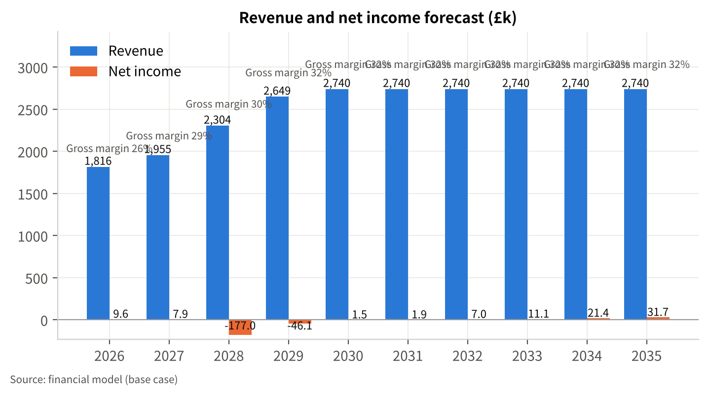
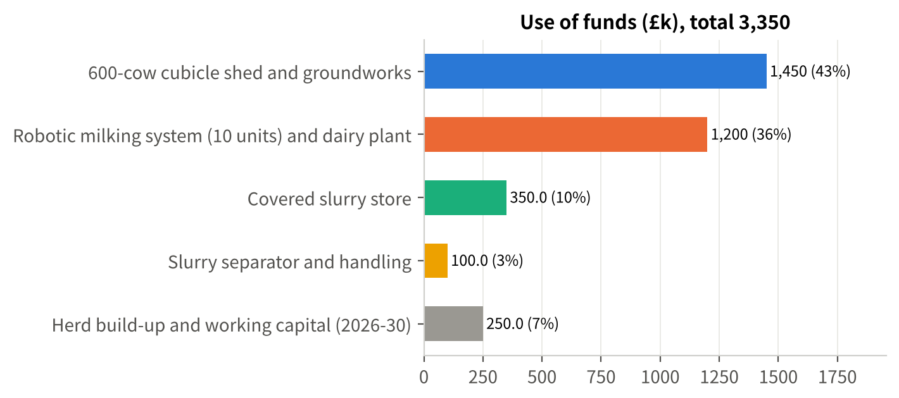
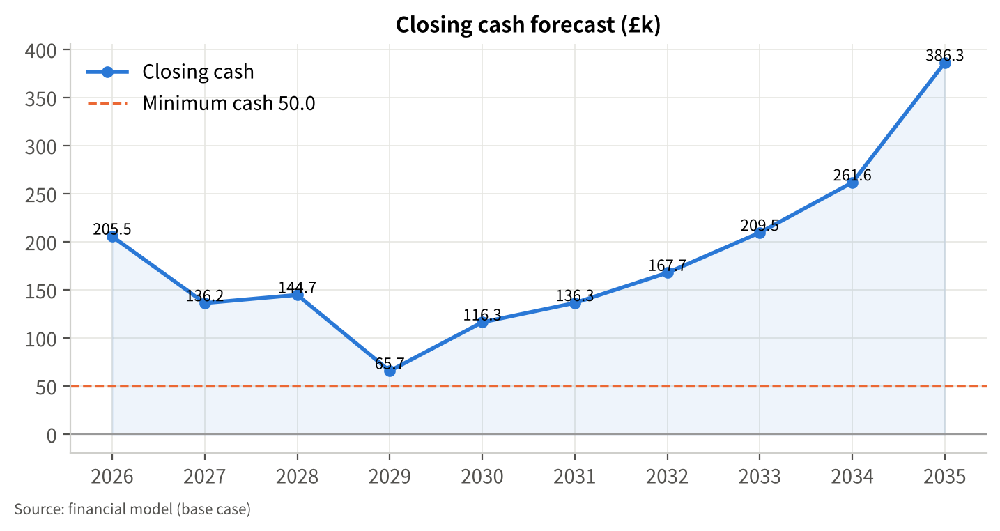
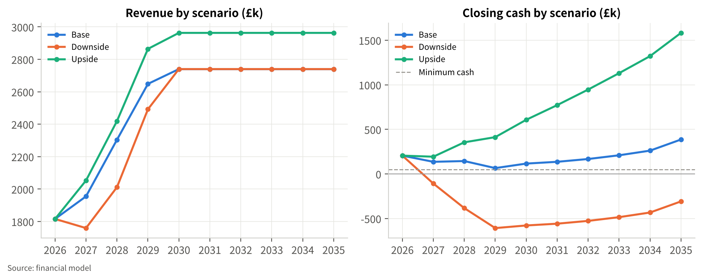
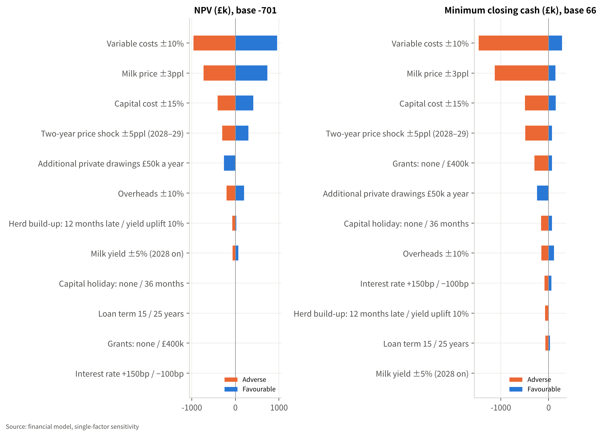
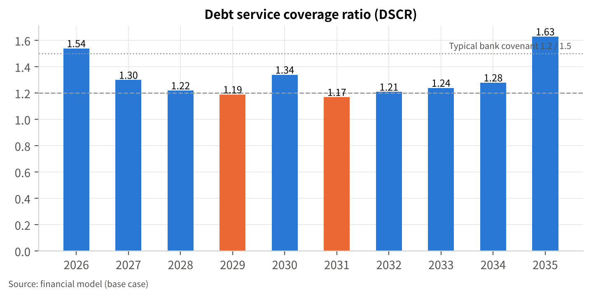
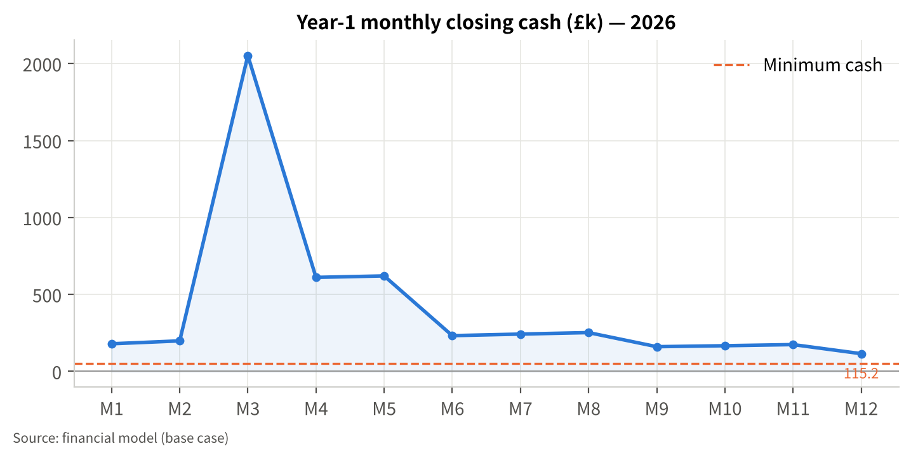

# 1 Executive Summary

**The request.** The partnership asks its bank for a **£2.2m term loan** [F-10] to build a 600-cow cubicle shed with robotic milking, a covered slurry store and a slurry separator, and to grow the milking herd from 440 to 600 cows. The total capital cost is c.£3.1m [F-09]. We recommend that the loan is structured over **20 years** with a **24-month capital repayment holiday**, drawn in two stages (£1.5m in 2027 for the shed and slurry infrastructure, £0.7m in early 2028 for the robots) [A-18], supported by a **£350k working capital facility** [A-21], **£300k of Defra capital grants** [A-19] and **£350k of partners' capital** [A-20]. The 15-year term first discussed does not service comfortably at a prudent milk price (section 12.6), so it is shown as an alternative rather than the base.

**How the loan is repaid.** Repayment comes from the milk cheque of a 600-cow herd averaging 9,600 litres a cow [A-04][A-05], priced at 40ppl in constant 2026 prices [A-03]. In the base case EBITDA rises from £155k in 2026 (a weak year, with the UK farmgate price 16% below 2025 [S-01]) to £439k in 2029 and £481k in 2030, against total debt service of £358k–£406k a year. The debt service coverage ratio (DSCR) is 1.22 in 2028, 1.19 in 2029, 1.34 in 2030, 1.17–1.28 in 2031–34 while the working capital facility is repaid, and 1.63 in 2035 once the existing 2019 loan is cleared. Closing cash never falls below £66k (2029), and borrowings fall from a peak of £2.87m at the end of 2028 (49.5% of total assets) to £1.34m by 2035.

**The honest caveats.** This is a long-term investment with thin margins in the first decade, and three things decide whether it works:

1. **Milk price.** At 5.76m litres, each 1ppl is worth £57.6k of EBITDA [E-05]. Debt service breaks even at 38.6ppl and the 1.25 DSCR a lender typically wants is reached at 40.3ppl [E-05]. A sustained 3ppl shortfall takes cumulative cash to −£1,064k; a two-year 5ppl shock in 2028–29 opens a £477k gap. The downside scenario — a repeat of the 2026 trough during construction — needs c.£657k of additional support, so the plan sets price and grant conditions that must be met before construction starts (section 10.2).
2. **Funding completeness.** The business balance sheet holds £190k of cash [F-06] and 2026 is weak, so c.£350k of the own-funds contribution must be introduced from outside the business [A-20][E-07]. Without grants the plan is £284k short; without the working capital facility it is short in 2029.
3. **Capital cost.** At £5,167 per cow place [E-04] for 600 places including robots and slurry infrastructure, the budget of £3.1m [F-09] is well below published all-in benchmarks of £7,500–10,000 per place [S-20]. Fixed-price quotes and a contingency are needed; a 15% overrun opens a £479k gap.

**Why do it at all.** Without the project the business earns EBITDA of c.£273k a year at 40ppl on 440 cows, covers its existing debt 1.54 times and accumulates cash — but it keeps a parlour and housing built for a 480-cow unit [F-06], relies on milking labour that is increasingly hard to recruit, and will still need six months of covered slurry storage. The project adds c.£195–208k of EBITDA a year [E-06], lifts output to 5.76m litres from a system designed to run for 20–25 years with the same three employed staff [A-25], and gives the next generation a unit that complies with slurry rules. On a strict ten-year incremental basis the return is low (incremental IRR c.0–1.5% with assets at written-down value [E-06]); the case rests on the longer asset life, the labour and compliance position, and a milk price at or above 40ppl.

Table 1 Key financial indicators (base case, £k, constant 2026 prices)

| Item | 2026 | 2027 | 2028 | 2029 | 2030 | 2032 | 2035 |
|---|---|---|---|---|---|---|---|
| Milk sold ('000 litres) | 3,916 | 4,050 | 4,770 | 5,546 | 5,760 | 5,760 | 5,760 |
| Revenue | 1,815.8 | 1,954.9 | 2,304.1 | 2,648.6 | 2,739.8 | 2,739.8 | 2,739.8 |
| EBITDA | 155.1 | 248.8 | 305.4 | 438.6 | 480.7 | 470.7 | 452.7 |
| Net income (after partners' tax) | 9.6 | 7.9 | -177.0 | -46.1 | 1.5 | 7.0 | 31.7 |
| Debt service (capital + interest) | 98.6 | 188.3 | 251.3 | 369.5 | 357.8 | 389.8 | 278.5 |
| DSCR | 1.54 | 1.30 | 1.22 | 1.19 | 1.34 | 1.21 | 1.63 |
| Closing cash | 205.5 | 136.2 | 144.7 | 65.7 | 116.3 | 167.7 | 386.3 |
| Borrowings (year-end) | 497.8 | 1,935.6 | 2,873.3 | 2,688.9 | 2,504.4 | 2,015.6 | 1,344.4 |

Source: financial model (chapter 11). Full statements in Appendix C.

**Key risks and responses** (chapter 13): milk price cycle — constant-price budgeting at 40ppl, conditions precedent on price and grants, £350k facility, cost flex worth c.£80k a year and an agreed option to extend the capital holiday; construction overrun — fixed-price contracts with contingency before drawdown; robot transition — yield budgeted at +7.9% against a 10% manufacturer guideline [S-10], phased build-up to 600 cows over two years.

<!-- pagebreak -->

# 2 The Business and the Project

## 2.1 The partnership

The business is a family partnership farming c.870 acres in North Yorkshire [F-08]. It milks 440 cows [F-05] through a parlour on a unit built for 480 cows [F-06], sells milk on a liquid contract to a processor [F-01], and sells beef-cross calves, cull cows and arable crops. Legal name, partners, roles and succession arrangements: `[to be provided — T-05]`. Land owned versus rented, and the most recent valuation: `[to be provided — T-04]`.

## 2.2 Trading record

The last two years were profitable and the balance sheet is conservatively geared (Table 2). Turnover grew from £1,860k to £2,040k [F-01] as cow numbers rose from 420 to 440 and yield from 8,650 to 8,900 litres [F-05]. Net profit before tax was £235k and £275k [F-04], after a family labour charge within overheads [F-03]. The milk price received is implied at c.42.0ppl in FY2024 and c.42.7ppl in FY2025 [E-01]. Cash cover of the existing loan is strong: FY2025 EBITDA of c.£413k [E-02] against debt service of c.£100k on the 2019 loan [F-07], a DSCR of about 4.1.

Table 2 Historical summary (£k) [F-01]–[F-07]

| Item | FY2024 | FY2025 | Note |
|---|---|---|---|
| Turnover | 1,860 | 2,040 | Milk c.82%; calves, cull cows and arable the rest |
| Cost of sales | 1,210 | 1,325 | Feed c.48%; contractors and vet included |
| Overheads | 415 | 440 | Labour (3 FTE + family), fuel, repairs, insurance, depreciation |
| Net profit before tax | 235 | 275 | Partnership; income tax paid personally |
| Cash at bank | 145 | 190 | |
| Trade debtors | 160 | 175 | Milk cheque paid monthly in arrears |
| Stock and growing crops | 520 | 560 | Livestock valuation, feed and forage |
| Fixed assets (net book value) | 2,450 | 2,380 | Parlour and buildings; land at cost |
| Trade creditors | 120 | 135 | |
| Bank loans | 620 | 560 | 2019 loan, base + 2.25%, c.9 years left |
| Partners' capital | 2,535 | 2,610 | |
| Milking cows | 420 | 440 | |
| Yield (litres per cow) | 8,650 | 8,900 | |

## 2.3 Why change now

Three pressures converge. First, the parlour and housing were sized for 480 cows [F-06]; further growth needs new housing. Second, milking labour: three employed staff plus family [F-03] milk 440 cows twice a day; robotic milking removes roughly 70–75% of routine milking labour [S-12] and lets the same team run 600 cows [A-25]. Third, slurry: covered storage with six months' capacity is the standard the Slurry Infrastructure Grant was designed to deliver [S-13] and is the direction of regulation for dairy farms in England. Current storage months: `[to be provided — T-08]`.

## 2.4 The project

- A 600-cow cubicle shed with groundworks, cubicles and mattresses, feed fence, ventilation, lighting, water and handling facilities — £1,450k [A-10].
- Ten robotic milking units with milk cooling, software and installation, sized at 60 cows per unit [S-10][S-11] — £1,200k [A-10].
- A covered slurry store with c.6 months' capacity for 600 cows, pumps and transfer — £350k [A-10].
- A slurry separator, gantry and stacking pad — £100k [A-10].
- Herd growth from 440 to 600 cows, mainly from home-bred heifers, carried in working capital (c.£250k) [A-15].

Construction is planned for 2027 with the robots commissioned in early 2028 and the herd reaching 600 cows during 2029 (chapter 10).

# 3 The System: Robotic Milking, Housing and Slurry Infrastructure

## 3.1 What changes for the cow and the team

Cows move from twice-daily parlour milking to voluntary milking in robot boxes, typically 2.7–3 times a day. Manufacturer guidance is to budget a 10% increase in yield, with users reporting 10–20% [S-10]; independent North American data put the gain at 3–5% for herds moving from a twice-a-day parlour [S-12]. This plan budgets +7.9% (8,900 to 9,600 litres) reached over three years [A-05]. Routine milking labour falls by about 70–75%, while management time on data, fetch cows and alarms rises [S-12].

## 3.2 Scale and specification

At 60 cows per unit [S-10], ten units cover 600 cows with modest headroom. Unit costs of £100–120k installed were reported in 2019 [S-11]; current UK quotes are needed `[T-03]`. Running costs are budgeted at c.£5–6k per unit a year for service and consumables [S-11][S-21], c.£3.1k per unit for electricity [S-10], rising with age [S-12]; net of the existing parlour's running costs this adds £40k a year in 2028, rising to £64k by 2035 [A-14].

## 3.3 Slurry infrastructure

A covered store removes rainwater from the storage volume and cuts ammonia loss; the separator reduces the liquid volume to store and spread, and produces a stackable solid usable as bedding or exported. Both were eligible items under the Slurry Infrastructure Grant specification [S-13]. Design capacity, Environment Agency notification and planning status: `[to be provided — T-03]`.

## 3.4 Comparison with alternatives considered

Table 3 Options considered

| Option | Capital cost | Comment | Source |
|---|---|---|---|
| New 600-cow shed + 10 robots + slurry (this plan) | c.£3,100k | Labour-sustainable; +7.9% yield budgeted; highest debt | [A-10] |
| New shed + new conventional parlour | not costed | Lower capital but keeps the milking labour requirement (c.2 FTE of milking time) | [S-10] |
| Scaled version: 520 cows, 8 robots | c.£2,660k | Lower exposure but DSCR no better (1.09) because EBITDA falls almost pro rata | [A-28], section 11.8 |
| Status quo: 440 cows, existing parlour | routine spend only | EBITDA c.£273k; still needs slurry storage and parlour renewal in time | [A-27], section 11.6 |

# 4 Market and Policy Environment

## 4.1 Milk price: where the cycle stands

The UK average farmgate price was 38.45ppl in September 2026, up 4.8% on August but 16% below September 2025 [S-01]. The 2026 trough was 33.99ppl in April (GB, −22% year on year) [S-02]; the 2025 peak was 46.56ppl in October 2025 [S-03], and December 2024 was 47.09ppl [S-06]. Processors held or raised prices in October 2026 (Müller +0.50ppl, Arla +0.89ppl, its sixth consecutive rise) [S-05]. AHDB expects prices to be "fairly stable" for around six months, with the outlook beyond that depending on global supply [S-04].

Supply is contracting: the GB milking herd was 1.57m head in July 2026, the lowest on record and 2.2% down on the year, and AHDB forecasts 2026/27 GB production of 12.74bn litres, −2.2% [S-04]. Producer numbers fell to c.6,850 in April 2026 (−2.7% in a year) while average output per farm rose to 1.90m litres [S-08]: fewer, larger farms.

Table 4 Reference points for the milk price assumption (ppl)

| Period | UK/GB average | Source |
|---|---|---|
| December 2024 | 47.09 | [S-06] |
| May 2025 | 43.12 | [S-03] |
| October 2025 (peak) | 46.56 | [S-03] |
| April 2026 (trough, GB) | 33.99 | [S-02] |
| June / July / August 2026 | 34.89 / 35.47 / 36.89 | [S-22] |
| September 2026 | 38.45 | [S-01] |
| **This plan: 2026 est. / 2027 / 2028 onwards** | **37.0 / 39.0 / 40.0** | [A-02][A-03] |

The base price of 40ppl from 2028 is close to today's price, below the 2023–25 average (c.42ppl, used as the upside) and above the 2026 trough. Annual averages for 2021–25 are to be verified against the Defra dataset `[to verify]`.

## 4.2 Costs and margins

Promar Milkminder herds averaged a milk price of 36.67ppl in August 2026 against 43.70ppl a year earlier, purchased feed of 11.27ppl at £298/t and a margin over purchased feed of 25.40ppl [S-09]. The milk-to-feed price ratio of 1.22 in July 2026 was below its five-year average of 1.30 [S-18]. The Dairy Group put the full economic cost of production, including family wages, at 48.5ppl for 2024/25 and 49.2ppl for 2025/26 [S-03]: at 2026 prices the average GB herd has been producing below full cost, which is why herd and producer numbers are falling.

## 4.3 Farm incomes

Dairy Farm Business Income in England averaged £224,500 in 2022/23, £71,000 in 2023/24 and £153,800 in 2024/25, with £224,000 forecast for 2025/26 [S-16][S-17]. The volatility — a threefold swing in two years — is the central fact for lenders to dairy and the reason this plan budgets at a constant 40ppl rather than the recent peak.

## 4.4 Grants and policy

The user has been told the project may be eligible for Defra capital grants for slurry infrastructure and productivity equipment of perhaps £300–400k [F-10]. The position at 2 November 2026 is:

- **Slurry Infrastructure Grant** (rounds 1–2, 2022–23): paid the lower of the reference-cost contribution or 50% of invoiced cost, £25k–£250k per business, for covered stores, separators and associated items, with six months' storage required [S-13]. No round was open at the date of this plan.
- **Improving Farm Productivity** (round 1 2022, round 2 closed 2024): 40% of eligible costs for robotic milking and other automation, minimum grant £35k [S-14]. Not currently open.
- **Farming Equipment and Technology Fund 2026**: closed in May 2026, capped at £25k per theme, and described as likely the last round under the current funding provision [S-15].
- Defra's £150m Capital Grants round (July 2025) includes slurry items at group caps of £25k, with a further round planned for 2026 [S-19].

The plan therefore treats £300k of grants in 2028 as an assumption to be evidenced [A-19], runs a "no grant" case (section 11.8) and makes a grant offer a condition precedent to drawdown (section 10.2).

## 4.5 Interest rates

Bank Rate is 3.75%, held in February 2026 (5–4) and again in September 2026 (6–3, with three members preferring a rise); the Bank expects CPI around 3.75% in the fourth quarter of 2026 [S-07]. The plan uses 6.25% for the term loan (Bank Rate plus a 2.5% margin) and 7.75% for the working capital facility [A-17], with sensitivities of +150bp and −100bp.

# 5 Competitive Position and Processor Relationship

A dairy farm does not compete for customers in the usual sense; it competes for a place in its processor's supply base and on cost per litre against other suppliers. Three points matter to the lender:

1. **Scale and efficiency.** At 440 cows and 3.92m litres the farm is already about twice the GB average output per producer of 1.90m litres [S-08]; at 600 cows and 5.76m litres it would be three times. Processors are consolidating their supply bases towards larger, consistent suppliers [S-08].
2. **Cost position.** The farm's FY2025 cost structure (cost of sales c.31.6ppl, cash overheads c.7.7ppl on 3.92m litres [E-03]) compares with a GB full economic cost of 48.5–49.2ppl including family wages, depreciation and finance [S-03]. Dilution of fixed costs over 5.76m litres is the main efficiency gain of the project (chapter 6).
3. **Contract.** The milk is sold on a liquid contract [F-01]; processor, contract type, price mechanism and notice period: `[to be provided — T-06]`. Liquid contracts in 2026 priced at 34.5–38.5ppl in the Scottish examples reported [S-02][S-03], consistent with the UK average.

Peer comparisons on yield (8,900 litres against a Promar average of 27.3 litres a day in milk [S-09]) suggest the herd is well managed; the robotic yield uplift is budgeted conservatively.

# 6 Business Model and Unit Economics

## 6.1 How the business earns

Revenue has three lines, modelled separately [A-02]–[A-12]: milk (84% of 2030 revenue), livestock sales of cull cows and beef-cross calves (12%), and arable and other income (3%). Milk is paid monthly in arrears (31 debtor days [F-06]); feed and services are paid in about 30 days; the livestock valuation (stock and growing crops) stands at about 154 days of cost of sales [A-15].

## 6.2 Per-litre economics

Table 5 Milk unit economics, base case (ppl unless stated) [A-03][A-07]

| Item | 2026 (440 cows, 8,900 l) | 2030 (600 cows, 9,600 l) | Basis |
|---|---|---|---|
| Milk price | 37.0 | 40.0 | [A-02][A-03] |
| Variable costs (feed, forage, vet, breeding, bedding, replacements) | 32.2 | 30.7 | £2,865 per cow plus 12p per marginal litre [A-07] |
| Margin after variable costs | 4.8 | 9.3 | |
| Cash overheads per litre (all enterprises) | 7.9 | 7.0 | £310.8k / £403.3k ÷ litres |
| Depreciation per litre | 2.7 | 5.3 | £105.4k / £305.9k |
| Interest per litre | 0.9 | 3.0 | £36.4k / £173.3k |

The project's economics are a trade: fixed costs per litre fall by about 0.9ppl and variable costs by 1.5ppl through yield dilution, while depreciation and interest add 4.7ppl. The business therefore needs the milk price to stay at or above 40ppl for the expanded unit to out-earn the existing one after financing costs (section 11.6).

## 6.3 Per-cow economics

Cost of sales per cow was c.£2,809 in FY2025 [E-03], held at £2,865 from 2026 [A-07]. Livestock sales are budgeted at £568 per cow a year [A-11], reflecting strong 2025 cull cow and calf values — a figure to confirm `[T-02]`. The family labour charge of £51.5k and the employed wage bill of £115.5k (3 FTE at £38.5k) [A-06][A-25] are fixed; at 600 cows labour costs c.£278 per cow against c.£380 today.

## 6.4 Operating leverage

Overheads rise from £310.8k (2026) to £391.3k (2028) and £431.3k (2035) [A-13][A-14], while revenue rises 51% to £2,739.8k. The EBITDA margin moves from 8.5% in 2026 to 17.5% in 2030. The flipside is that a 10% rise in variable costs (c.3ppl) removes £1,465k of cash over the forecast (section 11.8), so feed procurement and forage quality are the management levers that matter most after price.

# 7 Milk Marketing and Sales

The additional 1.84m litres a year are sold through the existing liquid contract [F-01]; volume terms, any growth cap and the notice period are `[to be provided — T-06]`. GB supply is forecast to fall 2.2% in 2026/27 [S-04], so additional, consistent volume from an established supplier is generally welcome to processors, but the partnership should confirm in writing that the contract accommodates 5.8m litres before construction begins (gate G2, chapter 10). Cull cows and calves are sold through the existing market and dealer channels; the arable area falls from 300 to 240 acres as land moves to forage [A-12].

# 8 Operations and Construction Plan

## 8.1 Site and buildings

The new shed is built alongside the existing 480-cow unit [F-06], which is retained for dry cows, transition cows and youngstock. Planning permission and any Environment Agency notification for the store: `[to be provided — T-03]`.

## 8.2 Herd build-up and yield

Table 6 Herd and output plan [A-04][A-05]

| Year | Average milking cows | Yield (litres/cow) | Milk sold ('000 litres) | Note |
|---|---|---|---|---|
| 2026 | 440 | 8,900 | 3,916 | Current system |
| 2027 | 455 | 8,900 | 4,050 | Heifers retained ahead of the move |
| 2028 | 530 | 9,000 | 4,770 | Robots commissioned Q1; transition year |
| 2029 | 590 | 9,400 | 5,546 | Herd approaches 600 |
| 2030 onwards | 600 | 9,600 | 5,760 | Steady state (+7.9% yield vs 2026) |

Heifers are mainly home-bred; a 440-cow herd using sexed semen can retain c.60 surplus heifers a year, so c.60 purchased animals may be needed to reach 600 by 2029 `[T-08]`. The livestock valuation rises from £560k to £783k by 2030 as a result [A-15].

## 8.3 Feeding, forage and arable

Variable costs are modelled per cow (£2,865) plus 12p of concentrate per marginal litre [A-07]. Of the 870 acres, 240 acres remain in cash crops from 2028 [A-12]; the rest grows grass and maize for the larger herd. Contractor forage costs are included in cost of sales [F-02].

## 8.4 Labour

Three employed FTE plus family labour run the unit before and after the project [A-25]: the robots remove the twice-daily milking routine, and the team's time shifts to cow flow, data and youngstock. At c.120 cows per labour unit this is within the normal range for robotic herds.

## 8.5 Capital programme

Table 7 Capital programme (£k) [A-10][A-16]

| Item | Amount | Timing | Life (years) | Grant-eligible under past schemes |
|---|---|---|---|---|
| 600-cow cubicle shed and groundworks | 1,450 | Apr–Dec 2027 | 25 | No |
| Robotic milking system (10 units), cooling, software | 1,200 | Jan–Feb 2028 | 12 | Yes — Improving Farm Productivity [S-14] |
| Covered slurry store | 350 | Jun–Sep 2027 | 20 | Yes — Slurry Infrastructure Grant [S-13] |
| Slurry separator and handling | 100 | Sep 2027 | 10 | Yes — Slurry Infrastructure Grant [S-13] |
| **Project total** | **3,100** | | | |
| Routine machinery and equipment replacement | 50 a year | 2026–35 | 8 | No |

No contingency is included in the £3.1m. Against published all-in costs of £7,500–10,000 per cow place for robotic units [S-20] the budget of £5,167 per place [E-04] looks tight; the partnership should obtain fixed-price quotes and hold a contingency of at least 5–10% before drawdown (gate G1).

## 8.6 Compliance, environment and animal health

The covered store and separator address storage capacity, ammonia and rainwater; nutrient management plans and spreading records follow. Bluetongue has spread across much of the west of Britain and AHDB assumes most dairy cattle are vaccinated [S-04]; the herd's vaccination and biosecurity protocols should be documented for the lender `[T-08]`.

# 9 Management and Labour

The partners and their roles, experience and succession plan are `[to be provided — T-05]`; nothing has been written here that the partnership has not supplied. The accounts show a business that has grown cows, yield and profit over two years while reducing debt [F-04]–[F-07], which is the track record a lender weighs most.

Labour plan: 3 employed FTE at £38.5k each including employer costs (£115.5k) throughout, plus a family labour charge of £51.5k [A-06][A-25]. One member of the team will need robot and data training before commissioning; the manufacturer's service contract and software are budgeted at £40k a year net from 2028 [A-14]. Advisers (vet, nutritionist, accountant, consultant): `[to be provided]`.

# 10 Implementation Plan, Milestones and Gates

Table 8 Milestones

| Stage | Timing | Deliverable / evidence of completion | Preconditions |
|---|---|---|---|
| Design, planning, grant applications | Nov 2026 – Mar 2027 | Planning consent; fixed-price quotes; grant application(s) lodged; bank offer letter | Partners' funds evidenced [T-09] |
| Gate G1/G2 (below) | Mar 2027 | Decision to proceed | Conditions met |
| Term loan tranche 1 drawn (£1.5m) | Mar 2027 onwards, against invoices | Shed and slurry works contracted | Gates passed |
| Shed, slurry store and separator built | Apr – Dec 2027 | Practical completion | Weather, contractor capacity |
| Robots installed; tranche 2 drawn (£0.7m) | Jan – Feb 2028 | Commissioning; cows trained | Shed complete |
| Grant claims paid (£300k) | 2028 | Receipt | Completion evidence |
| Herd at 530 average, then 590, then 600 | 2028 – 2030 | Monthly cow numbers and litres vs plan | Heifer supply |
| Capital repayments start | 2029 | DSCR reported to bank annually | Working capital facility in place from 2028 |

## 10.1 Critical path

Planning consent and fixed-price contracts gate everything else. Shed completion gates robot installation; robot commissioning gates the herd build-up. The working capital facility must be available before tranche 2 is drawn.

## 10.2 Decision gates (go / no-go)

- **G1 — Cost certainty.** Fixed-price quotes for all four capital items within £3.1m plus a contingency of 5–10%, or a revised funding plan agreed with the bank.
- **G2 — Market and grants.** Written processor confirmation that the contract accommodates 5.8m litres; grant offer letter(s) totalling at least £300k, or the "no grant" funding plan (section 12.5) agreed; UK average farmgate price (Defra) for the preceding six months at or above 38ppl and no announced cuts taking the farm's contract below 38ppl for the coming quarter.
- **G3 — Funds.** Partners' capital of £350k evidenced [A-20]; working capital facility of £350k agreed [A-21].

If G2 fails on price, construction is deferred by a year; the costs of deferral are limited to design and planning fees already spent.

## 10.3 Link to funding

Tranche 1 (£1.5m) funds the 2027 works; partners' capital (£350k) and 2026–27 cash flow fund the balance of 2027 spending. Tranche 2 (£0.7m) plus the working capital facility fund the robots and the herd build-up in 2028, bridged until the grants (£300k) are received [A-18]–[A-21].

<!-- pagebreak -->

# 11 Financial Plan

All figures are from the Excel financial model delivered with this plan, in thousands of pounds (£k) and constant 2026 prices: no inflation is applied to milk price or costs after 2026, on the basis that input and output inflation broadly offset over the long run; interest rates are nominal, which is conservative. 2026 is an estimate year (no management figures were supplied) [A-01][A-02]. Partners' income tax is modelled at 28% of taxable profit [A-09].

## 11.1 Key assumptions

Table 9 Key assumptions

| ID | Assumption | Value | Basis | Confidence |
|---|---|---|---|---|
| A-03 | Milk price | 37.0ppl 2026; 39.0ppl 2027; 40.0ppl 2028–35 | Defra Sept 2026 38.45ppl [S-01]; AHDB outlook [S-04] | Medium |
| A-04 | Average milking cows | 440 / 455 / 530 / 590 / 600 | Build-up plan | Medium |
| A-05 | Yield | 8,900 → 9,000 → 9,400 → 9,600 l/cow | +7.9% vs 10% guideline [S-10] | Medium |
| A-07 | Variable cost per cow | £2,865 + 12p per marginal litre | FY2025 accounts [F-02]; feed £298/t [S-09] | Medium |
| A-06, A-13 | Cash overheads | £310.8k (2026) → £391.3k (2028) → £431.3k (2035) | FY2025 split; robot running costs | Medium |
| A-14 | Robot service and consumables (net) | £40k (2028) → £64k (2035) | [S-11][S-21][S-12] | Medium |
| A-10 | Project capital cost | £3,100k, no contingency | User brief [F-09] | Low |
| A-16 | Replacement capex | £50k a year | Accounts trend | Medium |
| A-15 | Working capital | Debtors 31 days, stock 154 days, creditors 30 days | FY2025 balance sheet [F-06] | Medium |
| A-17, A-18 | Term loan | £2.2m, 6.25%, 20 years, 24-month capital holiday, two tranches | Bank Rate 3.75% [S-07] + 2.5% | Medium |
| A-21 | Working capital facility | £350k limit, £300k drawn 2028, 7.75%, repaid £60k a year 2031–35 | Model requirement | Medium |
| A-19 | Grants | £300k received 2028 | User brief [F-10]; scheme status [S-13]–[S-15] | Low |
| A-20 | Partners' capital introduced | £350k in 2027 | "Own funds" less business cash | Low |
| A-09 | Partners' tax | 28% of taxable profit; no capital allowances modelled | Blended estimate | Medium |
| A-22 | Depreciation | Existing assets 24 years; shed 25; robots 12 (10% residual); store 20; separator 10 | Accounts; asset lives | Medium |

## 11.2 Revenue

Revenue grows from £1,815.8k in 2026 to £2,739.8k from 2030, a compound 4.7% a year, almost entirely from milk volume: 3.92m litres becomes 5.76m. The 2026 estimate reflects the price fall to c.37ppl [A-02]; FY2025 turnover of £2,040k was earned at c.42.7ppl [F-01][E-01].

Table 10 Revenue by line (base case, £k)

| Item | 2026 | 2027 | 2028 | 2029 | 2030 | 2031 | 2032 | 2033 | 2034 | 2035 |
|---|---|---|---|---|---|---|---|---|---|---|
| Milk sales | 1,448.9 | 1,579.5 | 1,908.0 | 2,218.4 | 2,304.0 | 2,304.0 | 2,304.0 | 2,304.0 | 2,304.0 | 2,304.0 |
| Livestock sales (cull cows and calves) | 249.9 | 258.4 | 301.0 | 335.1 | 340.8 | 340.8 | 340.8 | 340.8 | 340.8 | 340.8 |
| Arable and other income | 117.0 | 117.0 | 95.0 | 95.0 | 95.0 | 95.0 | 95.0 | 95.0 | 95.0 | 95.0 |
| **Revenue** | **1,815.8** | **1,954.9** | **2,304.1** | **2,648.6** | **2,739.8** | **2,739.8** | **2,739.8** | **2,739.8** | **2,739.8** | **2,739.8** |

## 11.3 Costs, margins and profit

Cost of sales rises with cow numbers from £1,349.9k to £1,855.8k; the gross margin improves from 25.7% to 32.3% as yield dilutes per-cow costs and the price recovers from the 2026 low. Overheads rise from £310.8k to £403.3k by 2030 [A-13][A-14]. EBITDA therefore moves from £155.1k (2026) to £248.8k (2027), £305.4k (2028, transition year with full robot running costs but a herd still building), £438.6k (2029) and £480.7k (2030), easing to £452.7k by 2035 as robot service costs rise with age.

Depreciation nearly triples to £293.4k in 2028 as the shed and robots enter service, and interest peaks at £189.1k in 2028. The accounting result is a loss of £177.0k in 2028 and £46.1k in 2029, then small profits of £1.5k–£31.7k; cumulative net income over 2026–35 is −£131.1k. Taxable profit is nil from 2028 to 2035 under the model's loss carry-forward, before any Annual Investment Allowance [A-09]. The lender should read the plan on cash flow, not accounting profit: cumulative operating cash flow over the ten years is £2,361.8k.

Table 11 Income statement (base case, £k)

| Item | 2026 | 2027 | 2028 | 2029 | 2030 | 2031 | 2032 | 2033 | 2034 | 2035 |
|---|---|---|---|---|---|---|---|---|---|---|
| Revenue | 1,815.8 | 1,954.9 | 2,304.1 | 2,648.6 | 2,739.8 | 2,739.8 | 2,739.8 | 2,739.8 | 2,739.8 | 2,739.8 |
| Revenue growth | — | 7.7% | 17.9% | 15.0% | 3.4% | 0.0% | 0.0% | 0.0% | 0.0% | 0.0% |
| Cost of sales | 1,349.9 | 1,393.9 | 1,607.3 | 1,811.7 | 1,855.8 | 1,855.8 | 1,855.8 | 1,855.8 | 1,855.8 | 1,855.8 |
| **Gross profit** | 465.9 | 561.1 | 696.7 | 836.9 | 884.0 | 884.0 | 884.0 | 884.0 | 884.0 | 884.0 |
| Gross margin | 25.7% | 28.7% | 30.2% | 31.6% | 32.3% | 32.3% | 32.3% | 32.3% | 32.3% | 32.3% |
| Overheads (labour, power, repairs, robot service, insurance, admin) | 310.8 | 312.3 | 391.3 | 398.3 | 403.3 | 408.3 | 413.3 | 419.3 | 425.3 | 431.3 |
| **EBITDA** | 155.1 | 248.8 | 305.4 | 438.6 | 480.7 | 475.7 | 470.7 | 464.7 | 458.7 | 452.7 |
| EBITDA margin | 8.5% | 12.7% | 13.3% | 16.6% | 17.5% | 17.4% | 17.2% | 17.0% | 16.7% | 16.5% |
| Depreciation | 105.4 | 111.7 | 293.4 | 299.7 | 305.9 | 312.2 | 318.4 | 324.7 | 324.7 | 324.7 |
| EBIT | 49.7 | 137.1 | 12.0 | 138.9 | 174.8 | 163.5 | 152.3 | 140.0 | 134.0 | 128.0 |
| Interest expense | 36.4 | 126.1 | 189.1 | 185.0 | 173.3 | 161.7 | 145.3 | 129.0 | 112.7 | 96.3 |
| Profit before tax | 13.3 | 11.0 | -177.0 | -46.1 | 1.5 | 1.9 | 7.0 | 11.1 | 21.4 | 31.7 |
| Partners' income tax (modelled) | 3.7 | 3.1 | 0.0 | 0.0 | 0.0 | 0.0 | 0.0 | 0.0 | 0.0 | 0.0 |
| **Net income** | 9.6 | 7.9 | -177.0 | -46.1 | 1.5 | 1.9 | 7.0 | 11.1 | 21.4 | 31.7 |
| Net margin | 0.5% | 0.4% | -7.7% | -1.7% | 0.1% | 0.1% | 0.3% | 0.4% | 0.8% | 1.2% |

## 11.4 Investment and funding requirement

The project costs £3,100k [A-10]; routine machinery replacement adds £50k a year [A-16]; herd growth and higher debtors add c.£250k of working capital by 2030 [A-15]. Before any financing, the cumulative cash requirement peaks at £2,868.6k. Funding is described in chapter 12.

## 11.5 Cash flow and balance sheet

Operating cash flow is weak in the transition (£92.9k in 2027 and £20.7k in 2028, when interest, heifer retention and debtor growth absorb cash) and strong from 2030 (£285.1k rising to £356.9k). Closing cash falls to its lowest point of £65.7k at the end of 2029, the first year of capital repayments, and rebuilds to £386.3k by 2035 while the working capital facility is repaid. Borrowings peak at £2,873.3k at the end of 2028 (debt to assets 49.5%) and fall to £1,344.4k (32.9%) by 2035. The current ratio stays above 2.6 throughout.

Table 12 Cash flow statement (base case, £k)

| Item | 2026 | 2027 | 2028 | 2029 | 2030 | 2031 | 2032 | 2033 | 2034 | 2035 |
|---|---|---|---|---|---|---|---|---|---|---|
| Operating cash flow | 127.7 | 92.9 | 20.7 | 155.4 | 285.1 | 314.5 | 325.8 | 336.2 | 346.6 | 356.9 |
| Investing cash flow | -50.0 | -1,950.0 | -1,250.0 | -50.0 | -50.0 | -50.0 | -50.0 | -50.0 | -50.0 | -50.0 |
| Financing cash flow | -62.2 | 1,787.8 | 1,237.8 | -184.4 | -184.4 | -244.4 | -244.4 | -244.4 | -244.4 | -182.2 |
| Net change in cash | 15.5 | -69.3 | 8.5 | -79.0 | 50.6 | 20.0 | 31.4 | 41.8 | 52.1 | 124.7 |
| Opening cash | 190.0 | 205.5 | 136.2 | 144.7 | 65.7 | 116.3 | 136.3 | 167.7 | 209.5 | 261.6 |
| **Closing cash** | 205.5 | 136.2 | 144.7 | 65.7 | 116.3 | 136.3 | 167.7 | 209.5 | 261.6 | 386.3 |
| Unlevered free cash flow | 103.9 | -1,766.3 | -1,043.6 | 251.6 | 359.4 | 380.3 | 378.5 | 376.0 | 371.7 | 367.4 |

Table 13 Balance sheet (year-end, base case, £k)

| Item | 2026 | 2027 | 2028 | 2029 | 2030 | 2031 | 2032 | 2033 | 2034 | 2035 |
|---|---|---|---|---|---|---|---|---|---|---|
| Cash | 205.5 | 136.2 | 144.7 | 65.7 | 116.3 | 136.3 | 167.7 | 209.5 | 261.6 | 386.3 |
| Trade debtors | 154.2 | 166.0 | 195.7 | 224.9 | 232.7 | 232.7 | 232.7 | 232.7 | 232.7 | 232.7 |
| Stock and livestock valuation | 569.5 | 588.1 | 678.2 | 764.4 | 783.0 | 783.0 | 783.0 | 783.0 | 783.0 | 783.0 |
| Total current assets | 929.3 | 890.4 | 1,018.6 | 1,055.0 | 1,132.0 | 1,152.0 | 1,183.4 | 1,225.2 | 1,277.3 | 1,402.0 |
| Fixed assets, net | 2,324.6 | 2,262.9 | 5,119.5 | 4,869.8 | 4,613.9 | 4,351.8 | 4,083.3 | 3,808.7 | 3,534.0 | 3,259.3 |
| Assets under construction | 0.0 | 1,900.0 | 0.0 | 0.0 | 0.0 | 0.0 | 0.0 | 0.0 | 0.0 | 0.0 |
| **Total assets** | 3,253.9 | 5,053.3 | 6,138.1 | 5,924.9 | 5,745.9 | 5,503.8 | 5,266.7 | 5,033.9 | 4,811.3 | 4,661.3 |
| Trade creditors | 136.5 | 140.2 | 164.3 | 181.6 | 185.7 | 186.1 | 186.5 | 187.0 | 187.5 | 188.0 |
| Borrowings | 497.8 | 1,935.6 | 2,873.3 | 2,688.9 | 2,504.4 | 2,260.0 | 2,015.6 | 1,771.1 | 1,526.7 | 1,344.4 |
| Total liabilities | 634.3 | 2,075.8 | 3,037.6 | 2,870.5 | 2,690.1 | 2,446.1 | 2,202.1 | 1,958.1 | 1,714.2 | 1,532.4 |
| Partners' capital | 2,610.0 | 2,960.0 | 2,960.0 | 2,960.0 | 2,960.0 | 2,960.0 | 2,960.0 | 2,960.0 | 2,960.0 | 2,960.0 |
| Capital grants reserve | 0.0 | 0.0 | 300.0 | 300.0 | 300.0 | 300.0 | 300.0 | 300.0 | 300.0 | 300.0 |
| Retained profit | 9.6 | 17.5 | -159.5 | -205.7 | -204.2 | -202.3 | -195.3 | -184.3 | -162.9 | -131.1 |
| Total equity | 2,619.6 | 2,977.5 | 3,100.5 | 3,054.3 | 3,055.8 | 3,057.7 | 3,064.7 | 3,075.7 | 3,097.1 | 3,128.9 |
| **Total liabilities and equity** | 3,253.9 | 5,053.3 | 6,138.1 | 5,924.9 | 5,745.9 | 5,503.8 | 5,266.7 | 5,033.9 | 4,811.3 | 4,661.3 |
| Debt-to-asset ratio | 19.5% | 41.1% | 49.5% | 48.4% | 46.8% | 44.4% | 41.8% | 38.9% | 35.6% | 32.9% |
| Current ratio | 4.68 | 4.40 | 2.92 | 2.88 | 2.63 | 2.68 | 2.75 | 2.84 | 3.45 | 3.79 |

Land is carried at cost within fixed assets [F-06]; the balance sheet understates the partnership's net worth by the difference between cost and market value `[T-04]`. Grants are shown as a capital reserve; in the statutory accounts they would normally be released to profit over the life of the assets.

## 11.6 Key indicators for the lender, and the with/without comparison

Table 14 Lender indicators (base case)

| Indicator | 2027 | 2028 | 2029 | 2030 | 2031 | 2032 | 2033 | 2034 | 2035 |
|---|---|---|---|---|---|---|---|---|---|
| DSCR — (EBITDA − tax) ÷ (capital + interest) | 1.30 | 1.22 | 1.19 | 1.34 | 1.17 | 1.21 | 1.24 | 1.28 | 1.63 |
| Operating cash flow ÷ debt service | 0.49 | 0.08 | 0.42 | 0.80 | 0.77 | 0.84 | 0.90 | 0.97 | 1.28 |
| Interest cover (EBIT ÷ interest) | 1.09 | 0.06 | 0.75 | 1.01 | 1.01 | 1.05 | 1.09 | 1.19 | 1.33 |
| Debt to assets | 41.1% | 49.5% | 48.4% | 46.8% | 44.4% | 41.8% | 38.9% | 35.6% | 32.9% |
| Closing cash (£k) | 136.2 | 144.7 | 65.7 | 116.3 | 136.3 | 167.7 | 209.5 | 261.6 | 386.3 |

The operating-cash-flow ratio is below 1.0 until 2035 because operating cash flow is stated after interest and after the working capital absorbed by the growing herd; the EBITDA-based DSCR is the appropriate serviceability measure, and the lender's covenant definition should be agreed in advance.

**With and without the project.** The model was also run for the status quo (440 cows, existing parlour, routine machinery spend only) [A-27]. Without the project, EBITDA at 40ppl is c.£272.6k a year from 2028, the existing loan is covered 1.54 times and cash builds to c.£1,220k by 2035. The project adds £208.1k of EBITDA in 2030 (an average of £194.6k a year over 2030–35) and £275.3k of debt service in 2030 [E-06]. The cash yield on the £3.1m investment is 6.7% before grants and 7.4% after; over 2026–35, with the new assets taken at written-down value (£1,696.0k) plus recovered working capital (£230.5k) at the end of 2035, the incremental IRR is c.−0.1% before grants and 1.5% after, and the incremental NPV at a 6% discount rate is −£918.9k and −£651.9k respectively [E-06].

The comparison flatters the status quo: it ignores the covered slurry storage the farm will need to provide in any case and the eventual replacement of the parlour and housing, both of which would be charged to the status quo in a full comparison [A-27]. Nonetheless the lender should recognise what the numbers say: at 40ppl this is a long-life infrastructure investment that pays for itself slowly, and its serviceability depends on price (section 11.7).

## 11.7 Break-even

In steady state (2032) the business needs £389.8k a year for capital and interest. With EBITDA of £470.7k at 40ppl and £57.6k of EBITDA per ppl, debt service is just covered (DSCR 1.0) at 38.6ppl and the 1.25 level at 40.3ppl [E-05]. The model's accounting break-even revenue (fixed costs including depreciation and interest divided by the gross margin) is £2,735.3k in 2030, 99.8% of forecast revenue: the expanded business runs close to accounting break-even throughout, while generating cash because depreciation (c.£306k) is far larger than replacement spending (£50k).

## 11.8 Scenarios and sensitivities

**Scenarios.** The downside is a repeat of 2026 during construction and ramp-up: milk and livestock prices 10% below base in 2027–28 (c.35–36ppl) and 3% below in 2029, yields 3% below plan in 2028–29, variable costs +4% in 2027–28 and +2% in 2029, overheads +2% to 2029, all recovering from 2030 [A-24]. The upside is the 2023–25 price level (+5%, c.42ppl) with the full 10% robot yield gain from 2029 and 2% lower variable costs [A-24].

Table 15 Scenario comparison (£k)

| Metric | Base | Downside | Upside |
|---|---|---|---|
| Revenue 2035 | 2,739.8 | 2,739.8 | 2,963.1 |
| EBITDA 2028 | 305.4 | -0.8 | 448.7 |
| EBITDA 2030 | 480.7 | 480.7 | 682.2 |
| Cumulative net income 2026–35 | -131.1 | -825.2 | 1,091.3 |
| Minimum closing cash (year) | 65.7 (2029) | -607.0 (2029) | 193.5 (2027) |
| Funding gap against £50k cash floor | 0.0 | 657.0 | 0.0 |
| DSCR 2028 (interest-only year on the new loan) | 1.22 | 0.00 | 1.79 |
| Minimum DSCR, new-loan repayment years 2029–35 | 1.17 (2031) | 0.80 (2029) | 1.53 (2031) |
| DSCR 2030 | 1.34 | 1.34 | 1.75 |

In the downside EBITDA falls to £0.6k in 2027 and −£0.8k in 2028, cash turns negative in 2027 (−£107.5k) and reaches −£607.0k in 2029, and even after the recovery the shortfall is still −£307.8k at the end of 2035: the business cannot absorb a 2026-style trough during construction out of its own resources. This is why the plan makes the start of construction conditional on price (gate G2) and why the mitigation package in chapter 13 goes well beyond the £350k facility. The "downside with mitigations" variant — 36-month capital holiday, a £500k facility and reduced machinery spending — still leaves a £415.4k gap, so deferral is the primary response to a trough that arrives before construction, and additional partners' support or asset sales the response to one that arrives after it.

**Single-factor sensitivities.** Table 16 shows the effect of moving one assumption at a time, with the resulting minimum cash, funding gap against the £50k floor and minimum DSCR in a repayment year.

Table 16 Sensitivity analysis (single factor, £k); change vs base in brackets

| Case | Cumulative net income | Minimum closing cash | Funding gap | Min. operating DSCR |
|---|---|---|---|---|
| Base | -131.1 | 65.7 | 0.0 | 1.17 |
| Milk price −3ppl (2027 on) | -1,595.8 (−1,464.7) | -1,063.8 (−1,129.5) | 1,113.8 (+1,113.8) | 0.65 |
| Milk price +3ppl (2027 on) | 967.3 (+1,098.4) | 205.5 (+139.8) | 0.0 (+0.0) | 1.48 |
| Milk price −5ppl in 2028–29, then base | -646.9 (−515.8) | -426.6 (−492.2) | 476.6 (+476.6) | 0.27 |
| Milk price +5ppl in 2028–29, then base | 281.9 (+413.0) | 136.2 (+70.5) | 0.0 (+0.0) | 1.17 |
| Milk yield 5% below plan (2028 on) | -335.2 (−204.1) | 60.7 (−5.0) | 0.0 (+0.0) | 1.11 |
| Milk yield 5% above plan (2028 on) | 57.4 (+188.5) | 70.7 (+5.0) | 0.0 (+0.0) | 1.24 |
| Variable costs +10% (all years) | -1,854.1 (−1,723.0) | -1,399.8 (−1,465.5) | 1,449.8 (+1,449.8) | 0.20 |
| Variable costs −10% (all years) | 1,155.9 (+1,287.1) | 348.6 (+282.9) | 0.0 (+0.0) | 1.50 |
| Overheads +10% (all years) | -515.7 (−384.5) | -86.0 (−151.7) | 136.0 (+136.0) | 1.06 |
| Overheads −10% (all years) | 192.3 (+323.4) | 178.5 (+112.8) | 0.0 (+0.0) | 1.27 |
| Capital cost +15% (c.£465k overrun) | -389.7 (−258.6) | -428.5 (−494.2) | 478.5 (+478.5) | 1.17 |
| Capital cost −15% | 97.2 (+228.3) | 212.7 (+147.1) | 0.0 (+0.0) | 1.17 |
| Interest rate +150bp on new term loan | -376.0 (−244.9) | -19.7 (−85.4) | 69.7 (+69.7) | 1.07 |
| Interest rate −100bp on new term loan | 29.5 (+160.7) | 120.5 (+54.8) | 0.0 (+0.0) | 1.23 |
| Grants not received | -131.1 (+0.0) | -234.3 (−300.0) | 284.3 (+284.3) | 1.17 |
| Grants at £400k (upper end indicated) | -131.1 (+0.0) | 136.2 (+70.5) | 0.0 (+0.0) | 1.17 |
| 15-year term as first proposed | -69.4 (+61.7) | -2.7 (−68.4) | 52.7 (+52.7) | 1.05 |
| 25-year term | -166.0 (−34.9) | 92.3 (+26.6) | 0.0 (+0.0) | 1.22 |
| No capital repayment holiday | -58.3 (+72.8) | -94.4 (−160.1) | 144.4 (+144.4) | 0.85 |
| 36-month capital repayment holiday | -170.2 (−39.1) | 136.2 (+70.5) | 0.0 (+0.0) | 1.13 |
| Herd build-up delayed 12 months | -277.7 (−146.6) | -10.2 (−75.9) | 60.2 (+60.2) | 0.99 |
| Robot yield uplift reaches 10% (9,790 l/cow from 2030) | -62.4 (+68.7) | 62.7 (−3.0) | 0.0 (+0.0) | 1.20 |
| Additional private drawings £50k a year | -624.3 (−493.2) | -179.6 (−245.3) | 229.6 (+229.6) | 1.02 |
| Variant: No project (status quo) | 771.0 (+902.1) | 205.5 (+139.8) | 0.0 (+0.0) | 1.54 |
| Variant: Scaled 520-cow / 8-robot option | -361.0 (−229.9) | 145.2 (+79.5) | 0.0 (+0.0) | 1.09 |
| Variant: Downside with mitigations | -923.0 (−791.8) | -365.4 (−431.1) | 415.4 (+415.4) | 0.01 |

Reading the table: price and variable costs dominate; capital cost overrun and the grant outcome are the next largest; the loan structure (term, holiday) changes serviceability materially but not the underlying economics. The scaled option reduces exposure but not the DSCR, because EBITDA falls almost in proportion to the debt. Additional private drawings of £50k a year would take the DSCR to 1.02 — the partners' drawings assumption [A-08] is one the bank will want to test.

## 11.9 Link to the historical accounts

The FY2025 accounts [F-01]–[F-04] reconcile to the model's starting point as follows: turnover £2,040k at c.42.7ppl [E-01]; cost of sales £1,325k (c.£2,809 per cow [E-03]); cash overheads c.£302k after removing depreciation (c.£100k) and interest (c.£38k) from reported overheads of £440k [A-06]; EBITDA c.£413k [E-02]; profit before tax £275k. The 2026 estimate (EBITDA £155.1k) differs from FY2025 almost entirely because of the milk price (37.0ppl against 42.7ppl). The opening balance sheet is taken directly from the FY2025 year-end figures and balances [F-06].

<!-- pagebreak -->

# 12 Loan Proposal and Debt Service Analysis

## 12.1 Facilities requested

Table 17 Facilities requested [A-17][A-18][A-21]

| Facility | Amount | Term | Pricing (assumed) | Drawdown | Repayment |
|---|---|---|---|---|---|
| Term loan — tranche 1 (shed, slurry store, separator) | £1,500k | 20 years | Bank Rate + 2.5% (6.25%) | 2027, against invoices | Interest only 2027–28; 18 equal capital instalments 2029–46 |
| Term loan — tranche 2 (robotic milking system) | £700k | to 2046 (co-terminus) | Bank Rate + 2.5% (6.25%) | Jan–Feb 2028 | Interest only 2028; capital 2029–46 |
| Working capital facility (overdraft / revolving) | £350k limit | Annual review | Bank Rate + 4% (7.75%) | £300k drawn 2028 | Reduced by £60k a year 2031–35 from surplus cash |
| Existing 2019 loan | £560k balance | c.9 years remaining | Base + 2.25% (6.5%) [F-07] | drawn | c.£62k capital a year to 2034 |

## 12.2 Sources and uses of funds

Table 18 Sources and uses, 2026–30 (£k)

| Uses | £k | Sources | £k |
|---|---|---|---|
| 600-cow cubicle shed and groundworks | 1,450 | Term loan tranche 1 | 1,500 |
| Robotic milking system (10 units) and dairy plant | 1,200 | Term loan tranche 2 | 700 |
| Covered slurry store | 350 | Defra capital grants (2028) [A-19] | 300 |
| Slurry separator and handling | 100 | Partners' capital introduced (2027) [A-20] | 350 |
| Herd build-up and working capital | 250 | Working capital facility, drawn | 300 |
| | | Business cash and retained cash flow [E-07] | 200 |
| **Total uses** | **3,350** | **Total sources** | **3,350** |

Routine machinery replacement (£50k a year) is funded from cash flow and excluded from the table. The debt-funded share of the project cost is 71% (£2.2m of £3.1m); including the working capital facility, peak borrowings reach £2,873.3k at the end of 2028, equivalent to c.£4,800 per cow [E-08], falling to £1,344.4k by 2035.

## 12.3 Repayment source and cover

Repayment comes entirely from operating cash flow of the dairy business; no asset sales, refinancing or further grants are assumed. Table 19 sets out the debt service profile.

Table 19 Debt and debt service (base case, £k)

| Item | 2026 | 2027 | 2028 | 2029 | 2030 | 2031 | 2032 | 2033 | 2034 | 2035 |
|---|---|---|---|---|---|---|---|---|---|---|
| Loan drawdown | 0.0 | 1,500.0 | 1,000.0 | 0.0 | 0.0 | 0.0 | 0.0 | 0.0 | 0.0 | 0.0 |
| Capital repaid | 62.2 | 62.2 | 62.2 | 184.4 | 184.4 | 244.4 | 244.4 | 244.4 | 244.4 | 182.2 |
| Interest | 36.4 | 126.1 | 189.1 | 185.0 | 173.3 | 161.7 | 145.3 | 129.0 | 112.7 | 96.3 |
| **Debt service** | 98.6 | 188.3 | 251.3 | 369.5 | 357.8 | 406.1 | 389.8 | 373.4 | 357.1 | 278.5 |
| Borrowings (year-end) | 497.8 | 1,935.6 | 2,873.3 | 2,688.9 | 2,504.4 | 2,260.0 | 2,015.6 | 1,771.1 | 1,526.7 | 1,344.4 |
| EBITDA | 155.1 | 248.8 | 305.4 | 438.6 | 480.7 | 475.7 | 470.7 | 464.7 | 458.7 | 452.7 |
| **DSCR** | 1.54 | 1.30 | 1.22 | 1.19 | 1.34 | 1.17 | 1.21 | 1.24 | 1.28 | 1.63 |

The 2028 drawdown of £1,000.0k comprises tranche 2 (£700k) and the working capital facility (£300k). Capital repayments of £184.4k in 2029–30 comprise £122.2k on the new term loan and £62.2k on the 2019 loan; from 2031 the £60k facility reduction is added, and from 2035 the 2019 loan is repaid, which is why the DSCR rises to 1.63. The DSCR is below 1.2 in 2029 (1.19) and 2031 (1.17); if the bank's covenant is 1.25, the partners propose an annual test with a one-year cure period and the cost-flex measures in chapter 13. After 2035 the remaining balance of £1,344.4k amortises at £122.2k a year to 2046 with falling interest, so coverage continues to improve.

## 12.4 Liquidity through construction

The lender's first question after serviceability is whether the business stays liquid during the build. Table 20 shows the modelled month-end cash in 2027, the drawdown year, with tranche 1 drawn in March and the shed, store and separator paid in April, June and September; the lowest month-end balance is £115.2k in December 2027. The annual statements show £136.2k at the end of 2027; the difference (−£21.1k) arises because the monthly schedule uses whole-month payment lags rather than year-end debtor and creditor days, and the annual figures are the formal basis.

Table 20 2027 monthly cash (indicative, £k)

| Item | Jan | Feb | Mar | Apr | May | Jun | Jul | Aug | Sep | Oct | Nov | Dec |
|---|---|---|---|---|---|---|---|---|---|---|---|---|
| Net cash flow | -26.0 | 18.9 | 1,853.4 | -1,440.9 | 9.6 | -388.1 | 10.2 | 9.6 | -91.5 | 6.2 | 7.4 | -59.0 |
| Month-end cash | 179.5 | 198.3 | 2,051.8 | 610.8 | 620.5 | 232.3 | 242.5 | 252.1 | 160.6 | 166.8 | 174.2 | 115.2 |

In practice tranche 1 would be drawn against certified invoices rather than in March, which lowers 2027 interest below the £126.1k modelled. The tighter point is 2028–29: robots (£1,200k) are paid in early 2028 before the grants arrive, and the herd absorbs working capital, so the £350k facility must be in place before tranche 2 is drawn. Minimum year-end cash is £65.7k at the end of 2029, plus £50k of undrawn facility headroom [A-23].

## 12.5 Grants and the bridging of claims

Grants are paid after completion on receipted claims. The plan assumes £300k received during 2028 [A-19]. If no grant is received, closing cash falls to −£234.3k at its lowest and the plan is £284.3k short against the cash floor (Table 16). The "no grant" funding plan is therefore: increase the working capital facility to £500k, or increase tranche 2 to £900k, or raise an additional £300k of partners' capital — to be agreed before gate G2. The DSCR is unchanged in the year of impact because the grant is a capital receipt; the cost is the extra interest and slower deleveraging.

## 12.6 Why 20 years rather than 15

On the 15-year term first discussed, with the same 24-month holiday, capital instalments would be £169.2k a year rather than £122.2k. The DSCR would fall to 1.05 in 2029 and cash to −£2.7k, a £52.7k shortfall against the floor (Table 16). The 20-year term costs more interest over the life of the loan but holds the DSCR above 1.17 and keeps cash positive; a 25-year term would lift the minimum DSCR to 1.22. The partnership's land ownership [F-08] makes a long-dated agricultural mortgage the natural product, and the shed has a 25-year life [A-22]. One consequence should be planned for: the robots have a 12-year life [A-22] and will need replacing around 2040, before the loan matures in 2046, so the partnership should build a replacement reserve from the cash surpluses shown after 2032 or expect to use asset finance at that point.

## 12.7 Security and covenants

Security offered: first legal charge over the farm land and buildings (c.870 acres owned [F-08]; acreage, title and valuation `[to be provided — T-04]`) and a debenture or agricultural charge over livestock and equipment `[to be confirmed]`. The existing lender's charge for the 2019 loan [F-07] would be consolidated or ranked as agreed. Proposed covenants: DSCR tested annually on audited or accountant-certified accounts; delivery of a quarterly management report (cows, litres, price, cash) during 2027–29; capital holiday extension available for 12 months if the Defra average price falls below 36ppl for two consecutive quarters (chapter 13).

## 12.8 Conditions the partners accept

Before drawdown: fixed-price contracts and contingency (G1); processor confirmation, grant offer or agreed alternative, and the price condition (G2); evidence of £350k of partners' capital and the working capital facility (G3). During construction: drawdown against invoices certified by the project adviser.

<!-- pagebreak -->

# 13 Risk Analysis and Mitigation

Table 21 Risk matrix

| ID | Risk | Category | Likelihood | Impact | Mitigation | Trigger indicator | Owner |
|---|---|---|---|---|---|---|---|
| R-01 | Milk price trough (2026 fell 16% y/y [S-01]) during construction or early repayment years | Market | High (cyclical) | Severe — each 1ppl = £57.6k EBITDA; −3ppl sustained = £1,114k gap | Constant-price budget at 40ppl; gate G2 price condition; £350k facility; cost flex c.£80k a year (concentrate rate, contractor timing, machinery deferral); agreed 12-month capital-holiday extension; sale of surplus heifers/beef calves | Defra average below 38ppl for a quarter; contract price cut announcements | Partners / bank |
| R-02 | Feed and input cost inflation (concentrate £298/t [S-09]; milk-to-feed ratio 1.22 [S-18]) | Cost | Medium | High — variable costs +10% = £1,450k gap | Forward-buy feed in tranches; maximise home-grown forage (maize/grass on 630 acres); nutritionist review quarterly | Milk-to-feed ratio below 1.2 | Partners |
| R-03 | Capital cost overrun or delay (budget £5,167 per place vs £7,500–10,000 benchmark [S-20][E-04]) | Construction | Medium–High | High — +15% = £479k gap | Fixed-price contracts, 5–10% contingency, staged payments against certification; standard shed design | Quotes above £3.1m; programme slippage > 2 months | Partners / adviser |
| R-04 | Robot transition: yield dip, cow adaptation, culling of unsuitable cows | Operational | Medium | Medium — yield −5% = DSCR 1.11 | Phased herd build-up; manufacturer start-up support; train staff before commissioning; budget +7.9% not +10% | Daily litres per cow below plan for 2 months; visits per cow below 2.5 | Herd manager |
| R-05 | Grants not awarded or delayed (schemes closed at Nov 2026 [S-13]–[S-15]) | Funding | Medium–High | Medium — £284k gap | Gate G2 grant condition; alternative funding plan agreed in advance (section 12.5) | No grant offer by Mar 2027 | Partners / bank |
| R-06 | Own funds not available in full | Funding | Medium | High | Proof of funds before drawdown (G3); reduce scope or defer | — | Partners |
| R-07 | Interest rates rise (MPC split, inflation c.3.75% [S-07]) | Financial | Medium | Medium — +150bp = DSCR 1.07, £70k gap | Fix or cap the rate on tranche 1 for 5–10 years if offered; deleveraging from 2029 | Bank Rate above 4.5% | Partners / bank |
| R-08 | Animal health (bluetongue, TB, lameness in a larger herd) | Operational | Medium | Medium | Vaccination (AHDB assumes most dairy cattle vaccinated [S-04]); biosecurity for purchased heifers; cubicle comfort and foot-bathing in the new shed | Disease incidence, cell counts, mobility scores | Vet / herd manager |
| R-09 | Labour: loss of a key team member; robot skills | People | Medium | Medium | Cross-train two people on robots; manufacturer service contract; family labour depth | Vacancy > 3 months | Partners |
| R-10 | Processor contract change or volume cap | Market | Low–Medium | High | Written confirmation of volume (G2); maintain milk quality metrics; alternative buyers mapped | Contract notice; volume management schemes | Partners |
| R-11 | Private drawings or tax higher than modelled (drawings assumed within the £51.5k family labour charge [A-08]; tax 28% [A-09]) | Financial | Medium | Medium — +£50k drawings = DSCR 1.02 | Agree a drawings budget with the bank; use capital allowances (AIA) to reduce tax in 2027–29 | Drawings above budget | Partners / accountant |
| R-12 | Regulatory: slurry storage, nutrient rules, planning conditions | Compliance | Low | Medium | Covered store and separator deliver six months' storage [S-13]; nutrient management plan | EA inspection findings | Partners |

## 13.1 How the scenarios map to the risks

The downside scenario combines R-01, R-02 and R-04 occurring together in 2027–29 [A-24]. Its result — a funding gap of £657.0k — is larger than any single mitigation, which is the reason for two structural decisions in this plan: the price and grant conditions at gate G2 before construction starts, and the request for a 24-month capital holiday with an agreed extension option. Table 22 quantifies the mitigation package available once construction has started.

Table 22 Mitigation package if a trough arrives after construction starts (£k, indicative)

| Measure | Cash effect | Basis |
|---|---|---|
| Capital holiday extended by 12 months | +184.4 in the year applied | 2029 capital instalments (Table 19) |
| Working capital facility increased from £350k to £500k | +150 | Section 12.5 |
| Defer machinery replacement to £25k in two years | +50 | [A-16] |
| Cost flex: concentrate rate, contractor timing, discretionary repairs | c.+80 a year | c.3% of variable costs plus 10% of discretionary overheads |
| Sell surplus heifers and beef calves rather than retain | +50–100 | Herd plan [A-04] |
| **Indicative total** | **c.500–570** | Against a downside gap of 657.0 |

The remainder would come from the partners (further capital or deferral of drawings) or, as a last resort, land sale — which the security position makes possible but which the partners regard as the outcome to avoid. The "downside with mitigations" model run (Table 16) confirms that holiday extension, a £500k facility and machinery deferral alone still leave a £415.4k gap; the cost-flex and livestock measures narrow it further but are not modelled line by line.

## 13.2 Early-warning dashboard

Quarterly report to the bank during 2027–29: cows in milk, litres sold, price received, variable cost per litre, cash and facility headroom, capital programme spend against budget, and the Defra average price. Amber: price below 38ppl or litres 5% below plan for a quarter; red: price below 36ppl for two quarters or cash headroom below £50k, triggering the holiday extension and the mitigation package.

# 14 Environmental and Social Considerations

The covered slurry store and separator reduce ammonia emissions and rainwater entering storage and give six months' storage, the standard adopted by the Slurry Infrastructure Grant [S-13]; separated solids reduce the liquid volume to spread and can replace bought-in bedding. Higher yield per cow lowers emissions per litre, and robotic milking improves working conditions and hours for the team. The expansion secures three jobs and the family's livelihood in a sector that lost c.190 producers in the year to April 2026 [S-08]. Quantified emissions or nutrient balances have not been calculated `[to be provided if the lender's ESG questionnaire requires them]`.

<!-- pagebreak -->

# Appendix A Register of facts, assumptions and open items (summary)

The full register (`North-Yorkshire-Dairy-Expansion-Assumptions-and-Evidence-Register-2026-11.md`) lists 22 facts, 29 assumptions, 8 inferences, 10 items to be provided and 22 sources, each with grade, confidence and the model field it drives. The assumptions with the largest effect on the conclusions are:

| ID | Assumption | Value | Effect if wrong |
|---|---|---|---|
| A-03 | Milk price from 2028 | 40.0ppl | ±3ppl: cumulative net income +£1,098k / −£1,465k; −3ppl opens a £1,114k gap |
| A-07 | Variable cost per cow / per litre | £2,865 per cow (30.7–32.2ppl) | ±10%: ±£959k of NPV; +10% opens a £1,450k gap |
| A-10 | Capital cost | £3,100k, no contingency | +15% opens a £479k gap |
| A-19 | Grants | £300k in 2028 | None: £284k gap |
| A-20 | Partners' capital | £350k in 2027 | Shortfall must be borrowed or the project deferred |
| A-18 | Loan term | 20 years | 15 years: DSCR 1.05 and negative cash in 2029 |
| A-08 | Private drawings within family labour charge | £51.5k | +£50k a year: DSCR 1.02, £230k gap |
| A-05 | Yield on robots | 9,600 l/cow by 2030 | −5%: DSCR 1.11 |
| A-01 | Year-end and 2026 estimate | Calendar year; 37.0ppl | Changes the opening position and own-funds availability |

# Appendix B Sources

- [S-01] Defra, *United Kingdom milk prices and composition of milk — statistics notice, data for September 2026*, 29 Oct 2026, gov.uk (accessed 2 Nov 2026): UK average 38.45ppl, +4.8% m/m, −16% y/y.
- [S-02] SAC Consulting / Farm Advisory Service, *Business and Policy June 2026 – Milk*, 1 Jun 2026, fas.scot: Defra GB April 2026 33.99ppl (−22% y/y); processor prices; GB 2025/26 production 13.02bn litres.
- [S-03] SAC Consulting / FAS, *Business and Policy January 2026 – Milk*, Jan 2026, fas.scot: Defra 43.12ppl (May 2025), 46.56ppl (Oct 2025); The Dairy Group cost of production 48.5ppl (2024/25), 49.2ppl (2025/26 forecast).
- [S-04] AHDB, *Dairy October 2026 forecast update: GB milk production under pressure*, 14 Oct 2026.
- [S-05] AHDB, *Q3 2026 dairy market review*, 22 Oct 2026.
- [S-06] SAC Consulting / FAS, *Agribusiness News February 2025 – Milk*, 31 Jan 2025: Defra December 2024 47.09ppl.
- [S-07] Bank of England Monetary Policy Committee decisions of 5 Feb 2026 and 17 Sep 2026, as reported by GB News (5 Feb 2026) and MTS Insights (17 Sep 2026): Bank Rate 3.75%.
- [S-08] AHDB, *GB producer numbers: declining due to a difficult year*, 11 Jun 2026.
- [S-09] AHDB / Promar, *Promar Milkminder dairy costings*, August 2026 data, updated 20 Oct 2026.
- [S-10] Lely Center Midlands, *What's the cost of milking with a robot?*, figures dated Feb 2022.
- [S-11] Farmers Weekly, *A dairy farmer's guide to switching to robotic milking*, 21 Jun 2019.
- [S-12] The Bullvine, *Dairy Technology 2026: Robotics, Sensors, AI and Real-World ROI*, 6 May 2026 (citing USDA ERR-356 and Iowa State University Extension).
- [S-13] Defra / RPA, *Slurry Infrastructure Grant round 2 — applicant guidance*, gov.uk; Farmers Weekly, *New round of Slurry Infrastructure Grant widens options*, 27 Oct 2023.
- [S-14] FarmingUK, *Farmers urged to apply to Improving Farm Productivity grant*, 10 Jan 2022; Defra / RPA, *Improving Farm Productivity grant round 2 applicant guidance*, gov.uk.
- [S-15] Defra / RPA, *Farming Equipment and Technology Fund (FETF) 2026*, gov.uk; Farmers Guardian, *Defra's FETF 2026 opens: how farmers can access up to £75,000 in equipment grants*, 17 Mar 2026.
- [S-16] Defra, *Forecasts of Farm Business Income by type of farm, England 2025/26*, 12 Mar 2026 (updated 8 Sep 2026).
- [S-17] Defra, *Agriculture in the United Kingdom 2024 — Chapter 3: Farming income*, 10 Jul 2025.
- [S-18] AHDB, *Milk to feed price ratio*, updated 6 Oct 2026.
- [S-19] Defra / RPA press release, *£150m Capital Grants offer returns to help farmers boost profits*, 3 Jul 2025.
- [S-20] Farmers Weekly, *What's in Your Livestock Shed? visits a £1.36m robotic dairy*, 11 Oct 2018.
- [S-21] Irish Farmers Journal, *Robot wars: what can farmers expect to pay for service costs*, 7 Aug 2024.
- [S-22] AHDB, *UK farmgate milk prices*, updated 2 Oct 2026.

Links and the figures extracted from each source are in section 5 of the register.

# Appendix C Financial statements and model notes

Tables 11, 12, 13 and 19 are the full annual income statement, cash flow statement, balance sheet and debt schedule from the model; Table 15 and the model's scenario sheet give the three scenarios; Table 16 the sensitivities. The Excel model (`North-Yorkshire-Dairy-Expansion-Financial-Model-2026-11.xlsx`) contains the assumptions sheet (blue cells are inputs), revenue, overheads, capital expenditure and depreciation, financing, the three statements, indicators, the scenario comparison, the 2027 monthly cash schedule and a source log; changing an input recalculates the model.

Model conventions and limitations: annual periods with year-end timing of interest and receipts; equal capital instalments; constant 2026 prices; partners' tax at 28% of taxable profit with indefinite loss carry-forward and no capital allowances; straight-line depreciation; working capital from day-count ratios; grants as a capital reserve; no terminal value and no land revaluation. The model is unaudited and the plan is a draft for the partners' review; it is not a guarantee of future performance or of lending.

# Appendix D Information to be provided before submission

| Ref | Item | Where it is used |
|---|---|---|
| T-01 | Financial year-end; 2026 trading to date | 2026 column; opening cash |
| T-02 | Cost and income splits for FY2025; depreciation and interest | Chapters 6, 11 |
| T-03 | Fixed-price quotes; planning and EA status; contingency | Chapters 8, 10, 12 |
| T-04 | Land owned/rented; valuation; charges | Chapter 12.7 |
| T-05 | Partnership name, partners, roles, drawings, succession | Chapters 2, 9, 13 |
| T-06 | Milk contract terms | Chapters 5, 7 |
| T-07 | Grant correspondence and stage | Chapters 4, 12 |
| T-08 | Heifer plan and purchases; slurry storage months; health protocols | Chapter 8 |
| T-09 | Evidence of £350k partners' capital | Chapter 12 |
| T-10 | Existing loan statement | Chapter 12 |
